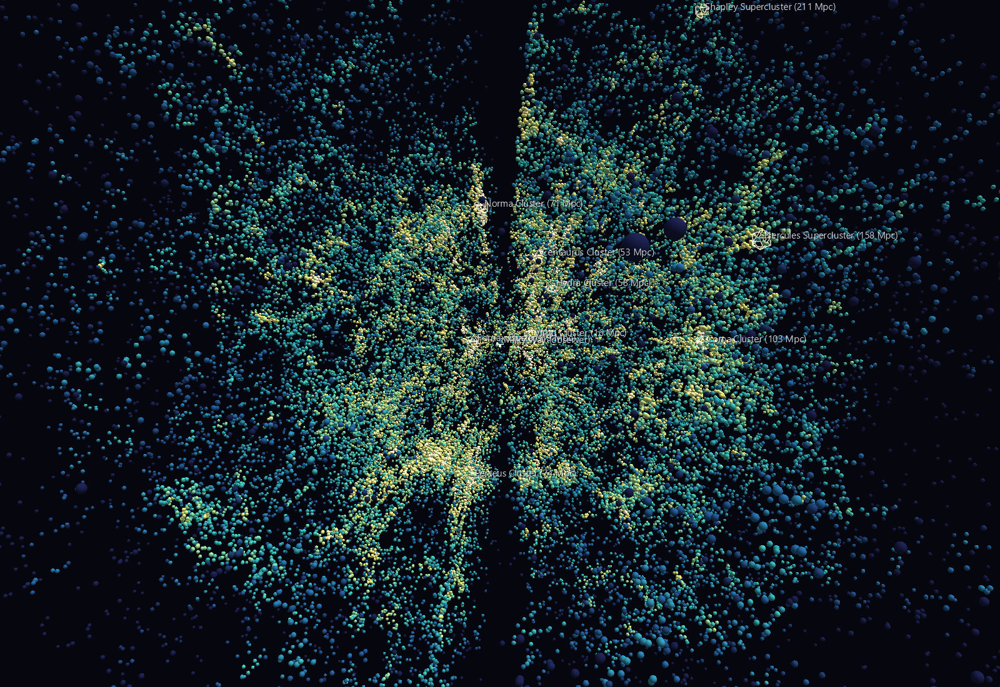
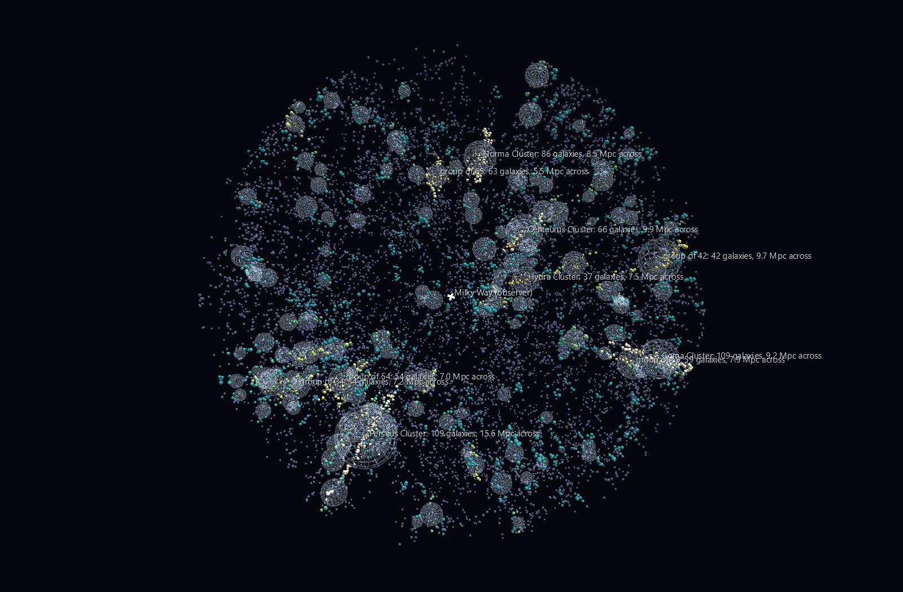

# The Cosmic Web — 43,414 real galaxies, all sky



The cosmic web is the one structure in astronomy that a flat picture cannot
tell the truth about. Filaments, sheets and voids are *defined* by how they
connect in three dimensions; project them onto the sky and they overlap into
a uniform haze. That is why almost every published "cosmic web" image is
either a thin slice through a survey or a simulation.

This is neither. It is the 2MASS Redshift Survey — 43,414 galaxies with
measured distances, covering the whole sky — placed in supergalactic
Cartesian coordinates at one world unit per megaparsec, and coloured by how
crowded each galaxy's own neighbourhood is. It is a thing to fly through.

Two scenes.

**`Local_Universe/`** — the whole catalogue, out to 427 Mpc. The colour ramp
runs from deep indigo in the voids through teal in the filaments to warm
white in the cluster cores, and it does the real work: without it a point
cloud this size is fog. Nine named structures are marked, and so is the
observer.

**`Cluster_Anatomy/`** — the same sky, restructured. A volume-limited
subsample inside 120 Mpc is run through a friends-of-friends percolation and
every group it finds becomes a hyperglyph: a frame at the group's centre of
mass carrying its member galaxies, wrapped in a wire shell at the group's own
radius. A knot of the web stops being a smear of pixels and becomes a
structure you can select, name and count.



## What the data says

Every number below is recomputed by `verify_astro.py` on each run.

**The local universe really is flat, and the frame proves it.** De
Vaucouleurs defined the supergalactic plane in 1953 from the apparent
alignment of nearby galaxies; putting the catalogue into that frame, the
median |supergalactic latitude| of galaxies inside 40 Mpc is **20.0°**
against the **30.0°** an isotropic distribution would give. The flattening
weakens with distance, exactly as it should for a local structure: 20.3° at
60 Mpc, 23.0° at 120.

**Percolation rediscovers the famous clusters without being told they
exist.** The four richest groups the friends-of-friends finds are, in order,
**Perseus, Coma, Norma and Centaurus** — and each lands within a few Mpc of
its published position. Hydra comes ninth. The Great Attractor, which took
astronomers a decade to identify because it sits behind the Milky Way, is the
third-brightest knot in the box.

**All nine named landmarks sit on genuine overdensities.** Each was placed
from its literature position and run through the same coordinate pipeline as
the galaxies; each has 6× to 138× the galaxy density expected at its own
distance. That is a strong end-to-end check on the pipeline, and it is why
the labels can be trusted.

**The fingers of God are real and they all point at you.** Cluster members
have their own motions, which add to the redshift, so a cluster is smeared
along the line of sight. Across the 40 richest groups the median radial
spread is **6.1×** the transverse spread. Those radial spikes in the scene
are not structures — they are the price of using redshift as distance, and
their convergence on the origin is how you recognise them.

**And there is a wall of nothing running through the middle.** The dark gash
splitting the cloud is the Zone of Avoidance: our own galaxy's dust and
stars. 2MRS is selected in the near infrared precisely to see through it, and
does far better than any optical survey, but it still cuts hard at 5° of
galactic latitude. **Zero galaxies** in the catalogue lie inside that band,
which is 8.7% of the sky, permanently.

## Structure

```text
Local_Universe
anchor
├─ galaxy ×43,414        sphere; position = supergalactic Mpc,
│                        colour = local density, size = K luminosity
├─ landmark ×9           wire icosahedron, labelled, at its own distance
└─ observer              cross at the origin

Cluster_Anatomy
anchor
├─ field anchor
│  └─ field galaxy ×8,733    in no group; dim slate
└─ group hub ×401            invisible frame at the centre of mass
   ├─ wire shell             radius = the group's own rms spread
   └─ member galaxy ×N       offset from the centre, colour = richness
```

Both scenes are CSV-native: no channels, no textures, no media folder. Every
galaxy carries its 2MASX identifier and distance as tag text.

## How a galaxy gets its place

Three steps, none of them optional if the picture is to be honest.

1. **Velocity into the CMB frame.** The catalogue records velocity measured
   from here, and here is moving: the Sun runs at 369.82 km/s toward galactic
   (264.021, +48.253) relative to the microwave background. Left
   uncorrected, that dipole tilts every distance by up to ±370 km/s — several
   Mpc — in a way that rotates with direction.
2. **Velocity into distance.** `d = v_CMB / H0` with H0 = 70 km/s/Mpc. This
   is a redshift distance, which is where the fingers of God come from.
3. **Galactic into supergalactic coordinates.** Built from the two published
   directions — north pole at galactic (47.37, +6.32), longitude zero at
   (137.37, 0) — rather than from a copied matrix, so the frame can be
   checked. It is orthonormal to 2e-16 and right-handed.

The equatorial-to-galactic rotation gets an unusually good test: 2MRS carries
galactic coordinates computed independently by someone else from the same
RA/Dec, and this module's own rotation reproduces them for **all 43,414 rows
to within 28 arcsec**.

## Honest caveats

- **Redshift distance is not distance.** Everything in both scenes is in
  redshift space. Clusters are radially elongated by their own internal
  motions, and nothing here corrects for that. It is visible, it is labelled,
  and it is the honest state of a catalogue like this.
- **The survey thins with distance, and that is a selection effect, not
  physics.** 2MRS is magnitude-limited, so the outer parts of
  `Local_Universe` hold only the most luminous galaxies. The median galaxy
  is at 120 Mpc; 15% lie beyond 200 Mpc, where the sample is sparse enough
  that structure cannot be read from it. `Cluster_Anatomy` sidesteps this
  entirely by working on a volume-limited subsample — 12,811 galaxies
  brighter than M_K = −23.65 inside 120 Mpc, every one of which would have
  been detected anywhere in the volume.
- **Galaxies inside 500 km/s are excluded.** That close, a galaxy's own
  motion swamps the Hubble flow and a redshift distance is meaningless. It
  costs the Local Group; M31 is not in the scene.
- **The grouping is a percolation, not a group catalogue.** Friends-of-
  friends with a linking length of 0.20 of the mean separation (1.65 Mpc),
  stretched 3× along the line of sight to keep fingers of God from shattering
  their own clusters. It over-merges: Perseus comes out 15.6 Mpc across
  because percolation runs it into the Perseus-Pisces filament it sits in.
  Published group catalogues do considerably more work than this.
- **Virgo is nearby but comes out small** — 27 members, not the hundreds it
  really has. The volume-limited cut needed to make richness comparable
  across the box removes almost everything in Virgo fainter than a giant.
  Hercules and Shapley are marked in `Local_Universe` but absent from
  `Cluster_Anatomy` because they lie beyond its 120 Mpc horizon.
- **A glyph is a symbol, not a scale model.** Real galaxies are ~0.03 Mpc
  across; at any zoom that shows the web they would be invisible. Size
  carries luminosity ordering and doubles as a depth cue. Nothing else.

## Verification

`verify_astro.py` checks the sky with no reference to GlyphViz: frame
orthonormality, the independent galactic-coordinate cross-check above, the
CMB dipole's amplitude and direction, the supergalactic flattening, an
overdensity test on every landmark, the percolation result, and the
fingers-of-God asymmetry.

`verify_scenes.py` loads the shipped CSVs with GlyphViz's own
`load_node_csv`, runs its own `compute_world_transforms`, and recovers the
catalogue from world-space geometry:

- all 43,414 galaxies present, **world positions recovering the catalogue's
  supergalactic coordinates to 0.5 kpc** — five parts in ten million of the
  box;
- distance from the observer round-trips across 7.3 to 427 Mpc;
- the density estimate behind the colour ramp separates the Coma core from
  the field by 1.5 dex, so the colour is carrying information rather than
  decoration;
- in `Cluster_Anatomy`, **hub position plus member offset reconstructs each
  galaxy's true place to 1 kpc**, checked group by group across all 401 —
  which is the check that the nesting composes;
- every hub sits at its group's centre of mass, every wire shell really does
  contain its own members, and field plus groups is exactly the
  volume-limited subsample;
- every visible glyph clears the renderer's 0.2 scale floor.

## Regenerating

```bash
python fetch_2mrs.py            # refresh data/2mrs.csv.gz from VizieR
python build_cosmic_scenes.py   # writes both scenes
python verify_astro.py          # checks the astronomy
python verify_scenes.py         # checks the scenes
```

Only `fetch_2mrs.py` needs the network. Everything else runs from the
vendored `data/2mrs.csv.gz` (1.4 MB). Requires numpy, pandas and scipy.

Data: 2MASS Redshift Survey, Huchra et al. 2012, ApJS 199, 26, via
[VizieR](https://vizier.cds.unistra.fr/) catalogue J/ApJS/199/26. Please cite
Huchra et al. (2012) for anything beyond looking at it.
