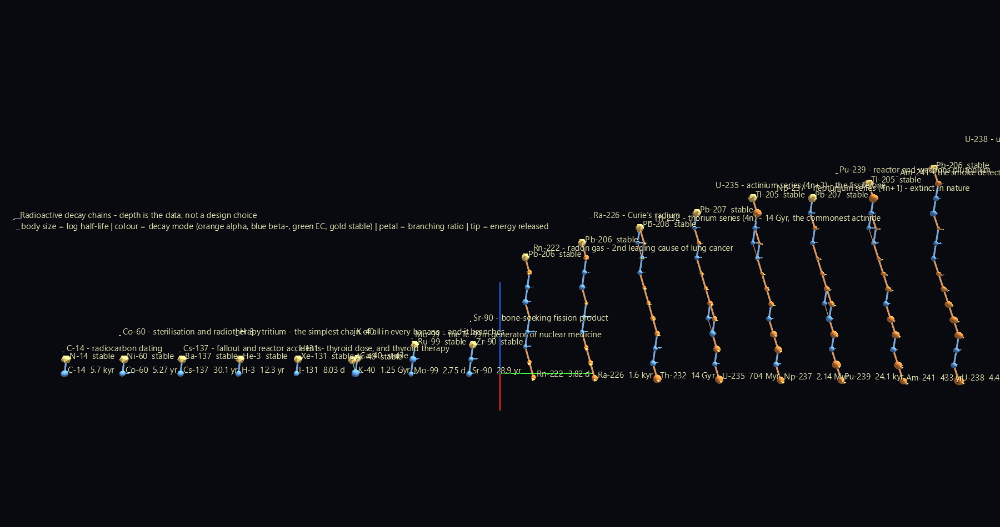
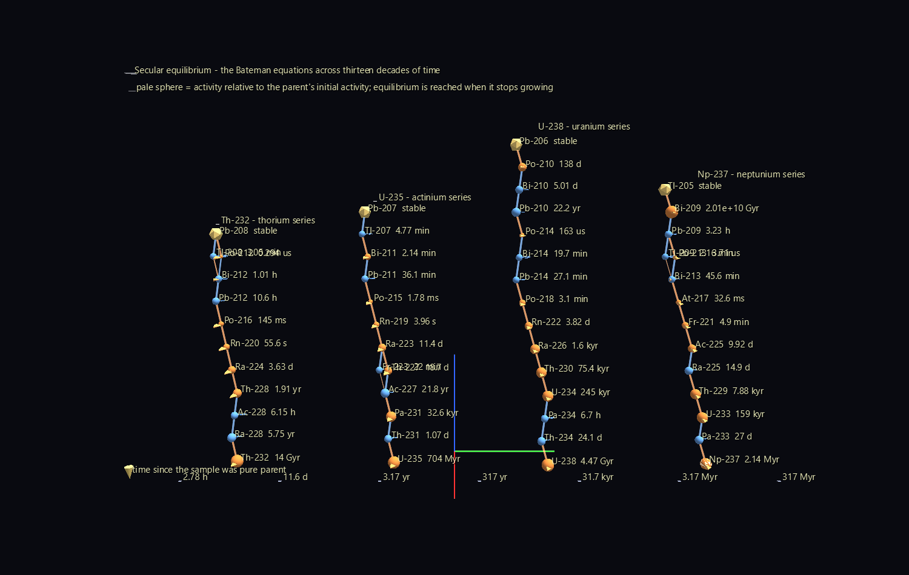

# Decay Chains — Depth Is the Data



A radioactive decay chain is a tree whose depth is not a design choice. U-238
takes fourteen steps to reach lead; tritium takes one. Bismuth-212 genuinely
forks — beta-minus 64% of the time, alpha the other 36% — and the two branches
rejoin at Pb-208. So the glyph nests as deeply as the physics does, and
comparing two glyphs compares two nuclear histories.

**`Chain_Forest/`** — sixteen chains side by side, ordered by how many decay
steps they take, so the forest reads as a skyline. On the left, the one-step
chains: C-14, Co-60, Cs-137, tritium, I-131, K-40, Mo-99, Sr-90, each with its
gold stable endpoint immediately above. On the right, the four natural series
towering fourteen levels up. The variation *is* the finding.

**`Secular_Equilibrium/`** — the four natural series animated across thirteen
decades of logarithmic time, every member's activity solved from the Bateman
equations. Watch equilibrium fill a chain from the top down: fast daughters
almost at once, Th-230 and Pa-231 taking a hundred thousand years. A cursor
rides a log-time axis from 2.78 hours to 317 million years.



## Structure

```text
chain member hub          invisible frame, ALWAYS scale 1
├─ body                   sphere sized by log half-life, coloured by decay mode
├─ activity sphere        animated by the Bateman solution (Secular_Equilibrium)
├─ ring                   topo = Cylinder
│   └─ mode petal ×1-3    azimuth = which mode, length = branching ratio
│       └─ tip            cone sized by the energy released (Q value)
└─ daughter hub           ... and the chain descends from here
```

Sixteen levels deep at the deepest point. The reason that is possible is the
rule that **chain hubs are always scale 1**: a parent's scale multiplies its
whole subtree, so encoding half-life as the hub's own size would compound
fourteen times over and collapse the chain. Half-life lives on a *child* of
the hub instead, where it is a leaf and cannot propagate.

Horizontal offsets are the real chart-of-nuclides displacement — an alpha step
moves −2 protons and −2 neutrons, a beta-minus step +1 and −1 — while each
decay step rises by a fixed height. A chain glyph is therefore a spiral
staircase whose shadow on the ground is the familiar zigzag of the chart of
nuclides, and whose alternating orange and blue rungs are the alpha/beta
alternation that defines the classical series.

Every decay edge is drawn as a Link node, including the ones that are not in
the spanning tree. A chain is a DAG, not a tree — a node can only have one
`parent_id`, so each is attached to the first parent that reaches it and the
remaining edges are drawn as links, which is how Bi-212's fork stays visible.

## What the physics says

The four classical series come out with the right members and the right
endpoints, and stay in their own 4n+k mass-number families — 4n for thorium,
4n+1 neptunium, 4n+2 uranium, 4n+3 actinium.

One nice detail: **the neptunium series ends on Tl-205, not Bi-209.** The
textbooks end it on bismuth-209, but Bi-209 was measured alpha-unstable in
2003 with a half-life of 2.01×10¹⁹ years, so a current nuclear-data table
carries the series one step further. The scene shows Bi-209 with its label
reading `2.01e+10 Gyr`.

Another: at the far right of the time axis the whole U-238 chain is fading
together. Secular equilibrium means a daughter's activity tracks its parent's
*current* activity, and by 317 million years U-238 itself has decayed 4.8%.
The verifier checks exactly this — A(Rn-222)/A(U-238) = 1.000072 at the last
frame, with both down to 0.9520 of the initial parent activity.

## Two problems worth recording

**Floats cannot solve this.** Decay constants in one chain span 25 orders of
magnitude (Po-214 at 4.2×10³ /s, U-238 at 4.9×10⁻¹⁸ /s). The Bateman solution
is an alternating series whose individual terms are astronomically larger than
their total, so in float64 it is pure cancellation noise. The solver runs in
stdlib `decimal` at 120 digits — exact for these chain lengths, and no new
dependency.

**The published branching ratios do not close.** Verifying atom conservation
turned up a residual far too large for 120-digit arithmetic, and the cause was
the input data, not the solver: each decay mode's percentage is rounded
independently in the evaluated nuclear data, so Bi-214 sums to 100.003%,
Tl-210 to 100.007%, Bi-210 to 100.0013%. Left alone, the Bateman solution
quietly creates atoms at the 10⁻⁵ level. Branch fractions are now renormalised
per nuclide, and conservation comes out at 2.7×10⁻¹⁰ — which is exactly
U-238's spontaneous-fission branch, a mode with no single daughter to follow.

## Honest caveats

- **Branches below 0.5% are pruned** for legibility. That discards the famous
  astatine path — Po-218's 0.02% beta-minus and Bi-214's 0.021% alpha — and
  leaks exactly that much probability (worst 1.9×10⁻⁷ over the sampled times).
  `verify_decay.py` checks conservation on both the pruned and unpruned chain
  so the cost is measured rather than assumed.
- **Spontaneous fission terminates a branch.** It has no single daughter, so
  the chain simply stops there; the mode still gets a petal.
- **Isomers are not modelled.** The table is ground states only, so the
  Mo-99 chain runs to Tc-99 rather than through the Tc-99m isomer that the
  medical generator actually delivers.
- Activities are normalised to the progenitor's *initial* activity, starting
  from a chemically pure parent sample. Real ores are already in equilibrium.

## Verification

Two scripts, deliberately separate.

`verify_decay.py` checks the physics against published facts and analytic
limits, never reusing the module's own reasoning for the expected answer:
series membership and endpoints, Bi-212's 64.06/35.94 fork and its rejoining
at Pb-208, the secular-equilibrium limit, 4n+k mass bookkeeping, and atom
conservation on both pruned and unpruned chains.

`verify_scenes.py` checks that the physics survived the trip into geometry,
re-deriving everything from world-space positions produced by the real
transform engine:

- the glyph nests 16 levels down;
- every visible node's own scale clears the 0.2 render floor;
- **the chart round-trip is exact** — each member's world offset from its
  chain root decodes back to its real (N, Z) displacement and step number with
  residual 0.00e+00 across 105 members;
- Bi-212's fork survives as two petals and two outgoing links, and both
  branches arrive at a single Pb-208 node;
- all 110 links span exactly one decay step;
- Rn-222's ingrowth curve appears verbatim in a channel track, rising from
  9.9×10⁻³⁹ to secular equilibrium.

The size check earned its keep in an unexpected way. A tip is a child of a
petal, so its *rendered* size is the product of the two scales, and in the
first build that product was 0.09 world units — effectively invisible, even
though both scales individually cleared the floor. Worth being precise about
what the floor actually does: `node_world_matrix` floors each node's own
`scale × base_scale` at 0.2 and then multiplies by the parent basis, so the
floor protects against authoring a node too small, but says nothing about how
small an ancestor's scale can make its descendants look.

## Regenerating

```bash
python build_decay_scenes.py    # writes both scenes
python verify_decay.py          # checks the physics
python verify_scenes.py         # checks the geometry
```

No network needed. Data: IAEA Nuclear Data Services `ground_states` export
(NUBASE/ENSDF-derived), 3386 ground states, vendored in `data/`.
