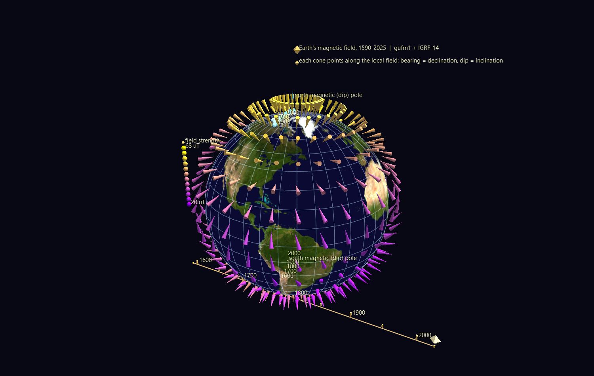
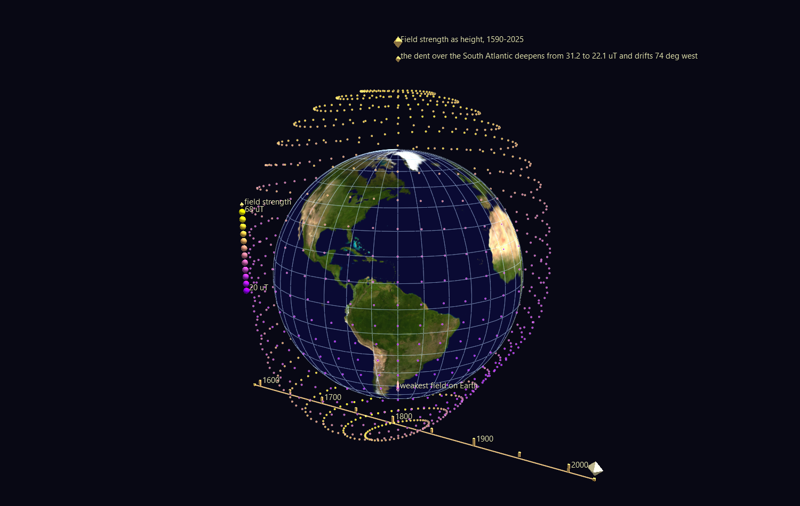

# Earth's Magnetic Field — four centuries of secular variation

The field that moves a compass needle is not fixed. It drifts, tilts, and
weakens on a timescale of decades, driven by convection in the liquid iron
outer core 3,000 km down. These two scenes animate that drift from **1590 to
2025** on a World Grid globe.



Nothing here is downloaded. Both scenes are computed from published Gauss
coefficients bundled in `data/`, and both are pure CSV once built — the
viewer plays back numbers that were evaluated ahead of time into channel
tracks.

---

## The models

| Model | Span | Degree | What it is |
|---|---|---|---|
| **gufm1** | 1590–1990 | 14 | Jackson, Jonkers & Walker (2000), *Phil. Trans. R. Soc. A* **358**, 957–990. Cubic B-splines in time on 2.5-year knots, fitted to ~365,000 historical observations — the bulk of them **compass bearings logged by merchant and naval mariners**. Four centuries of the field reconstructed largely from ships' logbooks. |
| **IGRF-14** | 1900–2030 | 13 | International Geomagnetic Reference Field, 14th generation (IAGA Working Group V-MOD, 2024). 5-yearly epochs, linearly interpolated; satellite-constrained over its later epochs. |

`geomag.py` uses gufm1 below 1900 and IGRF from 1900 on. Both are spherical
harmonic expansions of the scalar potential

```
V(r,θ,φ) = a · Σₙ (a/r)ⁿ⁺¹ Σₘ [gₙᵐ cos(mφ) + hₙᵐ sin(mφ)] Pₙᵐ(cos θ)
```

with Schmidt semi-normalised associated Legendre functions and
a = 6371.2 km. The field is **B = −∇V**, reported as X (north), Y (east),
Z (down), and from those the declination D, inclination I and total
intensity F.

`gufm1.txt` is redistributed from <https://geomag.colorado.edu/gufm1> with
the permission of Prof. Andrew Jackson. `IGRF14.shc` is the standard IAGA
coefficient file.

---

## Scene 1 — `Field_And_Poles/`

A lattice of **420 cone glyphs** at 12° spacing, each aimed along the true
local field: the cone's compass bearing is the declination, its dip is the
inclination, and its colour is the field strength (purple 20 µT → yellow
68 µT). Press **Space** and the whole lattice swings through 435 years.

Both **magnetic dip poles** — the points where the field is exactly vertical
and a compass needle stands on end — ride the same clock, along trails of
static markers labelled by century so you can see where they have been.

### How a glyph is aimed

Worth writing down, because it took a probe against the real transform
engine to establish and it is not documented anywhere else:

- A globe child's local **+Z is radially outward** (up), **+Y is east**,
  **+X is south**.
- In Heading/Tilt/Roll mode (`rotation_mode = 1`), `rotate_x` is **Tilt**
  (the angle away from up) and `rotate_y` is **Heading** (which spins the
  tilted axis about up). Heading 0 tilts toward east, 90 toward south, 180
  west, 270 north — so a compass azimuth *A* measured clockwise from north
  is `heading = A − 90`.
- Therefore, for a field with declination D and inclination I (positive
  downward): **`rotate_x = 90 + I`, `rotate_y = D − 90`**.

A `GEO_CONE` is centred on its node and spans ±`scale_z` along its own axis,
so each node floats a cone-half-length off the surface. Without that margin a
steeply dipping vector buries its apex — the end that carries the direction —
inside the globe, and near the poles the dip *is* ~90°.

### What to look for

- **The north dip pole's sprint.** It crawled at roughly 6 km/yr through the
  17th and 18th centuries and 10 km/yr through most of the 20th, then
  accelerated to about **43 km/yr since 1990**, leaving Arctic Canada and
  heading for Siberia. This is why the World Magnetic Model had to be
  updated off-schedule in 2019.
- **The two poles are not opposite each other.** Dip poles are not antipodal,
  because the real field is not a pure dipole — a fact that is obvious the
  moment you can see both at once.
- **Declination swinging over Europe.** At London the model gives **+11.6°
  east of north in 1590, −23.9° west in 1800, and +0.9° today** — a 36°
  swing, and the reason every old British map carries a date next to its
  compass rose. Watch the cones over the North Atlantic rotate while the
  ones over the Pacific barely move.

---

## Scene 2 — `Intensity_Shell/`



The same globe wearing a shell of 1,056 glyphs whose **height above the
surface is the field strength**. Strong field over the poles stands high;
weak field sags toward the ground.

The result is a landscape with one enormous depression in it: the **South
Atlantic Anomaly**, the region where Earth's field is weak enough that
satellites passing overhead take measurable radiation damage and instruments
are routinely switched off. A tracked marker sits at the weakest point.

### What the animation shows

Playing 1590 → 2025, the anomaly is not a fixed feature. It **forms, deepens
and marches west**:

| Year | Weakest field in the region | Where |
|---|---|---|
| 1590 | 31.2 µT | off southern Africa, ~14° E |
| 1800 | 29.3 µT | mid-Atlantic, ~6° W |
| 1900 | 25.5 µT | ~38° W |
| 2025 | **22.1 µT** | over Paraguay, ~60° W |

A **29% weakening and 74° of westward drift in four centuries** — the same
westward drift the whole non-dipole field shows, which is one of the primary
observational constraints on core flow. This is a real, consequential,
ongoing change to the planet, and it is very rarely rendered as anything but
a contour map of one epoch.

---

## Rebuilding

```bash
python build_geomagnetic_scenes.py                  # both scenes, 1590-2025
python build_geomagnetic_scenes.py --only Intensity_Shell
python build_geomagnetic_scenes.py --step 10        # coarser time sampling
```

Default sampling is every 5 years — 88 frames, and 130,000 field evaluations
in total. Both scenes are validated before writing (ids, parentage, colour
and `color_index` ranges, the render-scale floor, globe extents, and the
full three-way Channels join).

## Verifying

Two independent suites, both worth running:

**`verify_geomag.py`** — checks the physics, not the plumbing:

1. **vs. the `ppigrf` package**, a separately written IGRF implementation:
   agreement to 0.027 nT out of ~50,000 nT (2 ppm) across 8 sites × 6 epochs.
2. **The axial-dipole analytic limit** — with only g₁⁰ nonzero the answer
   must be exactly X = −g₁⁰ sin θ, Z = −2g₁⁰ cos θ, Y = 0. Exact to 0.
3. **Observed dip-pole positions** from NOAA/BGS magnetic surveys — an
   outside check rather than another model. Seven epochs from 1900 to 2020
   all land within 0.6° (~60 km), except the 1962 south pole at 1.3°.
4. **gufm1 vs. IGRF-14 across their 1900–1990 overlap** — two models built
   from largely different data, agreeing to an RMS of 335 nT in 1900
   improving to 25 nT by 1980 (0.3% → 0.03% of field).
5. **The anomaly's minimum weakens** from 1600 to 2025.

`ppigrf` is optional; the suite skips check 1 with a notice if it is not
importable (`PPIGRF_PATH=<dir>` points at an extracted copy).

**`verify_scenes.py`** — checks that the *picture* tells the truth. It pulls
each cone's direction back out of the real GlyphViz transform engine (the
glyph's local +Z axis in world coordinates), converts it to the local
East/North/Up frame, and compares the declination and inclination it implies
against the model — at frame 0, mid-animation, and the final frame, driving
the real `ChannelEngine` in between.

> Worst error across 420 cones × 3 epochs: **0.0005° in both declination and
> inclination** — which is the CSV's own 3-decimal rounding, not a
> discrepancy. The shell's heights reproduce |B| to 0.0005 world units, and
> the dip-pole markers land exactly on the computed poles.

```bash
python verify_geomag.py
python verify_scenes.py
```

## Files

```
geomag.py                        field synthesis: gufm1 + IGRF-14 -> D, I, F
build_geomagnetic_scenes.py      generator (no download required)
verify_geomag.py                 physics checks against independent sources
verify_scenes.py                 does the rendered scene mean what it claims?
data/gufm1.txt                   1590-1990 coefficients (Jackson et al. 2000)
data/IGRF14.shc                  1900-2030 coefficients (IAGA, 2024)
Field_And_Poles/                 628 nodes, 88 frames x 1,265 tracks
Intensity_Shell/                 1,087 nodes, 88 frames x 2,115 tracks
*/media/01_bluemarble.png        NASA Blue Marble equirectangular texture
```
