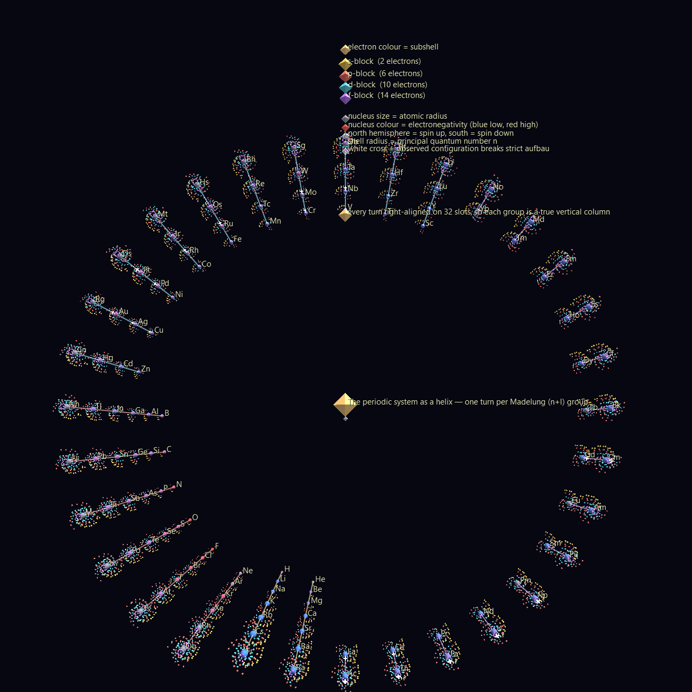
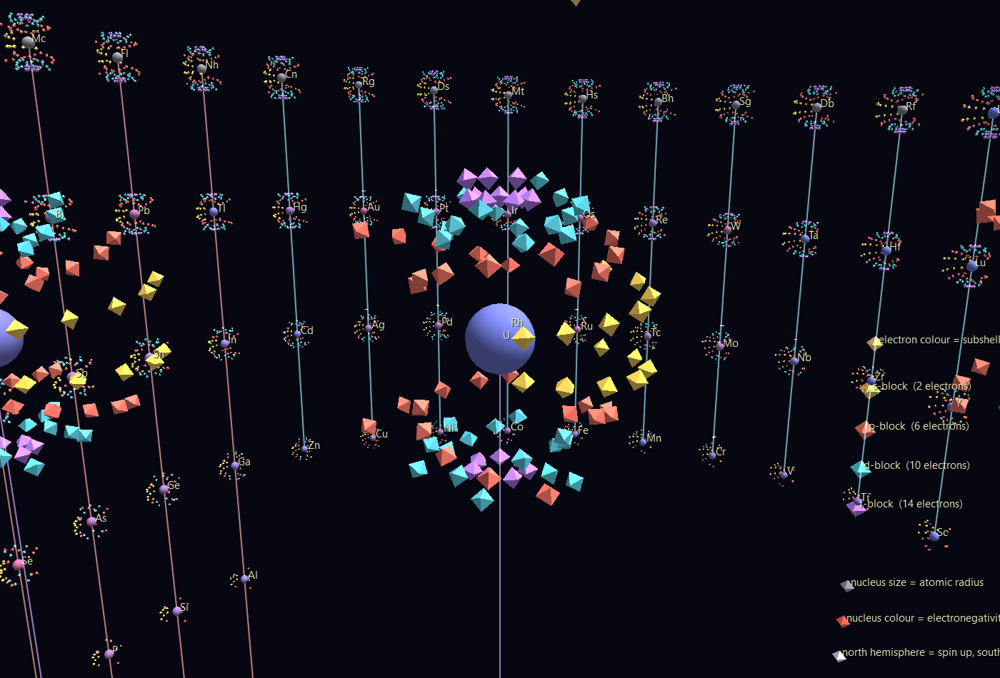
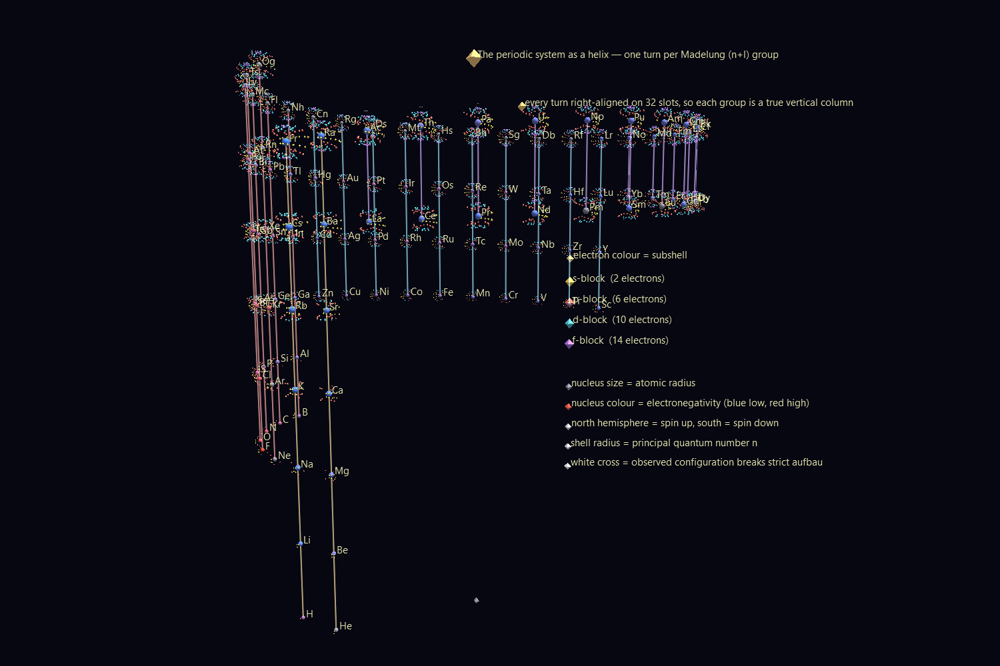
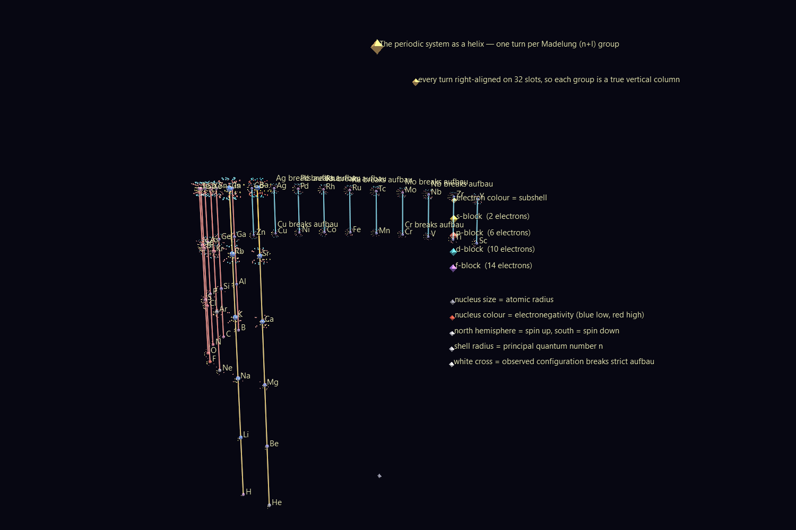

# The Periodic System as a Hyperglyph

The periodic table is a spreadsheet with a ragged left edge and two rows
exiled to a footnote. That shape is a printing compromise, not the physics.

This builds the same information as a **helix of nested atoms**: 118
elements on a GlyphViz Spiral topology, each one a hyperglyph carrying its
real electron configuration — 7,021 individual electron glyphs on concentric
shells. Periodicity stops being a caption and becomes geometry.



*Looking straight down the axis. Every radial spoke is a group — one column
of the periodic table, seen end-on.*

---

## Why a helix, and why **this** helix

Order the subshells the way nature fills them — by increasing n+l, and within
equal n+l by increasing n — and they fall into groups of length
**2, 2, 8, 8, 18, 18, 32, 32**. The important part is that every group is a
*suffix* of the longest one:

```
n+l=1   [s]                2      1s
n+l=2   [s]                2      2s
n+l=3   [p][s]             8      2p 3s
n+l=4   [p][s]             8      3p 4s
n+l=5   [d][p][s]         18      3d 4p 5s
n+l=6   [d][p][s]         18      4d 5p 6s
n+l=7   [f][d][p][s]      32      4f 5d 6p 7s
n+l=8   [f][d][p][s]      32      5f 6d 7p 8s
```

So if each turn of the helix is one n+l group, and every turn is
**right-aligned** onto a common 32-slot angular grid, all eight turns line
up. The s-block is always the last two slots, the p-block the six before
that, the d-block the ten before that, the f-block the first fourteen.
**Groups become exact vertical columns** — not by construction, but because
the filling rule is nested.

This is the Janet "left-step" arrangement, wound up. Two consequences are
worth looking at rather than arguing about:

- **Helium lands above beryllium**, not above neon, because helium's valence
  structure is s². This is the left-step table's most contested claim, and
  here it is a *position* rather than an opinion. Look down the axis: helium
  is on the alkaline-earth spoke.
- **The f-block stops being a footnote.** It is simply the first fourteen
  slots of the two longest turns, in the same column system as everything
  else. Nothing is parked underneath.

A third thing falls out for free: the helix stops **two slots short** at the
top. The eighth n+l group runs to Z=120, so the two empty slots are 8s¹ and
8s² — elements 119 and 120, undiscovered.

---

## Layout is idealised; the atoms are real

This is the part that makes it more than a diagram.

Elements are **placed** by the idealised Madelung rule. They are **drawn**
from their observed configuration, parsed from PubChem — anomalies included.
So the **19 elements that break the rule** visibly differ from the column
they are standing in, and each is marked with a white cross:

> Cr (3d⁵4s¹, not 3d⁴4s²), Cu, Nb, Mo, Ru, Rh, Pd, Ag, La, Ce, Gd, Pt, Au,
> Ac, Th, Pa, U, Np, Cm

Nothing reconciles the two. The disagreement is the content.

---

## The hyperglyph



*Uranium, close up. Nucleus at the centre, then shells outward: yellow s,
coral p, cyan d, violet f.*

Every visual channel carries one quantum number:

| Channel | Meaning |
|---|---|
| shell radius | **principal quantum number n** — the old K, L, M, N shells |
| latitude band | **orbital type l** — s near the equator, then p, d, f toward the poles |
| longitude | **which of the 2l+1 orbitals** (m₎), evenly spaced |
| hemisphere | **spin** — north up, south down |
| colour | subshell type, matching the latitude band |
| nucleus size | atomic radius |
| nucleus colour | electronegativity (blue low → red high; grey where none is published) |

The radius, the orbital count and the spin are physics. The latitude band
and the per-shell longitude twist are legibility conventions, and the code
says so where it applies them — without the twist, every s electron of a
heavy atom lines up at one longitude and the atom renders as a sea urchin
instead of a set of shells.

### Hund's rule is visible

Electrons fill by Hund's first rule: every orbital takes one electron of
parallel spin before any orbital takes a second. Because spin is the
hemisphere, **a half-filled subshell is a bare northern hemisphere**. Look
at chromium, manganese or gadolinium: the asymmetry between north and south
*is* the atom's unpaired electron count, and therefore its magnetism. The
verifier checks exactly this, reading it back off the geometry:

```
Gd: north-minus-south hemisphere = unpaired electrons   36-28=8, expected 8
```

---

## The scenes

### `Madelung_Helix/` — 7,258 nodes, static



All 118 elements, 7,021 electron glyphs, and 86 links joining each element
to the one directly above it in its group. From the side those links are
literal vertical columns; from above they are radial spokes.

Good viewpoints: **straight down the axis** for the periodicity, **level
with the equator** for the columns, and **close in on any atom** for the
shells. Press **T** to toggle labels; **U** on a selected element opens its
PubChem page.

### `Aufbau_Sequence/` — 158 frames



The same helix, built one element at a time in atomic order. Press
**Space**. The system assembles itself: shells fill, the 4s slot takes an
electron before 3d does, the f-block appears out of nowhere at lanthanum,
and the anomaly crosses pop as each rule-breaker arrives.

One channel per element (Z = 1…118) drives *two* attributes off the same
track — `color_a` and `show_text`. The second binding matters: a pinned
label draws whenever its node draws, and a node at alpha 0 still draws, so
without gating `show_text` every element's symbol hangs in space long before
the element exists.

---

## Data

**PubChem Periodic Table of Elements** (public domain, NCBI/NLM),
<https://pubchem.ncbi.nlm.nih.gov/rest/pug/periodictable/CSV>, vendored as
`data/pubchem_periodictable.csv` (15 KB — the whole dataset).

Coverage is not complete, and the gaps are all at the bottom of the table:
electronegativity for 95 of 118 (missing for the noble gases and most
superheavies), atomic radius for 99 (missing Z ≥ 100), ionization energy for
102. Missing radii fall back to the element directly **above in the same
column** — a group trend, which is the least-invented substitute available.
Missing electronegativity renders grey rather than being guessed at.

Configurations for elements 104+ are PubChem's *predicted* values; the
"(predicted)" marker is stripped when parsing, and it is worth remembering
that those atoms have never been observed long enough to measure.

---

## Rebuilding and verifying

```bash
python build_periodic_scenes.py
python build_periodic_scenes.py --only Madelung_Helix
```

Two verification suites, deliberately separate so a layout bug cannot hide
behind a plausible picture:

**`verify_elements.py`** — the chemistry, with no scene involved. Checks
that every configuration's electrons sum to Z; that no subshell exceeds
2(2l+1) and every one satisfies l ≤ n−1; spot-checks H, He, Ne and Fe
against the textbook; confirms the known aufbau exceptions are flagged *and*
that well-behaved elements are not; verifies unpaired-electron counts for
ten elements (N=3, Cr=6, Fe=4, Gd=8, …); and checks the layout produces the
right turn lengths, the right blocks in the right slot ranges, and columns
that are exactly the alkali metals, the noble gases, the halogens and so on.

**`verify_scenes.py`** — the built scenes, through the real GlyphViz loader,
transform engine and `ChannelEngine`. The headline check is the central
claim:

> every group is a TRUE vertical column (constant x,y across turns)
> — worst horizontal spread **3.1e-13 world units**

It also confirms every atom carries exactly Z electron glyphs, every
electron sits at its own principal shell radius (scaled by its atom), the
hemisphere asymmetry equals the unpaired-electron count, exactly the 19
anomalous elements carry a cross, all 86 group links are exactly vertical,
and — in the animated scene — that each element is dark before its frame and
lit on it.

```bash
python verify_elements.py
python verify_scenes.py
```

## Files

```
elements.py                      configurations, Madelung layout, Hund filling
build_periodic_scenes.py         generator (no download required)
verify_elements.py               the chemistry, checked against textbook facts
verify_scenes.py                 the geometry, checked against the chemistry
data/pubchem_periodictable.csv   118 elements, 15 KB
Madelung_Helix/                  7,258 nodes, static
Aufbau_Sequence/                 7,258 nodes, 158 frames x 118 tracks
```

No textures, no download, no runtime dependency beyond pandas.
