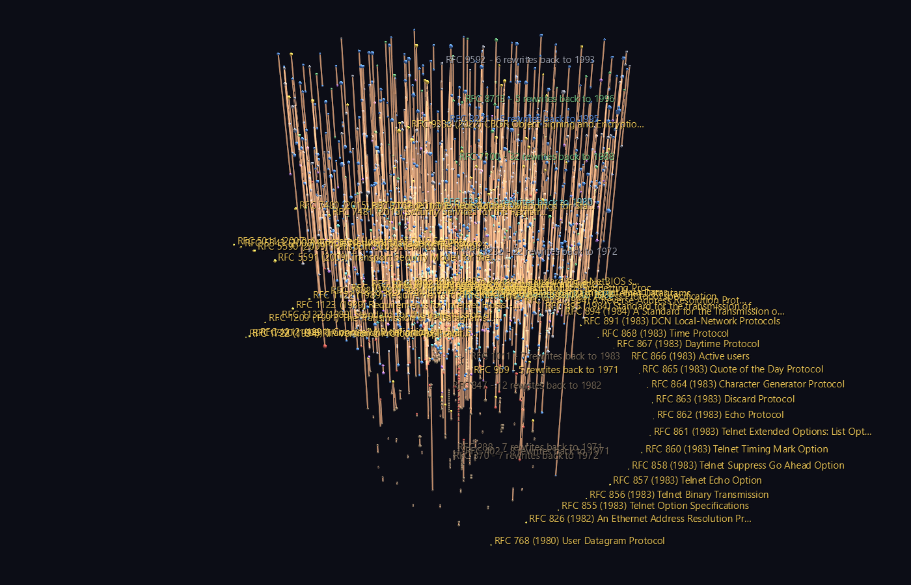
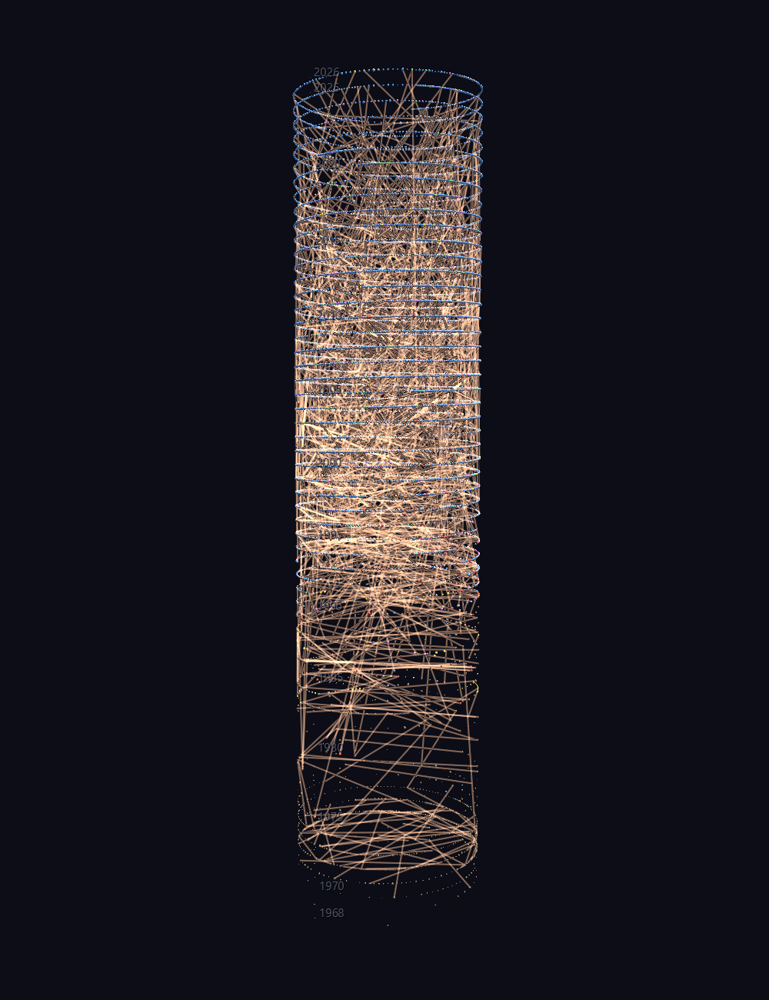
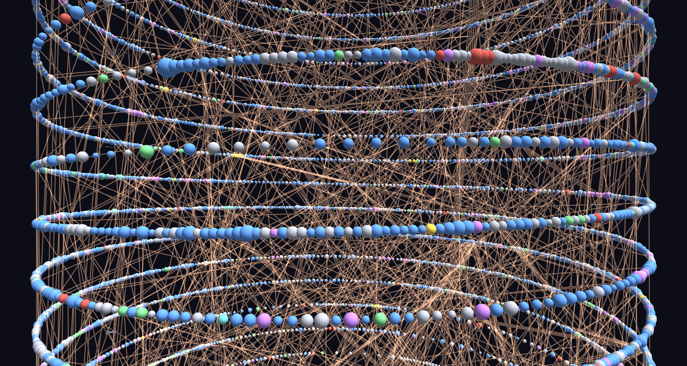

# RFC Genealogy — the archaeology of the internet



Every agreement the internet runs on is a numbered document, and the RFC
Editor keeps all 9,819 of them in a single index that records, for each one,
what it replaced and what replaced it. That makes the series something rarer
than an archive: a **dated genealogy**, from RFC 1 in April 1969 to this
year, of how a working infrastructure was argued into existence and then
maintained.

Two relations live in that index and they are not the same thing.
**Obsoletes** means A replaced B outright and B is dead. **Updates** means A
amended B and you now have to read both. Only the first is descent, and only
the first is what "genealogy" means here.

Two scenes.

**`Standards_Lineage/`** — the obsoletes relation followed *backwards* from
every document still in force. Each lineage is a hyperglyph whose height is
real time and whose depth is the number of times that specification has been
rewritten. The canopy at the top is what is current; the orange spines hang
down into the past, as deep as each document's ancestry goes. Out around the
edge, connected to nothing and standing at the years they were published, are
the 44 full Internet Standards that were never revised at all.

**`RFC_Spiral/`** — all 9,819 documents on a helix, one turn per calendar
year, each at its publication month and coloured by the status it holds
today. A core sample: the sparse turns at the bottom are the ARPANET, the
thick ones in the middle are the 2000s standards boom.



From outside, the obsoletes cabling is what you see — the corpus is 9,819
sub-pixel dots against 1,542 long bright lines, and the lower third is
visibly the era when a handful of documents were re-issued over and over.
Fly in and the turns resolve into strings of beads:



## What the data says

Nothing here was chosen to look good. Every number below is recomputed by
`verify_rfc.py` on each run, and the checks fail if the claim stops being
true.

**Most specifications are rewritten once and then left alone.** Of 871
lineages, 648 — 74% — are exactly one generation deep. The median replaced
document had stood for **4.2 years**; the 90th percentile is 12.9.

**The most-rewritten documents in the entire series are the bookkeeping.**
The deepest lineage, by a long way, is RFC 7100 at **32 generations** — the
"Internet Official Protocol Standards" summary, re-issued and re-issued until
2013, when the IETF gave up and retired the document instead of publishing a
33rd edition. Second deepest, at 22, is the *Assigned Numbers* list, which
stopped being a document in 2002 and became a database. No protocol comes
close: the deepest protocol lineages sit at five.

**The deepest protocol lineages are the ones you would guess**, and it is
worth seeing them at the same scale as the rest: FTP (RFC 959, five rewrites
back to 1971), SMTP (RFC 5321, five back to 1980), DHCP options (RFC 2132),
and the IPsec algorithm requirements (RFC 8221), which churn because
cryptography does.

**TCP took 41 years to be rewritten.** RFC 793 was published in September
1981 and stood untouched as the specification until RFC 9293 replaced it in
August 2022 — the longest replacement interval in the series bar one, and the
one that matters most. In the tower it is a single link falling almost the
full height of the scene.

**Forty-four full Internet Standards were got right the first time.** They
have no ancestry and no heir: nothing they replaced, nothing that replaced
them. The oldest is **RFC 20, the ASCII specification, from 1969** — 57 years
in force. UDP (1980) and ARP (1982) are there. Thirty-one of the 44 are from
the 1980s, and **thirteen of those were published in a single month** — May
1983, the block that fixed the Telnet options and the small services (Echo,
Discard, Daytime, Quote of the Day). Since the ring is ordered by date, they
form one contiguous arc of it.

IP and ICMP are deliberately *not* in that group, and the difference is
instructive: RFC 791 obsoletes RFC 760 and RFC 792 obsoletes RFC 777, so each
is a one-generation lineage rather than a standing stone. They were rewritten
exactly once, in 1981, and have carried every packet since.

## Structure

```text
Standards_Lineage
field anchor
├─ lineage anchor            one per lineage, at its phyllotaxis slot
│  └─ hub[root RFC]          invisible frame, always scale 1
│     ├─ body                sphere, size = pages, colour = current status
│     ├─ hub[predecessor]    translate_z = years back to it
│     │  └─ ...              recursing as deep as the ancestry goes
│     └─ descent link        hub -> hub
└─ standing stone ×44        icosahedron on the outer ring, at its own year

RFC_Spiral
spiral (topo = Spiral)
├─ year tick ×59             on the January meridian, outside the documents
├─ RFC ×9,819                one turn per year, azimuth = month
└─ link ×3,693               obsoletes (drawn) and updates (hidden)
```

Both scenes are CSV-native: no channels, no textures, no media folder.
Every glyph carries its title as tag text and a `link` to
`rfc-editor.org`, so **U** on a selected node opens the document itself.

## Two things worth knowing

**The helix is authored against Spiral's actual placement rule.** Spiral puts
a child at `((B+tz)·cos tx, (B+tz)·sin tx, (tx/360)·B + ty)` with `B` =
`base_scale` = 1, so `tz` carries the radius and `ty` corrects the pitch to
the 9 units-per-year the scene wants. `tx` counts straight past 360, which is
exactly what a multi-turn helix needs, and one turn being one calendar year
means January always faces the same way — a radial slice of the tower is a
season. `verify_scenes.py` reads the publication date back out of the
finished geometry two independent ways (height, and azimuth) and requires
them to agree.

**Nesting 32 deep costs nothing if every frame is scale 1.** A lineage
descends hub → hub, and the hubs are hidden, unit-scale placement frames; the
visible sphere is a leaf hanging off each hub. Sizing the *hub* by page count
instead would have compounded that factor 32 times over and collapsed the
deep lineages into a speck. This is the same discipline the Decay Chain
example needed for the same reason.

## Honest caveats

- **The obsoletes graph is a DAG, not a forest.** 109 RFCs were obsoleted by
  more than one successor — RFC 2616, the old HTTP/1.1, was split across six
  documents — so those appear in more than one lineage. Each occurrence is
  drawn as its own glyph rather than hidden or arbitrarily assigned; 138
  documents are duplicated this way, the worst of them (RFC 1048) in eight
  lineages. The verifier reports the count.
- **The updates links ship hidden.** 3,693 straight chords across a 59-turn
  helix is a haze, and at full-scene zoom the cabling swallows the documents
  it is supposed to connect. The 1,542 obsoletes links are drawn because they
  are the genealogy; the 2,151 updates links are in the file with `hide = 1`
  and appear the moment you tick **Display > Show Hidden Nodes**. This is a
  legibility decision and you can undo it in one click.
- **Dates are month-precision.** The index carries a month and a year, no
  day. Documents sharing a month are spread evenly across that month's 30° of
  arc so they do not stack on one radial spoke; within a month, the order
  along the arc is RFC number, not publication order.
- **The lineage field's height is real time, with one exception.** Two
  generations published within a few months of each other would draw as
  intersecting spheres, so a generation step is never shorter than the two
  glyphs' radii. 119 of 1,609 steps hit that floor, and because displacement
  is inherited, 171 of 2,480 documents end up off their true date — worst
  case 3.3 years, 99th percentile 0.79, and it is concentrated in the few
  lineages that were re-issued annually. The verifier checks the *step* rule
  exactly and reports the absolute cost separately.
- **"Current status" is today's status, not the status at publication.** A
  document marked HISTORIC was not born that way.
- **210 RFC numbers were never issued.** They are gaps in the numbering, not
  missing data.

## Verification

`verify_rfc.py` checks the index and the forest without touching GlyphViz:
cross-reference reciprocity in both directions for both relations, no
dangling references, recorded lineage depth equal to an independently
recomputed longest chain, and every headline number above.

`verify_scenes.py` loads the shipped CSVs with GlyphViz's own
`load_node_csv`, runs its own `compute_world_transforms`, and decodes the RFC
series back out of world-space geometry:

- every RFC sits at one radius, to 1e-15 world units — the helix is a true
  cylinder;
- **height decodes to each document's publication date within its own month**
  across all 9,819, and azimuth independently agrees to 2e-3 degrees;
- all 1,542 drawn links connect the true (successor, predecessor) pair, and
  all but four point down the tower into the past — those four are the
  handful of index entries where an RFC obsoletes something published after
  it;
- the deepest glyph nests exactly 32 generations, and **every** lineage's
  nesting depth matches its own history;
- no two consecutive generations intersect, over all 1,609 parent-child
  pairs;
- every visible glyph clears the renderer's 0.2 scale floor.

## Regenerating

```bash
python fetch_rfc_index.py     # refresh data/rfc_index.csv.gz from rfc-editor.org
python build_rfc_scenes.py    # writes both scenes
python verify_rfc.py          # checks the data
python verify_scenes.py       # checks the scenes
```

Only `fetch_rfc_index.py` needs the network. Everything else runs from the
vendored `data/rfc_index.csv.gz` (0.29 MB, distilled from the 14 MB
`rfc-index.xml`).

Data: [RFC Editor](https://www.rfc-editor.org/rfc-index.xml), retrieved
2026-08-06. RFC metadata is freely redistributable under the IETF Trust's
terms.
