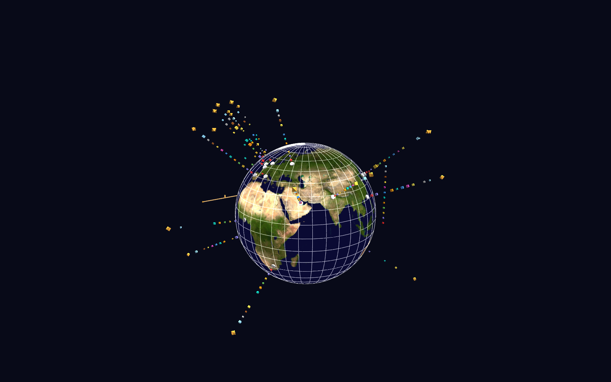

# RSS News Example — International News Visualization



A GlyphViz take on GaiaViz's "RSS Viz" concept: poll ~20 news feeds from
around the world (12 countries, 8 languages), count **concept mentions**
per outlet with a multilingual term dictionary, and render the result as
color-coded concept towers rising from a Blue Marble globe — with a
Channels time replay of the last 3 days of coverage and clickable
headlines.

Because concepts (war, election, economy, climate, …) are matched by
per-language term lists, a war spike is directly comparable between BBC
(English), TASS (Russian), and NHK (Japanese) — you can spot patterns in
languages you don't read.

## What you're looking at

| Element | Meaning |
|---|---|
| Globe | World Grid (type 6) in globe form, Blue Marble texture |
| White pads on the surface | News outlets, placed at their home city (`link` = homepage) |
| Cube towers | One cube per concept, same altitude slot on every tower; size = articles mentioning it; color = concept (see the legend column west of the globe) |
| Gaps in a tower | The outlet never mentioned that concept |
| Amber octahedron at the top | The outlet's latest headline (`text` label; `link` = the article) |
| Amber bar south of the globe | UTC timeline for the replay window; the spinning octa is the playback cursor |

## Using it

1. **File > Open** `rss_news_gv_node.csv` (the `media/` globe texture and
   the `ch-map`/`ch-tracks` channel files load automatically).
2. **Space** — play the time replay: every cube dims, then flashes in the
   3-hour buckets where matching articles were published while the cursor
   sweeps the timeline. **Stop** (Shift+Space) restores the static totals.
3. **T** — toggle text labels (outlet names, concept counts, headlines).
4. **Alt+click** a headline octahedron (or any outlet pad) — the article
   (or homepage) opens in your browser. Same for selecting it and
   pressing **U**.
5. **G** — select the globe; the World Grid panel appears.

## Rebuilding / going live

```
python build_rss_news_scene.py                 # fetch feeds, rebuild scene
python build_rss_news_scene.py --offline       # rebuild from data/rss_items.csv
python build_rss_news_scene.py --hours 48 --bucket-hours 2
python build_rss_news_scene.py --watch 300     # re-fetch + rewrite every 5 min
```

For a **live-updating scene**, run `--watch 300` in a terminal, open the
node CSV in GlyphViz, and turn on **File > Watch and Reload** (Ctrl+R):
each time the generator rewrites the CSVs the scene hot-reloads in place,
preserving your camera, selection, and playback state. Fetched items
accumulate in `data/rss_items.csv` (deduplicated by URL, pruned after 14
days), so the longer the watch loop runs, the fuller the replay timeline
gets — single feeds typically only carry the most recent 10–150 items.

A full 20-feed fetch+build cycle takes ~15 seconds. All writes are
atomic (temp file + rename), so a reload never sees a half-written CSV.

## Customizing

- `data/feeds.csv` — outlets: name, city lat/lon, language, feed URL,
  homepage. Add or replace feeds freely; failures are tolerated per-feed.
- `data/terms.csv` — the concept dictionary: `concept,lang,terms` with
  `;`-separated search terms. The tower slot order and colors are the
  `CONCEPTS` table at the top of the generator. "RSS viz can be
  customized for any topic" — swap in your own concepts and terms.

Term matching is case-insensitive and per-article (an article counts once
per concept no matter how often a term repeats). Alphabetic-script terms
match at word starts ("election" also matches "elections", "вакцин"
matches "вакцина"); terms of ≤3 letters require a full word; CJK terms
match as substrings.

## Requirements

`pandas` only (feed fetching/parsing uses the Python standard library).
Network access is needed for live fetching; `--offline` rebuilds from the
bundled snapshot.
