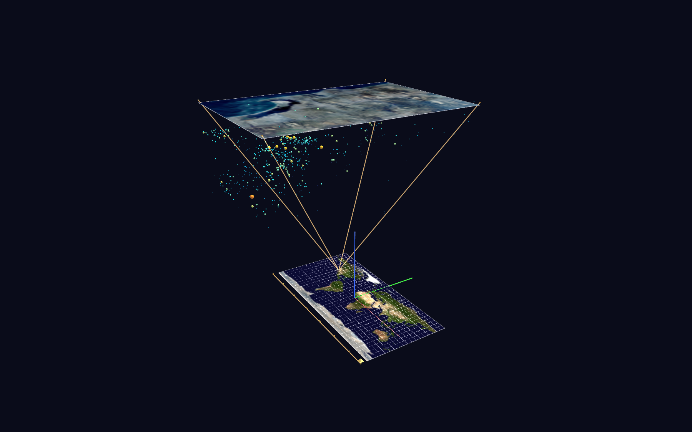

# San Diego Seismicity Callout — World Grids + Channels time replay

A start-to-finish demonstration of GlyphViz World Grids and Channels: live
USGS catalog acquisition → georeferenced scene generation → validated
`sd_quakes_gv_node.csv` → a 66-year time replay of the region's seismicity.



## The scene

Two World Grids in one scene:

1. **Earth reference** — a 216×108-unit Blue Marble plate at the origin,
   whole-earth extents (−180..180, −90..90), 10° graticule.
2. **San Diego region** — the aerial mosaic as a ~191×280-unit plate
   hovering 230 units directly above its own footprint on the world map.
   Extents: lon −117.31..−116.97, lat 32.57..32.98.

Connecting them, the classic cartographic inset-zoom callout in true 3D:
an amber halo and a true-scale footprint rectangle (4 corner glyphs + 4
Link edges) on the world map, with 4 more Link edges rising to the big
plate's corners — a zoom frustum.

Earthquake hypocenters attach to the San Diego grid by raw longitude /
latitude; depth hangs **beneath** the aerial plate (`translate_z =
−depth_km`, exaggerated ×6.5 by the grid's `scale_z`), so the seismicity
volume fills the frustum under the photo. Magnitude drives both glyph
size (quadratic) and a cold-blue → cyan → gold → red color ramp, plus
`color_index` 1–20 pre-wired for in-app palette cycling. Events ≥ M3.5
carry inline labels; every event links to its USGS event page.

## The time replay (Channels)

Press **Space** and the catalog plays back at one animation frame per
calendar month, ~1960 to now (847 frames ≈ 28 s at the default 30 FPS):

- Every hypocenter is born invisible (`color_a` 0), **flashes to 255 the
  month it happened**, then decays to a dim "memory" alpha (145) — so the
  bright glyphs are always the *recent* events and the dim field is the
  accumulated history.
- In the final second of the loop the whole catalog **relights** to full
  brightness, then the cycle restarts from an empty volume.
- A timeline bar with decade ticks runs along the south edge of the world
  map; a spinning amber cursor sweeps it via a `translate_x` channel —
  its position *is* the current date.

Playback OFF (or Stop, Shift+Space) shows the complete static catalog:
the channel files only ever animate the CSV's own values.

**What it teaches:** the channel-sharing compression pattern applied to
event data — 634 animated hypocenters driven by only 315 channels because
every event born in the same calendar month shares one `ch_input_id` (one
step-function `color_a` track each); a flash-decay-relight alpha profile
built from those step functions; a `translate_x` channel as a timeline
cursor (channel values are coordinates in the node's own parent space);
and the one-clock rule — every track shares the scene's single 847-row
frame count, with "not yet born" encoded as alpha 0, exactly as
`glyphviz-skill/references/channels-animation.md` prescribes.

## Files

- `build_sd_quake_scene.py` — the whole pipeline (fetch + build + validate)
- `sd_quakes_gv_node.csv` — the generated scene (665 rows)
- `sd_quakes_gv_ch-map.csv` / `sd_quakes_gv_ch-tracks.csv` — the Channels
  pair (316 bindings; 847 frames × 316 tracks); auto-load with the node CSV
- `data/usgs_catalog.csv` — snapshot of the fetched catalog (634 events,
  1960→2026), for offline regeneration
- `media/01_bluemarble.png` — texture_id 1 (Earth grid)
- `media/02_sandiego_aerial.png` — texture_id 2 (San Diego grid)

Keep `media/` beside the CSV — GlyphViz maps `texture_id` to the
alphanumerically sorted contents of that folder, hence the numbered names.

## Running

```
pip install pandas requests
python build_sd_quake_scene.py                          # live fetch, refreshes data/
python build_sd_quake_scene.py --offline data/usgs_catalog.csv   # reproducible
python build_sd_quake_scene.py --min-mag 1.0            # declutter tiny events
python build_sd_quake_scene.py --structure-only         # grids + callout only
python build_sd_quake_scene.py --no-channels            # static scene only
```

Then GlyphViz → File > Open → `sd_quakes_gv_node.csv`. The channel files
auto-load; the Channels panel appears; Space plays.

The fetch is count-first (probes `/count` before pulling), pages at the
FDSN 20,000-event limit, retries with backoff, identifies itself with a
User-Agent, and snapshots the tidied catalog to `data/usgs_catalog.csv`.
`--offline` accepts any USGS-format CSV (`time, latitude, longitude,
depth, mag, id, place, …`); SCEC catalogs work after renaming columns.

## In-app notes

- **Space** plays/pauses the replay; **Shift+Space** stops and restores
  the static scene; the FPS slider trades loop length for smoothness.
- **G** cycles/selects the grids (grids are never click-pickable);
  the World Grid panel can flip either plate to a globe live.
- **T** toggles labels; **U** on a selected quake opens its USGS page.
- The solid aerial plate occludes picking from above — orbit below or
  beside it to select hypocenters, or flip the plate to wire.
- **=/−** cycles `color_index` recoloring.

## Knobs (top of the script)

`WORLD_GRID_SCALE`, `SD_PLATE_HEIGHT`, `SD_HOVER_Z`, `DEPTH_EXAGGERATION`
(the vertical-exaggeration control — it re-spaces child elevations without
touching glyph sizes, per the grid scale rule), `LABEL_MIN_MAG`, the
magnitude→size/color ramps, and — for the replay — `ALPHA_FLASH`,
`ALPHA_SETTLE`, `FLASH_DECAY_FRAMES`, `HOLD_FRAMES`, `RELIGHT_FRAMES`,
plus the georeferencing constants below.

## Georeferencing (how the extents were derived)

The aerial mosaic has no embedded geodata, so its bounds were solved
visually from four landmarks (Mission Bay, MCAS Miramar, Lake Murray,
Sweetwater Reservoir) assuming square ground pixels:
**lon −117.31..−116.97, lat 32.57..32.98**, estimated uncertainty
±0.02°. The San Diego grid's `scale_x/scale_y` are set so the plate
matches the image's pixel aspect exactly (undistorted texture); over a
0.4° window this is within ~2% of a locally conformal map — well inside
the georeferencing uncertainty. If you have the mosaic's true corner
coordinates, replace the four constants and re-run; registration,
extents, and event filtering all follow automatically.
