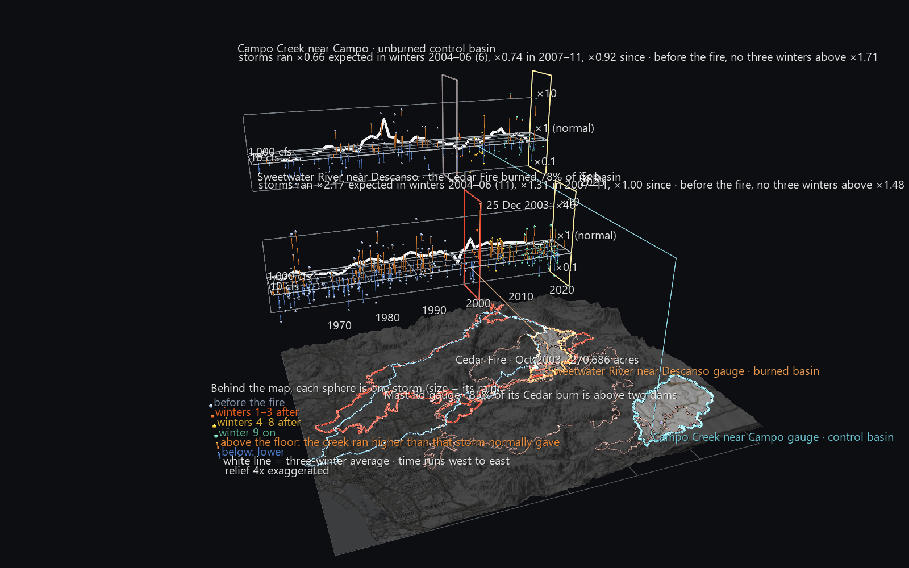
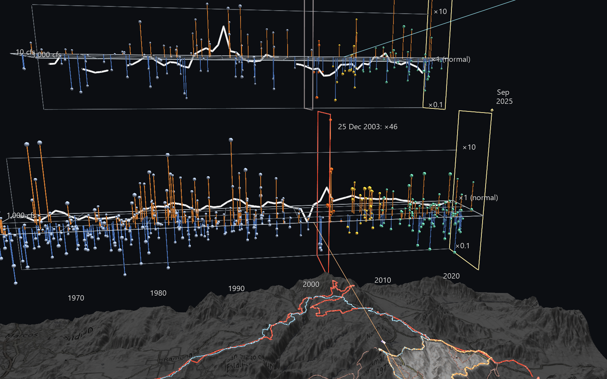
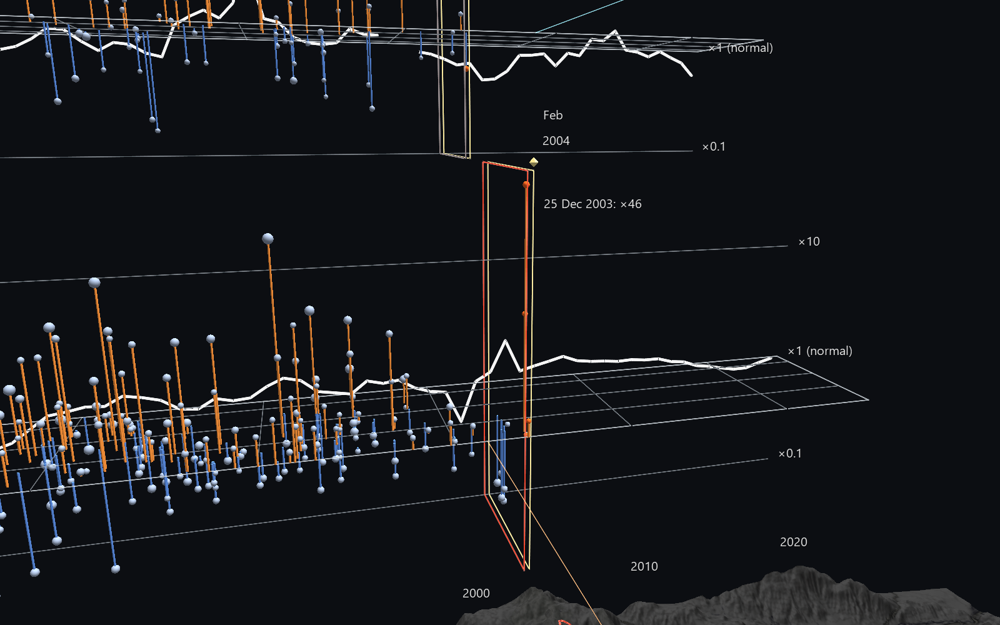

# San Diego River Watershed Atlas: After the Cedar Fire

The Atlas's headline question: **after a fire, does the same rain make a
bigger river?** This scene answers it where the public record can. Every storm
since 1960 on two mountain creeks is measured against what that same storm
would have produced before the October 2003 Cedar Fire. One creek's basin
burned, and the other's is the control.



## Why not the Atlas's own river?

The Cedar Fire burned **80%** of the land draining to the Mast Rd gauge in
Santee. But **85% of that burned land lies above El Capitan and San Vicente
dams** (60% and 25%), so the reservoirs absorb whatever the burn did to the
river. No gauge above either dam has a record that spans 2003. The areas are
measured from USGS NLDI basins and the CAL FIRE perimeter. The dam basins come
out at 190 and 74 square miles, which match their published figures.

So the scene compares two undammed creeks in the same mountains:

| | Burned basin | Control basin |
|---|---|---|
| Gauge | Sweetwater River near Descanso, USGS 11015000 (45 sq mi, daily since 1905) | Campo Creek near Campo, USGS 11012500 (85 sq mi, daily since 1936) |
| Rain | Cuyamaca, GHCN USC00042239 | Campo, GHCN USC00041424 |
| Cedar Fire | burned **78%** of the basin | burned 0% |
| Other fires | Conejos (1950) burned 45%, ten winters before the baseline begins. Laguna (1970) burned 5%. | No fire since 1960 burned more than 16% (Donovan, 1968). |

## Reading the scene

- **The map** shows both basins lit on the relief, the Cedar Fire perimeter in
  red, other fires that burned at least 5% of either basin in faint red, the
  San Diego River watershed divide in pale blue, and the gauges and rain
  stations. Click the Mast Rd gauge or either dam for its share of the burn.
- **Behind the map are two storm slabs**, one per creek. The burned creek is
  in front, and the control is behind and higher. A thin line runs from each
  gauge to its slab.
  - **Across (west to east): time**, 1960 to 2025.
  - **Depth: how big the storm was**, as its expected peak flow, from about
    1 cfs at the front edge to 1,000+ cfs at the back.
  - **Height: observed over expected, on a log scale.** The flat floor is
    normal. A storm whose creek ran higher than expected stands up out of the
    floor on an **orange** stem, and one that ran lower hangs below on a
    **blue** stem.
  - **Sphere colour** marks the period: grey before the fire, red-orange for
    winters 1–3 after, yellow for winters 4–8, green from winter 9 on.
  - **Sphere size** is the storm's rain.
  - **The white line** is the three-winter rolling average.
  - **A wall** marks 25 October 2003: red on the burned slab, grey on the
    control.
- **Press Space** and the record plays month by month. Storms appear in the
  month they fell, and a yellow frame slides east through both slabs with the
  month and year. The white averages stay drawn throughout, as a summary.
- **Click any storm** for its date, rain, how wet the ground already was, the
  flow before, the observed and expected peaks, and its multiplier.



## What the record shows

**Sweetwater River (78% burned):**

| | Storms | Average multiplier |
|---|---|---|
| Winters 2004–06, the first three after the fire | 11 | **×2.17** |
| Winters 2007–11 | 28 | ×1.31 |
| Winters 2012–25 | 86 | **×1.00**, recovered |

**Before the fire, no three consecutive winters averaged above ×1.48** (41
stretches from 1961 to 2003, each with at least six storms). Eight of the 11
post-fire storms ran above expected.

**Campo Creek (the control), same periods:** ×0.66 (6 storms), ×0.74 (18
storms), ×0.92 (40 storms). Campo ran at or below its own normal while
Sweetwater ran high, so the post-fire jump isn't a region-wide wet spell.

**The first storm on the bare ground was the most extreme in the 65-year
record.** On 25 December 2003, two months after the fire, 2.8 inches of rain
at Cuyamaca put Sweetwater at 88 cfs. The pre-fire record says that storm, on
that dry ground, should have produced about 1 cfs: **×46**.



**How robust this is:**

- **The biggest effect was on the smaller storms.** After the fire, storms
  expected to peak under 20 cfs ran ×3.2 (5 storms), and larger ones ×1.6
  (6 storms). Before the fire, both groups ran about ×1. The large storms of
  January and February 2005 came in close to expected: 689 cfs against 611 on
  7 January. That pattern is consistent with burned slopes shedding water
  fastest before the ground is soaked, and the slab's depth axis shows it
  directly.
- **The Christmas storm isn't carrying the whole result.** Drop each
  three-winter stretch's single largest storm, before and after alike. The
  post-fire winters then average ×1.60, and no pre-fire stretch exceeds ×1.29.
- **The rain timing doesn't change the conclusion.** A co-op gauge's "day"
  ends when the observer reads it:
  - Cuyamaca is read at 08:00, so most of a day's total fell the day before,
    and it is shifted one day earlier.
  - Campo is read at 17:00, so its totals aren't shifted.

  The shifts come from each station's recorded observation hour, not from
  which choice gives the bigger number. Without Cuyamaca's shift, the
  Christmas storm lands after its own flood peak, and the post-fire winters
  still average ×1.66 against a pre-fire maximum of ×1.40. The build prints
  both.

**What this does not show:** how much sediment moved, what happened at Mast Rd
behind the dams, or whether the fire caused any single storm's peak. It's a
statistical before-and-after, with one small-sample comparison: 11 post-fire
storms, and 6 at Campo, whose rain record has gaps.

## How "expected" is computed

**Storms.** A storm starts on a day with at least 0.5 in of rain, when three
days total at least 1.5 in. It lasts while daily rain stays at or above 0.2
in. For each storm the build takes:

- **rain**, the storm's total;
- **how wet the ground was**, the rain in the 60 days before (storms missing
  more than 6 of those days are skipped);
- **flow before**, the lowest daily flow in the 3 days before;
- **peak**, the highest daily mean flow during the storm and the day after.

**Model.** A regression on the pre-fire storms, October 1960 to 24 October
2003 (286 at Sweetwater, 90 at Campo):

```text
ln(peak + 1) = a + b·ln(rain) + c·ln(60-day rain + 1) + d·ln(flow before + 0.1)
```

Sweetwater's coefficients are a = −0.035, b = 1.79, c = 0.23, d = 0.66, with a
residual standard deviation of 0.77.

**Multipliers.** A storm's multiplier is (peak + 1)/(expected + 1), so a dry
creek's storms don't produce infinite ratios. Averages are geometric means of
those multipliers. Stems stop at ×0.1, where a creek that barely ran would
otherwise hang off the slab, and each storm's label keeps its true value.

## Data

| What | Source |
|---|---|
| Daily flow | USGS NWIS daily values: 11015000, 11012500, 11022480 |
| Basins | USGS NLDI: the three gauges, plus El Capitan and San Vicente dams located on NHDPlus by position |
| Daily rain and observation hour | NOAA GHCN-Daily via RCC-ACIS: USC00042239 (Cuyamaca), USC00041424 (Campo) |
| Fire perimeters | CAL FIRE FRAP, from the Burn Record example's cache (`../San_Diego_Fire_History_Example/data/`) |
| Watershed divide | USGS WBD, from the Watershed example's cache |
| Terrain | USGS 3DEP via AWS Terrain Tiles, 300-column surface, relief 4× exaggerated |
| Basemap | © OpenStreetMap contributors, SRTM, © OpenTopoMap (CC-BY-SA) |

## Rebuilding

```text
python build_cedar_runoff_scene.py            # uses data/ and the sibling examples' caches
python build_cedar_runoff_scene.py --refresh  # re-fetch flow, rain and basins
```

The build refits both models a second way (the normal equations instead of
least squares), then loads its own output back through GlyphViz's loader,
Scene and ChannelEngine and measures it:

```text
Sweetwater River near Descanso: normal-equation refit differs from lstsq by 5.61e-15
Campo Creek near Campo: normal-equation refit differs from lstsq by 3.33e-15
storms: 565 placed, worst error 0.0005; stems 562, ends off the floor/sphere 0; map points xy error 0.00021
playback at 5 frames: wrong storm/stem visibility 0, wrong readout 0, now-frame error 0.0000; engine 780 frames, 1,208 bound nodes
```

## Size and speed

81,840 nodes (9.3 MB), 368 tracks × 780 monthly frames (0.6 MB). Headless, it
renders at about 13 ms a frame while you fly around and **10 ms a frame**
while playing.

## Known limits

- **Daily mean flow, not the instantaneous peak.** A flash flood inside one day
  is averaged across it, which understates every storm, and probably the
  post-fire ones most.
- **One rain gauge per basin.** Cuyamaca sits at the Sweetwater basin's north
  edge, and storms that hit the basin and missed the gauge (or the reverse)
  are noise in both directions.
- **Campo's rain record has gaps,** so fewer of its storms qualify (154 against
  Sweetwater's 411).
- **The overview's labels overlap at a distance;** move in on a slab to read
  them.
