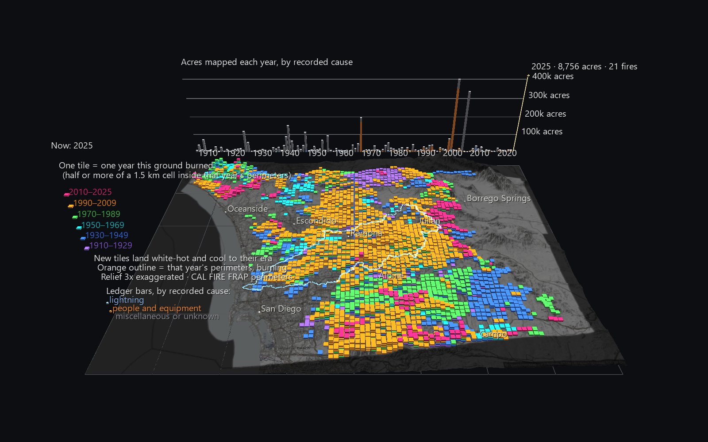

# San Diego River Watershed Atlas: The Burn Record, 1910–2025

A San Diego River Watershed Atlas scene, widened to the whole county. It
shows every wildfire perimeter CAL FIRE has mapped in San Diego County since
1910 (1,640 of them) laid down on the county's relief as **layers**. Each year
a patch of ground burns, it gains one more tile. Ground that keeps burning
rises into a tall striped stack. Ground with no mapped fire stays bare.



**To open it:** the scene ships zipped (17 MB of CSV compresses to 5.7 MB).
Drag `Burn_Record.zip` onto the GlyphViz window, which extracts it beside
itself and loads it. Or unzip it and open `Burn_Record/sd_fire_history_gv_node.csv`.

## Reading the scene

- **The county is cut into 1.5 km squares.** When at least half of a square
  burns in a given year, the square gains one tile. Tiles stack in the order
  the fires happened, oldest at the bottom, so **a stack's height is how many
  times that ground has burned**, and its stripes say when.
- **Tile colour is the twenty-year era of that fire:**

  | Era | Colour |
  |---|---|
  | 1910–1929 | violet |
  | 1930–1949 | blue |
  | 1950–1969 | teal |
  | 1970–1989 | green |
  | 1990–2009 | orange |
  | 2010–2025 | magenta |

  From above you see each square's most recent fire. Drop the camera low to
  read the layers underneath.
- **Press Space and the century plays**, four frames a year. A year's new tiles
  land white-hot, cool through orange over the next year, and settle into
  their era colour. Meanwhile that year's fire perimeters burn on the ground
  as orange outlines, then go out.
- **The ledger behind the county's north edge** has one bar per year for acres
  mapped, split by the cause CAL FIRE recorded: blue for lightning, orange for
  people and equipment, grey for miscellaneous or unknown. A cursor tracks the
  clock, and its label gives that year's acres and number of fires.
- **The pale blue line is the San Diego River watershed divide**, the home
  basin of the rest of the Atlas. It floats above the tiles so it stays
  visible over the most-burned ground.
- **Click any tile** for the fire's name, year, mapped acres and cause, plus
  every year that square has burned. Click an outline while it burns for its
  alarm date and CAL FIRE unit.


## What the record shows

All figures are measured from the perimeter records, using the rules below.

- **Half the county has burned at least once since 1910.** Of the 5,193
  squares inside the county line, 2,636 (51%) have at least one tile.
  - 1,243 squares have burned once, 766 twice, 405 three times and 160 four
    times.
  - 44 have burned five times, 16 six times and 2 seven times.
- **The most-burned ground is in the Atlas's own watershed.** A square beside
  El Capitan Reservoir, above Lakeside, burned in:
  - 1929 (an unnamed fire)
  - 1956 (the "Outside Origin #42" fire)
  - 1995 (El Monte)
  - 2003 (Cedar)
  - 2007 (Witch)
  - 2010 and 2025 (both named Monte)

  The other seven-time square is on the Roblar fires' ground at the county's
  north-west corner.
- **Two years dominate the century.** 2003 (Cedar, Paradise, Otay and others)
  mapped 401,000 acres and 2007 (Witch, Harris, Poomacha and others) mapped
  337,000. Together they are 23% of every acre mapped since 1910. The next
  largest years are 1970 (196,000, Laguna), 1944 and 1928.
- **Fire comes back to the same ground.** Of the 728 squares the 2003 fires
  burned, 178 had burned again by 2025.
- **The recorded cause is mostly unhelpful.** 71% of mapped acres are coded
  miscellaneous or unknown, 26% people and equipment, and 3% lightning. The
  ledger shows the coding as it stands and doesn't reinterpret it. For
  example, FRAP codes the Cedar Fire as equipment use, though it is widely
  reported to have started from a lost hunter's signal fire, and codes the
  Witch Fire as miscellaneous.


## The rules that decide what a tile means

- **What counts as burned.** A square burns in year Y when at least 8 of 16
  sample points spread across it lie inside **all of year Y's perimeters
  combined** (holes in a perimeter are unburned). Combining the year's
  perimeters means duplicate or adjoining records for the same year can't
  count twice. It also means a square gains at most one tile per calendar year.
- **Which fire a tile belongs to.** Each tile is credited to whichever of that
  year's fires covered the most of its sample points.
- **Which fires are included.** Every FRAP perimeter with a vertex or its
  centre inside the county is kept, 1910–2025. That leaves out the other 85
  perimeters in the rectangular download window. Almost all of them are in
  Riverside, Orange or Imperial County, and a couple were too small to keep an
  outline after simplification. A fire crossing the county line keeps its
  whole outline, and the ledger counts its full mapped acres.
- **A bare square means "no mapped fire", not "never burned".** FRAP is
  incomplete before about 1950, and small fires, typically under 10 acres, are
  mostly absent throughout. A fire smaller than about 300 acres can't cover
  half of a 1.5 km square, so it leaves an outline but no tile.

## Data

| What | Source |
|---|---|
| Fire perimeters | CAL FIRE FRAP, *California Fire Perimeters (all)*, FeatureServer layer 0: final perimeter shapes, year, alarm date (day only), mapped acres, cause. Cached in `data/`, simplified at 20 m. |
| County boundary | US Census TIGERweb, GEOID 06073 |
| Watershed divide | USGS Watershed Boundary Dataset, the three HUC-10s of the Atlas, from `../San_Diego_River_Watershed_Example/data/` |
| Terrain | USGS 3DEP elevation via AWS Terrain Tiles, 300-column surface, relief 3× exaggerated |
| Places | USGS GNIS |
| Basemap | © OpenStreetMap contributors, SRTM, © OpenTopoMap (CC-BY-SA), toned dark at build time |

## Rebuilding

```text
python build_fire_history_scene.py              # uses the caches in data/; writes Burn_Record/ and Burn_Record.zip
python build_fire_history_scene.py --refresh    # re-fetch everything
```

The build loads its own output back through GlyphViz's loader, Scene and
ChannelEngine and measures it. It also recounts the burn rule a second way, on
the 25 tallest squares plus 25 random ones, using separate pure-Python
point-in-polygon code:

```
tiles: 4,960, xy error 0.00050, stacking error 0.0005, bottoms below the surface at the cell centre 0; places xy error 0.00011
independent recount (pure-Python ray casting) on 50 cells, the 25 tallest + 25 random: mismatches 0
playback at 5 frames: wrong tile visibility 0, wrong tile colour 0, wrong perimeter visibility 0, wrong readout 0, cursor error 0.0000; engine 464 frames, 6,869 bound nodes
```

## Size and speed

140,670 nodes (16.6 MB), 782 tracks × 464 frames (0.9 MB). The file loads in
1.6 s. Headless, with the channel file loaded, it renders at about **11 ms a
frame** while you fly around and **22 ms a frame** while playing.

This scene prompted a renderer change. Before it, every channel-bound node was
redrawn one at a time on every frame, and these 6,869 bound nodes cost 60–80 ms
a frame even while paused. Nodes whose channels only change colour or
visibility are now drawn from a cached list per channel, and a list is only
redrawn when that channel's values change. See
`tests/test_channel_appearance_groups.py`.

## Known limits

- **Final perimeters, not progression.** Each fire appears at its final mapped
  size in its year.
- **Squares, not exact burned area.** A 1.5 km square is either burned that
  year or not, so a tile overstates a fire's edge in some places and misses
  thin fingers of burn in others.
- **The pre-1950 record is thin and its dates are coarse,** so the violet and
  blue layers undercount.
- **No HPWREN camera sites.** HPWREN's public site list wasn't reachable when
  this was built, and their coordinates weren't guessed.
