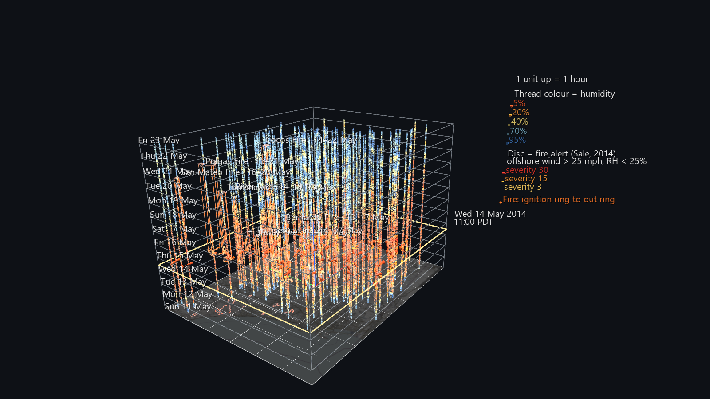
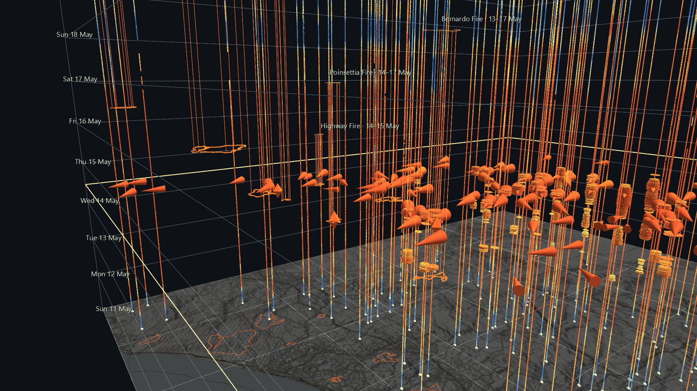

# San Diego River Watershed Atlas: The May 2014 Fire Siege

Phase 3 of the San Diego River Watershed Atlas, and its first fire scene.
Between 13 and 16 May 2014, during a Santa Ana, eight fires broke out across
northern San Diego County. This scene covers the twelve days around them,
**11–23 May 2014**, as a **space-time cube**. The county map is the floor,
and **time rises one world unit per hour**.



## Reading the cube

- **Every weather station is a vertical thread.** It runs from midnight on
  Sunday 11 May, at the floor, to midnight on Friday 23 May, at the top. Each
  hour of the thread is coloured by relative humidity, from red (bone dry) to
  blue (saturated). When the Santa Ana arrives, the whole county turns red at
  the same height.
- **Discs are fire alerts, using Jeff Sale's own 2014 index.** It is ported
  unchanged from the PHP he wrote against this same station network in 2014.
  A station is in alert when three things are true at once:
  - sustained wind is **over 25 mph**
  - the wind blows **from between 10° and 110°** (offshore)
  - relative humidity is **under 25%**

  Severity = (wind − 25) + (25 − humidity). Each ten-minute alert is a disc on
  that station's thread, with radius showing severity, so a run of alerts
  stacks into a spindle.
- **Each fire is a prism.** Its mapped perimeter is drawn at the height of its
  ignition and again at the height it was declared out, joined by vertical
  edges. Its footprint is also traced on the floor. Each fire's name and date
  span are pinned at the top of its prism. Click the ignition ring for the full
  record.
- **The now plane.** Press **Space** and a frame sweeps up through the cube.
  Every station's wind rides on it as a cone that points downwind, sized by
  speed and coloured by humidity. A flame marks each fire while it is burning.
  The date and time ride along at the plane's south-east corner.

The scene opens at **11:00 PDT on Wednesday 14 May**, the ten minutes with the
most stations in alert (32).



## What the cube shows

Measured from the station records at each fire's ignition, not taken from
reporting:

- **The Santa Ana is one band.** The first alert came at 06:00 on Monday
  12 May (Lucky Five Ranch), and the last at 10:20 on Thursday 15 May (Otay
  Mountain): 2,654 ten-minute alerts at 52 stations. At 11:00 on 14 May,
  114 of the 126 stations reporting were below 10% humidity.
- **The alerts were in the mountains; the fires were not.** The stations with
  the most alerts are Crestwood (258), Volcan Mountain (214), Lucky Five Ranch
  (198) and La Posta (189), all in the eastern mountains where the offshore
  wind is strongest. Only 123 of the 2,654 alerts came from stations west of
  117°W, which is where every fire started.
- **At the ignitions it was extremely dry and hot, but the wind was mostly
  below the threshold.** At the three stations nearest each fire, humidity was
  between 2% and 12%, temperatures were between 82 and 101°F, and sustained
  wind was mostly under 25 mph. Of those 24 station readings, only two were in
  alert: Hodges Dam, 4.8 km from the Bernardo Fire, and Olivenhain, 14 km
  from the Poinsettia Fire.
- **Two fires started after the index went quiet.** The Pulgas Fire
  (Thursday 14:45) and the San Mateo Fire (Friday 11:24), both on Camp
  Pendleton, ignited after the last alert. By then the wind at the nearest stations
  was light (13 mph or less), but humidity was still 2–8%
  and temperatures were 89–101°F.

None of this says why a fire started. The perimeter records list one cause
(the Bernardo Fire, equipment use) and the rest as unknown. What the cube does
show is where and when the air was dangerous, next to where and when fires
actually began. It also shows that a wind-based threshold drew the dangerous
area in a different place than the fires did.


## Data

| What | Source |
|---|---|
| Weather | The SDG&E weather-station network, scraped every ten minutes and archived by Jeff Sale (`station_data/may2014`, 128 stations). Only derived values for this window are in `data/` (wind speed and direction, gust, temperature, humidity), never the raw archive. |
| Fire perimeters | CAL FIRE FRAP historic fire perimeters: final shapes, with dates recorded to the day only |
| Fire start and end times | CAL FIRE's public incident list, to the minute (UTC, converted to PDT) |
| Basemap | © OpenStreetMap contributors, SRTM, © OpenTopoMap (CC-BY-SA) |

**Details that matter:**

- **Time.** The archive's stamps are Pacific *Standard* Time all year. At the
  9 March 2014 daylight-saving change, the scrape file names skip 02:00 but the
  stamps inside don't. So every stamp is shifted +1 hour to PDT, the clock this
  scene uses.
- **Matching fires.** Seven FRAP perimeters match CAL FIRE incidents by name.
  FRAP's "COMBAT" perimeter is the incident CAL FIRE calls the San Mateo Fire:
  its incident location falls inside the perimeter, and both records say 1,457
  acres. FRAP also dates the three Camp Pendleton fires 19 May with no
  containment date. The incident list's times are used instead, and they are
  the ones that fit the week. The 56-acre Freeway Fire has no mapped perimeter
  and is left out.
- **Mapped vs reported acres.** Labels give both, and they differ: the
  Poinsettia Fire's perimeter maps 377 acres, while the incident reported 600.
- **Missing readings stay missing.** Across the 128 stations there are 1,997
  isolated missed ten-minute readings, as well as some longer gaps. Alerts and humidity threads use only real
  observations. The wind cones hold their last value through one missed
  reading so they don't blink off, and hide for longer gaps.
- **The alert threshold is Jeff's 2014 index as written,** including its
  strict inequalities. It is not the National Weather Service's red-flag
  criteria.

## Rebuilding

```
python build_fire_siege_scene.py                  # uses data/ and the Atlas data caches
python build_fire_siege_scene.py --refresh        # re-read the archive, re-fetch the fire data
python build_fire_siege_scene.py --archive PATH   # where the hpwren_sdge archive lives
```

The fire perimeters and incident list are cached with the Atlas's shared data
in `../San_Diego_River_Watershed_Example/data/`. The build reuses the Santa Ana
Wind example's reader, cone and humidity encodings. It then loads its own
output back through GlyphViz's loaders, Scene and ChannelEngine, and measures
it:

```
stations at lon/lat: worst offset 0.00050; alert discs 2654 (independent recount 2654), worst time error 0.0000 units; fires at ignition height: worst 0.0000
at 5 frames: plane height error 0.0000, cone bearing error 0.000°, wrong cone hide 0, wrong readout 0; engine 1728 frames, 293 bound nodes
```

## Size and speed

42,070 nodes (4.8 MB), 1,063 tracks × 1,728 frames (7.3 MB). Headless playback
through the real engine takes about **15 ms a frame**. At the default 30 fps
the twelve days pass in about a minute.

## Known limits

- **Final perimeters, not progression.** A fire is drawn at its full final
  size from the moment it ignites.
- **Station elevation isn't shown.** The floor is flat, because height means
  time here. Each station's label gives its elevation.
- The humidity threads have one colour per hour, and the round joins between
  hourly segments make them look slightly beaded up close.
