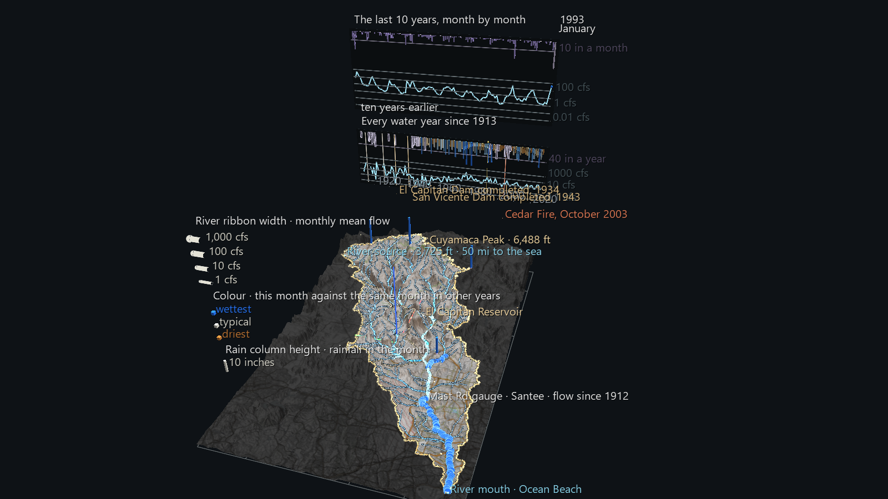
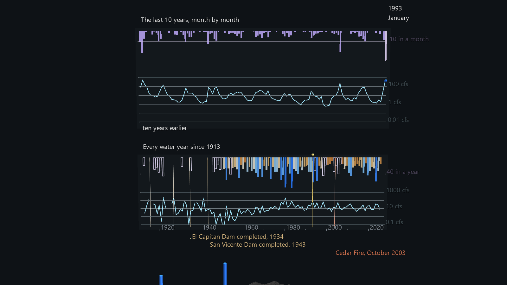

# San Diego River Watershed: The Pulse

Phase 2 of the San Diego River Watershed Atlas. Time arrives. The scene is the
Phase 1 watershed, rebuilt unchanged, with **one Channels frame for every month
since May 1912**: the river's flow at three USGS gauges and rainfall at four
NOAA stations, from the first month of the Mast Road record to the last
complete one (1,372 frames).



Press **Space** to play. At the default 30 fps a century takes 46 seconds.
Slow the FPS slider down to watch individual winters.

## What moves

- **The river swells and shrinks.** Each gauge drives a ribbon draped over the
  reach it measures: Mast Rd to Fashion Valley, Fashion Valley to the sea, and
  Los Coches Creek from its gauge to the river. **Width** is the month's mean
  flow on a log scale, from a 1-pixel thread when the river is dry to 14 pixels
  at 1,000 cfs. **Colour** compares the month with the same calendar month in
  that gauge's other years, from ochre (driest) through pale (typical) to blue
  (wettest). So a wet January and a wet August both read as blue, even though
  the January is far wider. A month the gauge didn't record hides its ribbon.
  Fashion Valley and Los Coches only appear from 1982 and 1983, when their
  records start.
- **Rain columns** rise over the four rain stations. Height is the month's
  total rainfall (1.5 world units per inch) and colour uses the same
  wetter/drier scale. A month with more than three days unrecorded hides its
  column.
- **The panel** stands beyond the east edge, in two strips:
  - **The century** (lower strip): every water year (October to September)
    since 1913. Mast Rd's annual mean flow is the line, on a log scale.
    Cuyamaca's annual rainfall hangs from the top as bars, coloured by how the
    year ranks. A cursor sweeps across it.
  - **The last 10 years** (upper strip): a live monthly window that scrolls as
    the clock runs. Its right-hand end is always "now", with the month and
    year read out beside it.



## What the century shows

These are measured from the monthly record the scene is built on:

- **February 1927 is still the record month** at Mast Rd: a 1,871 cfs mean
  for the whole month.
- **The gauge has no record for January to March 1916.** January 1916 is also
  Cuyamaca's wettest month on record, at 36.5 inches. There is a second gap,
  October 1923 to September 1925.
- **The dams change the river.** El Capitan Dam was completed in 1934 and San
  Vicente Dam in 1943, and both are marked on the panel. Before 1935, 67 of
  245 months had no flow at all, and monthly means reached 1,871 cfs. From
  1944 to 1969 there were 76 dry months, and no month averaged more than
  135 cfs.
- **The river hasn't run dry since September 1968.** From 1970 on, the median
  month flows at 6 to 8 cfs, and not one month since has averaged zero. The
  flow record shows this but doesn't explain it. It's one of the questions
  for the next phase.

## Reading the gaps honestly

- **Missing data is drawn as missing.** The 10-year window is built from
  separate segments, so a gauge gap is a break in the line. A single line
  would have drawn a straight segment across the gap instead.
- **Cuyamaca's early record is patchy.** Of 113 water years, 67 are complete
  and drawn as solid bars. Another 21 are missing one or two months and are
  drawn as **wire bars labelled "at least"**: the months that were recorded
  add up to a true lower bound. Years missing more than two months are left
  as gaps. None are estimated.
- **Only Cuyamaca comes close to a full century.** Julian CDF has records for
  603 of the 1,372 months, Lakeside 2 E for 872, and Descanso for 676 (its
  record ends in 2017). Their columns come and go as their records do.

## Data

All public and keyless, and shared with Phase 1 under
`../San_Diego_River_Watershed_Example/data/`:

| What | Source |
|---|---|
| Monthly flow | USGS NWIS daily discharge, averaged per month here. Months missing more than 3 days are gaps. Recent values are provisional. |
| Monthly rainfall | NOAA GHCN-Daily monthly totals via RCC-ACIS. Months missing more than 3 days are gaps, and a trace counts as 0. |
| Dam completion dates | City of San Diego |
| Cedar Fire | CAL FIRE FRAP |
| Everything else | see the Phase 1 README |

## Rebuilding

```
python build_pulse_scene.py              # uses the cached data
python build_pulse_scene.py --refresh    # re-download it
```

The build imports `build_watershed_scene.py` and `watershed_data.py` from the
Phase 1 folder. This scene needs its own folder, because GlyphViz loads one
ch-map/ch-tracks pair per folder.

The build loads its own three files back through GlyphViz's loaders and
`ChannelEngine`, applies frames spread across the century, and compares the
result with the source series:

```
rain columns at 3 frames: xy offset 0.000097, height error 0.000000, bases below station top: 0
window at 6 frames x 120 slots: height error 0.0005, wrong gap state 0; cursor error 0.0005; frames with a wrong month/year readout 0
```

## Size and speed

70,809 nodes (8.0 MB), 772 tracks × 1,372 frames (4.7 MB). Headless playback
through the real engine takes about **12 ms a frame**, including the
full-frame readback.

## Known limits

- **Channels can't animate label text**, so the month/year readout is a bank
  of 127 pre-labelled nodes, and one year and one month label show per frame.
- The screenshot and every view before you press Play show **January 1993**.
  That is the month with the highest combined flow among months when all
  three gauges and Cuyamaca reported. Headless exports don't apply Channels.
- Thick ribbons can look slightly beaded on sharp bends. That's the same
  round-join effect as Phase 1's thin tributaries.
