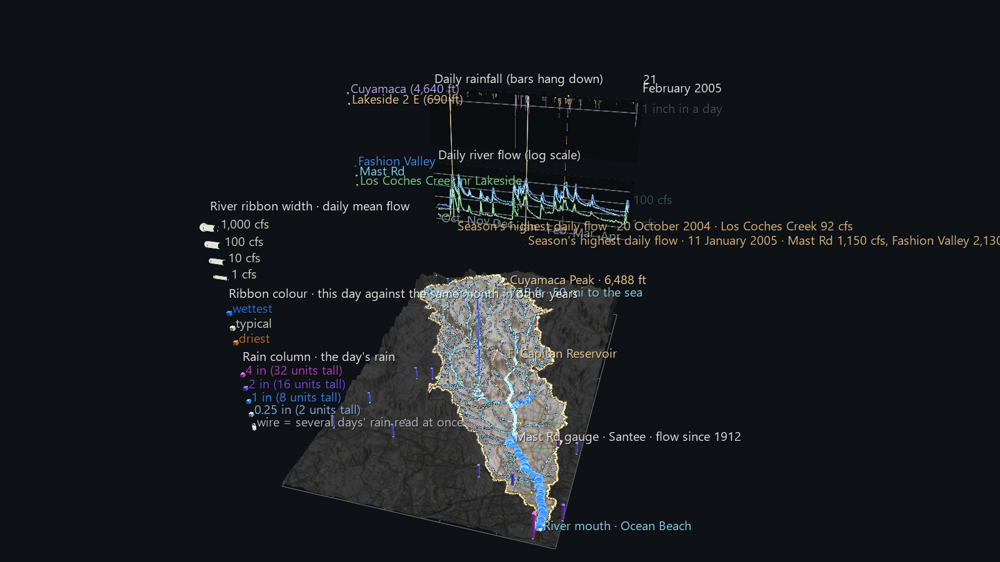
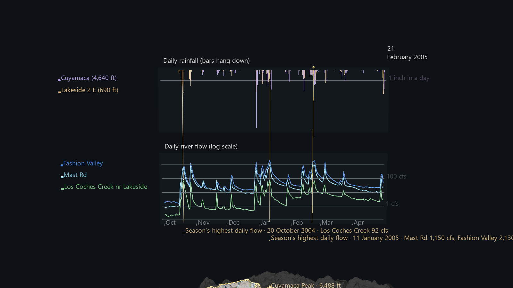
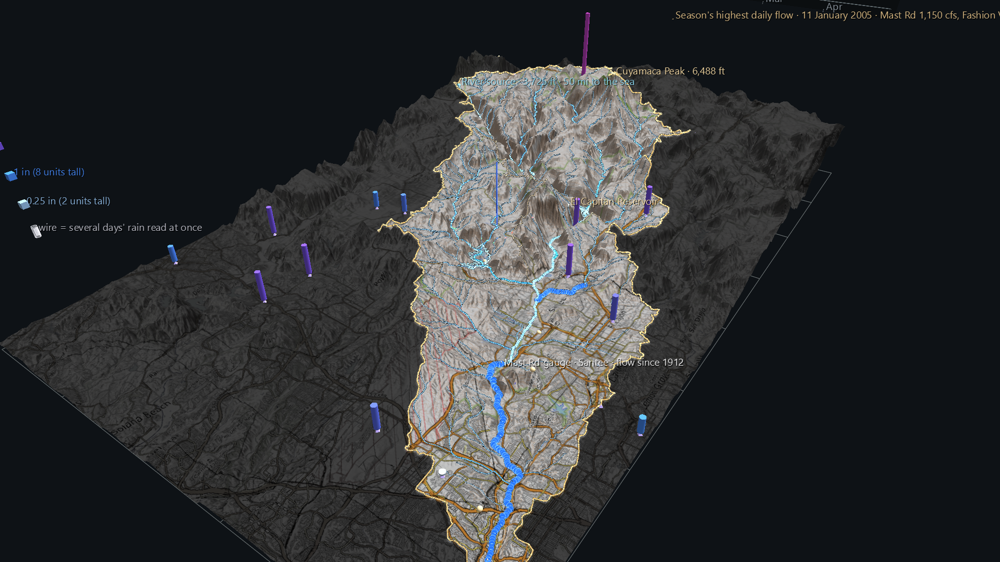

# San Diego River Watershed: The Storm Winter, 2004–05

A scene of the San Diego River Watershed Atlas. It plays one wet season day by
day, **1 October 2004 to 30 April 2005** (212 frames), over the unchanged
Phase 1 watershed: the river at its three USGS gauges and the rain at 18 NOAA
daily rain gauges across the county.



Press **Space** to play. The default 30 fps runs the season in 7 seconds, which
is too fast to follow. Set the FPS slider to 4–8 to watch each storm arrive and
the river answer it.

## Why this winter

Measured from the records the Atlas is built on:

- **It was one of the wettest winters on record.** Lakeside 2 E, in the
  middle of the watershed, recorded 29.3 inches in water year 2005. That is the
  second-highest of its 64 complete water years; only 1978 had more, with 29.5.
  Mast Rd's mean flow for the year ranks 11th of 110.
- **It was the burned hillsides' first real test.** The Cedar Fire burned
  across the upper watershed in October 2003, and the winter that followed was
  dry, with 9.7 inches at Lakeside. So 2004–05 was the first big rain to fall
  on the burn scar. Whether the river answered it differently is the question
  the Atlas's fire phase will measure. This scene shows the winter itself.

## What moves

- **Flow ribbons** over the reach each gauge measures work exactly as in The
  Pulse, but for each day. **Width** is the day's mean flow (log scale).
  **Colour** ranks the day against every recorded day in the same calendar
  month across that gauge's whole record: ochre is the driest, pale is
  typical, blue is the wettest. So a January day that looks typical here
  would look typical in any January since 1912.
- **The rain field.** A column stands over each rain gauge in the map window
  that reported on at least 100 of the 212 days: 18 gauges, 7 of them inside
  the divide. **Height** is the day's rain (8 world units per inch), and
  **colour** is the amount, from pale for a trace, through blue at an inch, to
  magenta at four inches or more. Gauges outside the divide are kept on
  purpose, because a storm doesn't stop at a watershed line.
- **The panel** stands beyond the east edge. It holds the season's daily flow
  at all three gauges (log scale), daily rain at Cuyamaca (mountains, violet)
  and Lakeside (valley, amber), a cursor, and the day and month read out.
  Every rain burst in the upper strip is followed by a flow spike below it.



## What the season shows

- **The biggest river day was 11 January 2005.** Mast Rd averaged 1,150 cfs and
  Fashion Valley 2,130 cfs. Los Coches Creek peaked earlier, at 92 cfs on
  20 October 2004.
- **The wettest days across the rain field** were 27 October 2004 (1.87 in
  averaged over the 13 gauges reporting), 29 December 2004 (1.71 in over 16 gauges, with
  5.63 in at Cuyamaca, the season's largest single reading), and 21 February
  2005 (1.63 in over 14). A day's average counts only the gauges that
  reported that day, and leaves out accumulated totals.
- The scene opens on **21 February 2005**. That day is both wet across the
  field and high on the river, so every layer has something to show.
  11 January has the bigger river, but by then the rain had mostly passed.



## Reading the rain honestly

- **Most of these gauges are read by hand, once a day.** A NOAA co-op observer
  empties the gauge at their own observation time, often in the morning, so a
  day's column can hold rain that fell the previous evening. Two gauges a few
  miles apart can put the same storm on neighbouring days. The airport
  stations (Montgomery Field, San Diego International, Miramar, Ramona Airport)
  are automated.
- **Missing days are hidden, not filled in.**
- **Accumulated totals are drawn as wire columns.** When an observer
  couldn't read the gauge for a few days, the record holds one total covering
  all of them. The scene draws that total as a **wire** column on the day it
  was read, and hides the days it covers. Spreading it across those days would
  invent a daily pattern nobody measured. Alpine, El Capitan Dam and La Mesa
  have the most of these.
- One gauge in the window, Santee Fire Dept, reported on only 37 days and is
  left out.

## Data

All public and keyless, cached in `../San_Diego_River_Watershed_Example/data/`:

| What | Source |
|---|---|
| Daily flow | USGS National Water Information System daily values. Each gauge's whole daily record is cached, which is what the colour ranking needs. |
| Daily rainfall | NOAA GHCN-Daily via RCC-ACIS (MultiStnData over the map window), with the M, T, S and A flags kept |
| Terrain, rivers, places | see the Phase 1 README |

## Rebuilding

```
python build_storm_scene.py              # uses the cached data
python build_storm_scene.py --refresh    # re-download it
```

The build reuses `build_watershed_scene.py` (the frame) and
`build_pulse_scene.py` (the ribbon and rain-column layers). It then loads its
own three files back through GlyphViz's loaders and `ChannelEngine` and checks
them against the source data:

```
rain columns at 6 frames: xy offset 0.000097, height error 0.000000, wrong hide 0, wrong solid/wire 0, bases below station top 0; cursor error 0.0002; wrong readout 0
```

## Size and speed

70,799 nodes (8.0 MB), 180 tracks × 212 frames (0.15 MB). Headless playback
through the real engine takes about **8 ms a frame**, including the readback.

## Known limits

- Daily resolution can't show a storm *moving* across the county. Fronts cross
  in hours. USGS keeps 15-minute flow for this winter, and hourly rain exists
  for the airport gauges, so an hour-by-hour version of one storm is possible.
- The readout is a bank of pre-labelled nodes (7 months, 31 days), because
  Channels can't change label text.
