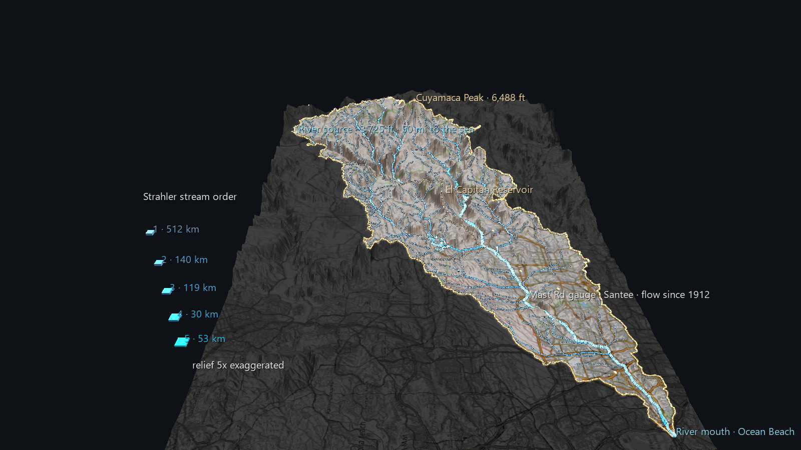

# San Diego River Watershed: The Frame

Phase 1 of the San Diego River Watershed Atlas. It covers the whole watershed,
from the source to the sea, at its true coordinates. There is no time axis yet.
This scene is the frame that every later phase will be laid over: the century
of rain and river flow, the fires, and personal footage.



The screenshot looks from above the Pacific, up the valley toward the Cuyamaca
and Volcan mountains. The river mouth is in the foreground on the right.

## What's in the scene

- **The watershed's own relief.** A 300 × 195 Surface lattice (about 213 m
  between vertices) built from USGS 3DEP elevation, with relief exaggerated
  5×. An OpenTopoMap basemap is draped over it and dimmed and greyed
  **outside** the watershed divide. That makes the basin read as a shape
  before any line is drawn. GlyphViz has no filled polygons, so the mask is
  baked into the image.
- **The divide** is drawn in gold. The **three sub-basin divides** between the
  HUC-10 units (Upper San Diego River, San Vicente Creek, Lower San Diego River)
  are fainter.
- **The whole river network** upstream of the mouth, from NHDPlus V2. It's
  split into 267 reaches of constant **Strahler stream order**, with line
  width and colour growing with order, so you can see the river get bigger as
  tributaries join it. The mainstem is brighter.
- **El Capitan and San Vicente reservoirs**, as shoreline outlines.
- **Three USGS stream gauges** (pins) and **four long-record NOAA rain
  stations** (octahedra).
- **Named places** (spheres), each checked against a federal gazetteer rather
  than typed in: Cuyamaca Peak, Volcan Mountains, Lake Cuyamaca, El Capitan
  Reservoir, San Vicente Reservoir, Lake Jennings, Lakeside, Santee, Cowles
  Mountain, Mission Gorge, Mission Valley, and the river's source and mouth.

Click a stream, gauge or place to see its label; press **T** to show every
label. Each stream carries an invisible, clickable point at its downstream end.
Its label gives the reach's name, Strahler order, length and drainage area, and
**U** opens its NHDPlus record. The gauges and rain stations link to their USGS
and NOAA pages.

## Facts the data corrected

A few things in the Atlas plan were wrong, and the data put them right:

- **The watershed is three HUC-10 units, not the HUC-8.** HUC-8 18070304
  ("San Diego") covers 1,553 sq mi, including the Sweetwater, Otay and San
  Diego Bay basins. The river's own watershed is **1,120.8 km² = 432.8 sq mi**.
- **The mainstem is 81.0 km (50.3 mi)** by NHDPlus reach lengths, not 52 mi.
- **It rises near the Volcan Mountains**, west of Julian, not in the Cuyamaca
  Mountains. Cuyamaca drains in through Boulder Creek.
- **Julian CDF and Descanso Ranger Station are outside the divide.** Both are
  long-record rain stations close to the watershed. Their labels say so.

## Data (all public, keyless, cached under `data/`)

| What | Source |
|---|---|
| Watershed outline | USGS Watershed Boundary Dataset, HUC-10 1807030405 / 06 / 07 |
| River network | NHDPlus V2 via the USGS NLDI (upstream of terminal reach comid 20331522), attributes from the USGS water-data GeoServer |
| Reservoir shorelines | NHDPlus V2 waterbodies |
| Stream gauges | USGS NWIS: 11022480 Mast Rd (daily since 1912), 11023000 Fashion Valley, 11022200 Los Coches Creek |
| Rain stations | NOAA GHCN-Daily via RCC-ACIS: Cuyamaca, Julian CDF, Lakeside 2 E, Descanso RS |
| Place names | USGS National Map Gazetteer (GNIS) |
| Elevation | USGS 3DEP via AWS Terrain Tiles (Terrarium) |
| Basemap | © OpenStreetMap contributors, SRTM, © OpenTopoMap (CC-BY-SA) |

## Rebuilding

```
python build_watershed_scene.py              # uses the cached data/
python build_watershed_scene.py --refresh    # re-download it
python build_watershed_scene.py --exag 4 --cols 450
python build_watershed_scene.py --home LON,LAT   # adds a "you are here" pin
```

**Never commit a `--home` build.** A rooftop latitude and longitude is
effectively a street address.

`watershed_data.py` fetches and shapes the data, and later Atlas phases can
import it. Terrain fetching and draping live in the app itself, in
`glyphviz_core/terrain.py`.

## How it stays accurate

The build loads its own output back through GlyphViz's loader and scene
engine and measures the result:

```
point glyphs: 20, grid-vs-surface frame offset 0.000324 world units, height error 0.000013
draped vertices: 10873, below the rendered surface: 0, tightest gap 0.799 world units (clearance 0.8)
```

**Lines are draped onto the rendered mesh, not onto the elevation data.**
Each mesh vertex is the average height of its cell, which fills valleys in, so
a river sampled straight from the elevation data runs *under* the visible
surface. In testing, 94% of mainstem vertices were buried, by up to 73 m of
true height. `terrain.drape_polyline` places each line against the surface
actually drawn. It adds a vertex wherever the line crosses a lattice edge or
diagonal, then removes every vertex the line doesn't need, so no part of any
line can pass below the terrain.

Point features stand on that same surface, so a summit glyph sits where you
see the summit. Their labels report the true elevation at the point itself,
because the averaged mesh understates every peak.

## Performance

69,676 nodes and a 7.7 MB node CSV, rendering at about **3.3 ms a frame**
headless. Building this scene turned up five places where GlyphViz's desktop
renderer did per-frame work that grew with scene size. All five are fixed with
pixel-identical output; on this file the earlier renderer took 89 ms a frame.
The terrain and river vertices are authored at **scale 0**, which the renderer
now skips outright; see "Large terrain" in the Topologies reference.

## Known limits

- **Thin tributaries on steep slopes can look slightly beaded.** GlyphViz
  draws a round point at every vertex of a Plot line, and where a line
  genuinely needs closely spaced vertices (crossing ridges) those points
  darken a 1–2 px line.
- The relief is 5× exaggerated, and flat shading makes the upper basin look
  crinkled at close range. Both `--exag` and `--cols` are adjustable.
- NHDPlus V2 is the 1:100,000 medium-resolution network. Small channels, and
  exact channel positions in urban Mission Valley, are approximate.
