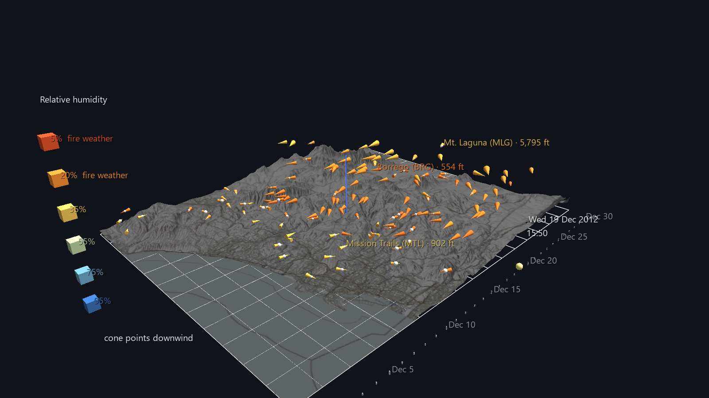

# Santa Ana Wind — San Diego County, December 2012

130 weather stations, every ten minutes for a month, each drawn as a cone that
points downwind over the real terrain of San Diego County.

This is **Phase 0 of the San Diego River Watershed Atlas**: Jeff's own
HPWREN/SDG&E mesonet archive, restored. He built a version of this scene in
ANTz in 2012–2017; this is the same month of data on a renderer that can put
it over the county it was measured in.



## The month has two opposite weeks in it

That is the reason this month was chosen, and the reason to press play rather
than look at a still.

| | Dec 13–18 | Dec 19–21 |
|---|---|---|
| Flow | onshore, off the Pacific | **offshore, out of the desert** |
| Stations pointing inland | 9–34% | **64–67%** |
| Stations below 25% RH | 0% | **30% → 61%** |
| Peak gust | 65 mph | 50 mph |
| Colour of the scene | blue | **red** |

Over roughly twelve hours on 19 December the entire wind field swings around
and the colour collapses from blue to red. Seeing 130 stations do that at once,
across real topography, is the thing a hydrograph or a wind rose cannot show.

Run `build_santa_ana_scene.py --scan` to print the day-by-day table this came
from, straight out of the archive.

## How to read the scene

Each cone is one station.

Each cone is one station, with a small white bead at its pivot.

| Encoding | Variable |
|---|---|
| **Direction it points** | downwind — where the air is *going* |
| **Size** | sustained wind speed, 0 → 40 mph — scaled **uniformly** |
| **Bead at the pivot** | gust factor (gust ÷ sustained) — how rough the air is |
| **Colour** | relative humidity, dry-hot → moist-cool |
| **Height above the terrain** | station elevation, exaggerated 15× |

**The cone holds a fixed 3:1 length-to-base-diameter ratio at every wind
speed** and only changes size. This matters more than it sounds: an earlier
version drove length from speed and width from the gust factor independently,
which at low speed produced short wide cones that read as blobs, and a field of
them lost its direction altogether. Holding the shape constant means a 2 mph
vane points as clearly as a 40 mph one. Gust moved onto the bead, where it no
longer competes with direction.

Colour carries humidity rather than speed on purpose: speed is already the
size, and the variable that makes a Santa Ana legible — and that links this
scene to the fire work later in the Atlas — is how dry the air is. The terrain
imagery is 80% desaturated and darkened at build time so it hands the colour
channel to the data; the last 20% of colour is kept only because a fully grey
OpenTopoMap loses the coastline into the coastal plain.

## The terrain, and why two exaggerations

The county is a real DEM surface, built from free AWS Terrarium elevation tiles
with the terrain map **draped on it as a texture**.

That last part matters for sharpness. A Surface parent can be coloured either
per-vertex or by a texture, and per-vertex caps the picture at one pixel per
lattice point — 11,400 samples of a 2,391-pixel-wide image, with the rest
thrown away. The texture carries the whole image over the same relief, so the
lattice density is chosen for the *landform* and the map stays crisp
regardless. Vertex colours are still written into the file as a fallback for a
scene opened without its `media/` folder.

It is deliberately drawn at **6× vertical exaggeration while the stations sit
at 15×**. One number for both does not work: at 15× the relief turns to spikes
that swallow the wind field, and the mountain stations — the interesting ones
during a Santa Ana — disappear into the mountains they are measuring. At 6× the
landform reads as landform and the wind stays on top of it.

Lower terrain is still not enough on its own, because near the coast a station
and the ground under it both sit at z ≈ 0 whatever the exaggeration. So every
station is **also lifted by a fixed clearance** — one constant for all of them,
which shifts the whole field without touching the relative elevation encoding.

The clearance is not applied blind. A station's height comes from the
gazetteer; the ground under it comes from the DEM; those two disagree, and the
rendered surface is a lattice whose nearest corner can sit above a station
standing in a valley. The generator measures the worst such disagreement across
all 130 stations *against the actual mesh corners* and lifts everything by that
much plus the clearance, then reports both numbers. Measured on the shipped
scene: **no station is at or below the terrain, and the tightest gap is 8.14
world units.**

The bar south of the map is the month, one tick per day with every fifth day
labelled. The yellow bead is the current frame, and **it carries a running
clock** — date above, time of day below — that updates as the animation plays.

Wind direction in the source data is meteorological — the direction the wind
comes *from*. A cone reads as an arrow, so it is pointed the opposite way, at
`(direction + 180) mod 360`.

**The scene at rest is the Santa Ana peak.** Channels are not applied until
playback starts, so whatever is written into the node CSV is what you see
before pressing play — and in every headless render. Rather than leave 130
cones pointing north at a default size, the generator scores every frame in the
month by *offshore flow × dryness* and authors the winner into the file. That
turns out to be **19 December 2012, 15:50**, with 74% of stations blowing
offshore and 79% below 25% RH. Press play to watch the month arrive at it and
leave again.

**Tip:** tags show only on selection by default. Click any station for its
name, abbreviation and elevation; four are pinned permanently for orientation —
the coast, the watershed, the high mountains and the desert.

## Verified, not assumed

Three things were measured against the real engine rather than taken on faith,
because all three are easy to get quietly wrong:

- **Cone aiming.** `GEO_CONE` is built along +Z. A node loaded from CSV with no
  `rotation_mode` column defaults to ANTz's Heading/Tilt/Roll, and under it
  `rotate_x = 90, rotate_y = B` points the apex at compass bearing `B`, dead
  level. Checked across all 130 stations at three frames against an independent
  re-read of the archive: **maximum bearing error 0.0000°, out-of-plane
  component 6.1e-17.**
- **Elevation.** A flat World Grid's `scale_z` does multiply child
  `translate_z`. Mt. Laguna (5,795 ft) sits 54.156 world units above Rancho
  Santa Fe (263 ft) — exactly the 15× exaggeration configured, to 1.3e-5.
- **Terrain registration.** The mesh is a root node, not a grid child, so it
  has to reproduce the grid's own lon/lat mapping to sit under the stations. A
  cone's world position and `world_xy()` of its own lon/lat agree to
  **0.000000 world units**, and the lattice corners land on the plate edges to
  1e-4.
- **Colour.** All 130 stations match the humidity ramp exactly at the Santa Ana
  peak, where 29 stations are below 15% RH.
- **Cone shape.** `scale_z / scale_x` holds at 3.0 across every station and
  frame (to ±0.03%, which is the 3-decimal rounding in the CSV, not drift), and
  **no cone is ever shorter than its base diameter** — shortest length 5.70
  world units against a widest base diameter of 4.98.
- **The clock.** At twelve sampled frames spread across the month, exactly one
  date label and exactly one time label is showing, and both match the frame's
  real timestamp.

## Source data

Jeff's personal archive, read at generation time and **not committed**:

```
<archive>/station_data/dec2012/       4,428 scrape files, ~130 stations each
<archive>/sdge_met_locations.csv      158-station gazetteer
```

The scrape files are headerless but self-describing — every row carries the
station abbreviation, name and lat/lon, so placement needs no lookup. Field
positions and units (°F, mph) are documented in the generator's docstring.
Fields 10–14 are left unidentified rather than guessed at; nothing here uses
them.

Three archive quirks the generator handles, all worth knowing before touching
this data again:

- `sdge_met_locations.csv` is **CR-delimited** and reads as a single line
  unless split explicitly.
- The scrape calls Ranchita **`RCH`**; the gazetteer calls it **`RAN`**.
  Without the alias the station loses its 4,124 ft elevation and drops onto
  the coastal plane.
- Two gazetteer rows carry a **placeholder elevation of exactly 1000 ft**.
  They are used as-is and named in the run report.

The terrain imagery is fetched at build time from OpenTopoMap through
GlyphViz's own basemap module, and the grid's extents window is set to exactly
the bounding box the tiles were rendered for — that registration is what keeps
the stations on their real ground. Elevation comes from **AWS Terrarium**
tiles, also free and key-free, decoded as
`(R × 256 + G + B ÷ 256) − 32768` metres. Each tile is decoded to float
*before* anything is resampled: interpolating the raw RGB would mix the high
and low bytes of neighbouring heights and produce nonsense. Both tile sets
share GlyphViz's own cache directory, so a rebuild re-fetches nothing.

Two details the relief depends on. Heights are **area-averaged over each mesh
cell**, not point-sampled: the lattice is one vertex per ~23 DEM pixels, and
sampling a single pixel per vertex aliased real crags into spikes and lost the
landform between them. And the sea is **flattened to zero before averaging** —
the Pacific bottoms out near −6,700 m in this window, and a cell straddling the
coast would average that against the land and punch a hole through the
shoreline.

## Rebuilding

```
python build_santa_ana_scene.py --scan          # characterise the month
python build_santa_ana_scene.py                 # full build
python build_santa_ana_scene.py --stride 6      # hourly, quick look
python build_santa_ana_scene.py --no-basemap    # skip the tile fetch
python build_santa_ana_scene.py --month may2014 # the 2014 fire-siege month
python build_santa_ana_scene.py --map-colour    # keep the terrain in full colour
python build_santa_ana_scene.py --map-alpha 100 # fade the map further at load
python build_santa_ana_scene.py --no-gust-bead  # cones only
python build_santa_ana_scene.py --no-surface    # flat textured plate, no DEM
python build_santa_ana_scene.py --surface-res 200 --surface-exag 4 --clearance 10
```

`--archive` points at the mesonet root if it is not on `G:`.

Any month in the archive works — it covers **Nov 2012 → Dec 2017** — so
`--month may2014` builds the week the Cocos and Bernardo fires burned, which is
where the Atlas picks this thread up again.

## Files

| File | What |
|---|---|
| `santa_ana_wind_gv_node.csv` | the scene: World row, grid, 11,400-point terrain mesh, 130 cones + 130 beads, timeline, clock, legend — 11,880 nodes |
| `santa_ana_wind_gv_ch-map.csv` | 1,087 tracks |
| `santa_ana_wind_gv_ch-tracks.csv` | 4,428 frames — the whole month at 10-minute resolution |
| `media/01_sdcounty_terrain.png` | OpenTopoMap terrain, registered to the grid extents |
| `build_santa_ana_scene.py` | the generator |

## Known limits

- **Calm is not distinguishable from a dead sensor.** A station stuck at one
  reading draws a valid-looking short cone. The later scrape in this archive
  has at least one station like that; December 2012 was not audited for it.
- A station missing from a scrape **carries its previous reading forward**
  rather than disappearing, so a gap looks like persistence.
- The gust factor is undefined at zero wind and is pinned to 1.0 (thinnest
  cone) below 0.5 mph.
