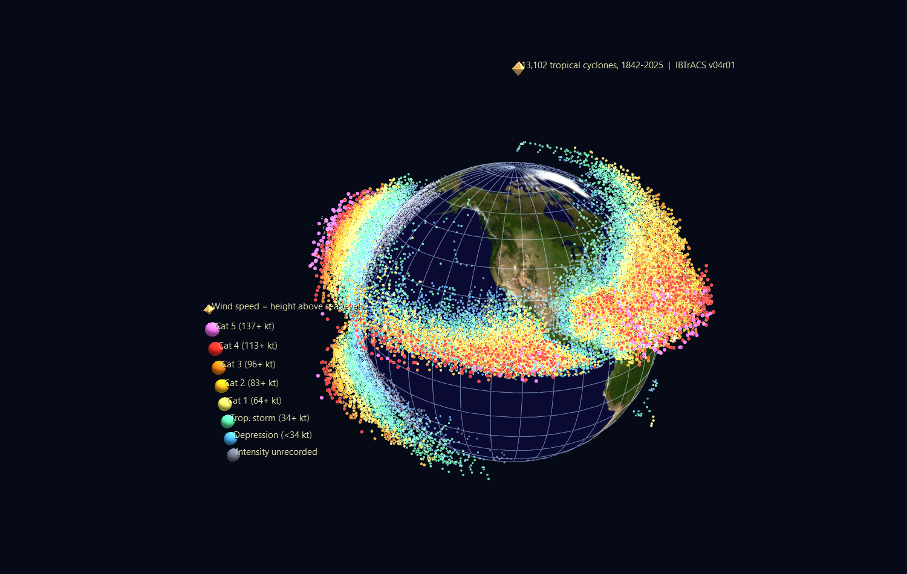
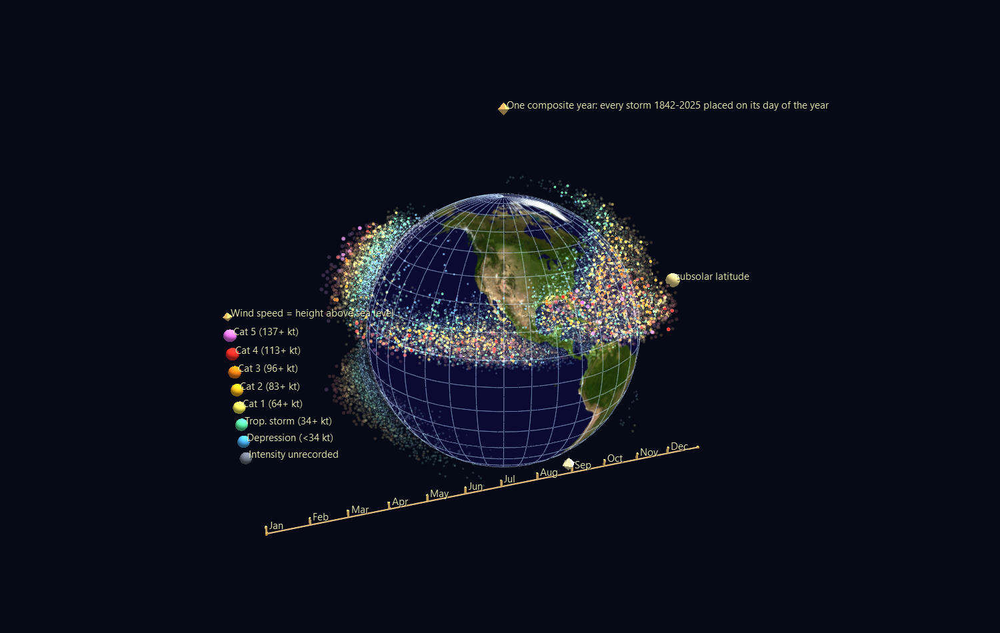
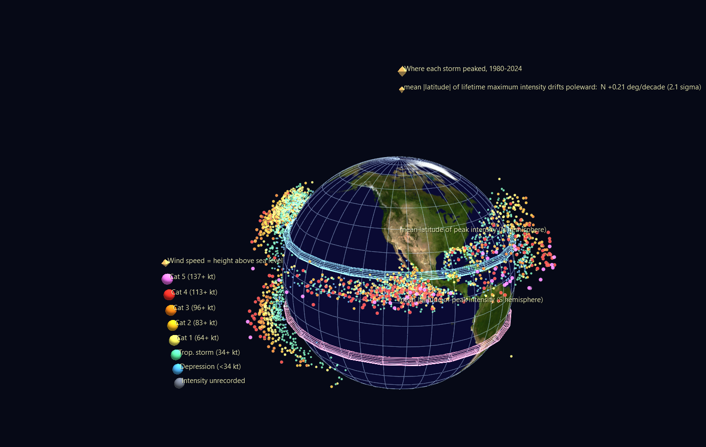

# Tropical Cyclones — 184 years of storms on a World Grid globe

Every tropical cyclone humanity has tracked, from 1842 to 2025, placed on a
Blue-Marble globe by longitude and latitude — with **height above the ocean
standing in for wind speed**, so the tracks stop being lines on a map and
become a relief you can fly through.



Three scenes are built from one dataset, each answering a different question.

---

## The data

**NOAA NCEI IBTrACS v04r01** — the International Best Track Archive for
Climate Stewardship, the World Meteorological Organization's official
consolidation of every regional forecast centre's storm records. Public
domain.

<https://www.ncei.noaa.gov/products/international-best-track-archive>

The full all-basin CSV is ~330 MB, so it is **not** committed here. The
builder downloads it once (`--download`) or reads a local copy
(`--source`), then writes a compact tidy snapshot to
`data/ibtracs_tidy.csv.gz` (3.9 MB) that every later rebuild reads offline.

After tidying: **341,735 synoptic observations across 13,102 storms.**
Only `TRACK_TYPE == "main"` rows are kept (spurs and provisional duplicates
are dropped), and only the 00/06/12/18 UTC synoptic reports, since parts of
the archive are interpolated to 3-hourly and would otherwise weight some
basins more heavily than others.

Wind speed is `WMO_WIND`, falling back to `USA_WIND` where the WMO agency
recorded none.

> **One trap worth naming.** The North Atlantic's basin code in IBTrACS is
> the literal string `NA`, which pandas reads as *missing* under its default
> settings — quietly deleting the most-studied basin in the archive. The
> builder passes `keep_default_na=False` for exactly this reason.

---

## Scene 1 — `Global_Tracks/`

Every storm position ever recorded: **174,545 point glyphs**, one per storm
per 12 hours, as children of a globe World Grid.

| Channel | Encoding |
|---|---|
| longitude / latitude | position on the globe (`translate_x` / `translate_y`) |
| **wind speed** | **elevation above the surface** (`translate_z`, 0.14 world units per knot) |
| wind speed | colour, on the Saffir–Simpson ladder |
| wind speed | glyph size (Point glyphs size from `ratio`, not `scale`) |

The 24 most intense storms carry labels at their moment of peak intensity —
deliberately **not** pinned, because two dozen pinned labels stack into an
unreadable heap over the Pacific. White stars mark them; press **T** to
learn who they were.

### What to look for

- **Two ridges and a hollow equator.** Just 0.43% of all 341,735
  observations fall within 5° of the equator, and 0.02% within 2°, because
  the Coriolis force vanishes there and a storm has nothing to spin it up.
  The gap is not an artifact — it is a law of physics drawn in negative
  space.
- **The empty South Atlantic.** One basin on Earth essentially never
  produces tropical cyclones: **61** South Atlantic observations in this
  dataset against **115,437** in the West Pacific. Wind shear and cool water
  suppress them.
- **Storms rise and fall along their own tracks.** A track climbs as the
  storm intensifies over warm water and sinks back as it recurves poleward
  into cooler seas — visible per-storm, not just in aggregate.
- **The grey mat underneath.** Storms whose intensity was never recorded lie
  flat and grey. They are almost entirely 19th- and early 20th-century
  storms, so the shape of the archive itself — where and when humanity was
  watching — is part of the picture.

---

## Scene 2 — `Seasonal_Pulse/`



The same globe, animated over **one composite calendar year**: all 184 years
of storms collapsed onto day-of-year. Each track point lights on its own day
and decays over the following fortnight; the decay is *circular*, so the
loop has no seam at New Year.

- 366 frames, one per day. One channel per day-of-year drives `color_a` —
  the compression pattern from `channels-animation.md`, so 91,164 glyphs
  need only 368 channels.
- A **subsolar-latitude marker** rides the same clock, tracking the sun
  between the tropics. It ties the pulse to its cause rather than leaving
  the seasonality as an unexplained rhythm.
- A calendar bar with month ticks and a spinning cursor runs below the globe.

Press **Space**. The two hemispheres breathe in antiphase; the basins switch
on in sequence (West Pacific first and longest, North Atlantic sharply
peaked in September); and the equator and South Atlantic stay dark all year.

---

## Scene 3 — `Poleward_Drift/`



One glyph per storm, at its point of **lifetime maximum intensity** — where
it was at its strongest — animated by season, with two rings marking the
running mean |LMI latitude| in each hemisphere.

### The measurement

Over the satellite era, the latitude at which tropical cyclones reach peak
intensity has been moving away from the equator. This build measures, over
**1980–2024** (4,479 storms):

| Hemisphere | Trend in mean \|LMI latitude\| | Significance |
|---|---|---|
| Northern | **+0.21°/decade** | 2.1σ |
| Southern | **+0.22°/decade** | 2.2σ |

Both hemispheres move the same way at nearly the same rate, which is the
sort of agreement that makes a result harder to dismiss as one basin's
bookkeeping. The direction matches the published finding of Kossin, Emanuel
& Vecchi (2014), *Nature* **509**, 349–352.

### Read the caveats before quoting the number

- **The window is doing real work.** Run the identical regression back to
  1950 and the northern trend *flips* to −0.16°/decade. Before geostationary
  satellite coverage the archive simply missed storms, and missed them
  unevenly by latitude, so a longer window measures the growth of the
  observing system rather than the behaviour of the atmosphere. Storms per
  season with a usable intensity peak: 41 (1950) → 74 (1970) → ~100 (1990
  onward). 1980 is where the builder starts, and `DRIFT_FIRST_SEASON` is one
  constant if you want to test that choice yourself.
- **Restricting Kossin's exact 1982–2012 window** gives +0.37 (N) and +0.31
  (S) °/decade here — same sign, larger magnitude, still short of their
  published figures, which used a different LMI dataset and method. Treat
  this as a replication of the *direction*, not of the coefficient.
- **2.1σ is suggestive, not settled.** A 45-year record of a noisy annual
  mean does not support a stronger claim than that.
- A trailing partial season is dropped automatically, so an in-progress year
  cannot drag the endpoint of the fit.

---

## Rebuilding

```bash
# first time: fetch the archive (~330 MB) and build all three scenes
python build_cyclone_scenes.py --download

# or tidy a copy you already have
python build_cyclone_scenes.py --source /path/to/ibtracs.ALL.list.v04r01.csv

# afterwards: rebuild offline from data/ibtracs_tidy.csv.gz
python build_cyclone_scenes.py
python build_cyclone_scenes.py --only Seasonal_Pulse
```

Every scene is validated before it is written — ids, parentage, link
targets, colour ranges, the 0.2 render-scale floor, globe extents, and the
three-way Channels join (node `ch_input_id` → map `channel_id` → tracks
`ch<id>` column, with attribute names checked against the bindable set).

## Verifying

`verify_scenes.py` re-opens the built scenes through the **real** GlyphViz
loader, transform engine and `ChannelEngine` — no OpenGL context required —
and checks that:

- each scene has exactly one World Grid and it resolves as a globe;
- every storm lands at the radius its elevation implies and at the lon/lat
  the data says (max error ~1e-14 world units);
- the channel join resolves, the animation actually changes state between
  frames, alpha stays in range, and no animated scale falls below the render
  floor.

```bash
python verify_scenes.py
```

## Files

```
build_cyclone_scenes.py          generator (fetch → tidy → three scenes)
verify_scenes.py                 post-build checks through the real engine
data/ibtracs_tidy.csv.gz         tidied snapshot, 341,735 rows
Global_Tracks.zip                174,581 nodes, static          (3.0 MB)
Seasonal_Pulse.zip               91,192 nodes, 366 frames       (2.6 MB)
Poleward_Drift/                  4,494 nodes, 85 frames
*/media/01_bluemarble.png        NASA Blue Marble equirectangular texture
```

**The two big scenes ship zipped**, following the same convention as
`Global_Terrorism_Example` — 42 MB of CSV compresses to 5.6 MB, and the
unzipped working copies are gitignored. You do not need to unpack them by
hand: **drag a zip onto the GlyphViz window** and it extracts beside itself
and loads. Or unzip in place, or rebuild from the snapshot with
`python build_cyclone_scenes.py`.

`Poleward_Drift/` is small enough to live unzipped. Each scene folder is
self-contained: open its `*_gv_node.csv` and the `media/` folder and channel
files beside it load automatically.
