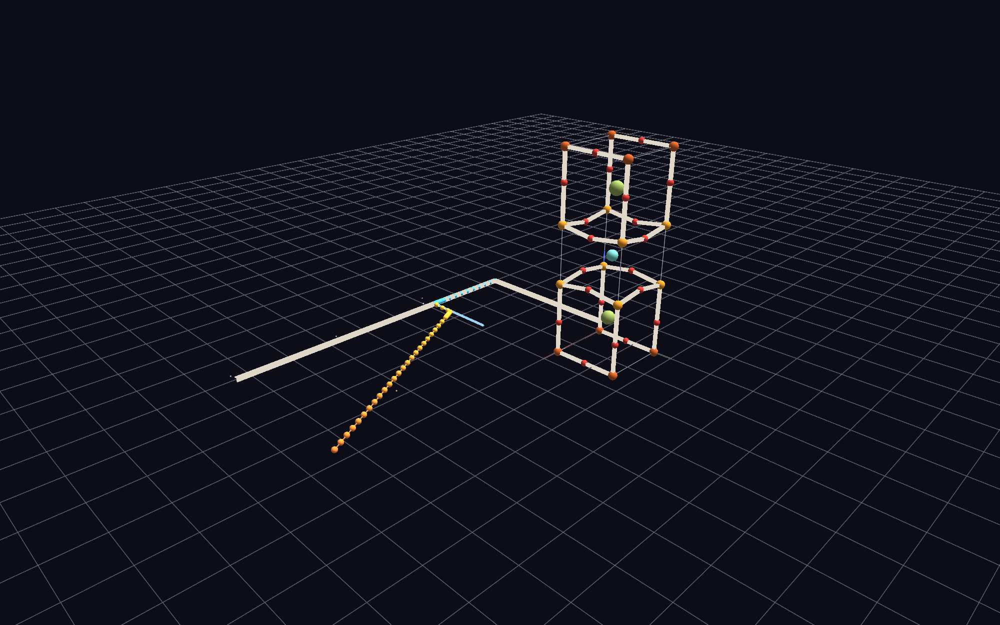

# YBa2Cu3O7 (YBCO) — GlyphViz's first crystallography exemplar

The 1987 "liquid-nitrogen superconductor" (Tc ≈ 92 K, orthorhombic Pmmm,
space group #47) as a materials-science storytelling scene: crystal
structure, a resistivity-vs-temperature property plot, literature links,
and a Channels animation that ties the structure's symmetry directly to
the physics — all in one glyph scene, not a dedicated crystal-structure
viewer.



This is deliberately **not** a general `.cif` importer or a symmetry
engine: it hand-builds one real, well-documented structure to test
whether the format itself — structure + property + citations + animation
in one navigable scene — is worth building general crystallography
infrastructure around. See the project owner's notes before generalizing
this into anything broader.

## The scene

One conventional unit cell, drawn textbook-style — a full atom at every
symmetry-equivalent corner/edge site, matching how every published YBCO
structure figure presents it. Layer stack along *c* (the classic "1-2-3"
perovskite order):

```
CuO chain (Cu1 + O1)      z=0
BaO                        z~0.184
CuO2 plane (Cu2+O2+O3)     z~0.378
Y                          z=0.5
CuO2 plane                z~0.622
BaO                        z~0.816
CuO chain                  z=1  (next cell's layer, drawn to close the box)
```

Cu-O nearest-neighbor bonds (chain, apical, in-plane — the network that
actually matters physically) are drawn as textured `GEO_LINE_PRISM`
tubes; chain-copper and plane-copper get distinct colors so the two
structural roles read at a glance. Ba and Y are left unbonded (highly
ionic, many-coordinate, not part of the conduction-relevant network).

Lattice parameters and fractional coordinates are representative
published values (Jorgensen et al., *Phys. Rev. B* 41, 1863 (1990)),
cross-checked against the [Materials Project entry](https://legacy.materialsproject.org/materials/mp-20674/)
and the original [Nature structure paper](https://www.nature.com/articles/328606a0) —
not digitized from one single source, and rounded for a clean
illustrative model rather than a research-grade refinement.

Beside the structure, a `TOPO_PLOT` polyline shows illustrative
ρ_ab(T): T-linear "strange metal" normal-state resistivity (the real,
noteworthy anomaly — ordinary metals go as T², YBCO's ab-plane
resistivity is famously linear) dropping sharply to exactly zero at Tc.

## The oxygen-content Channels animation

Press **Space**. A 240-frame loop sweeps the oxygen-deficiency parameter
δ in YBa2Cu3O(7−δ) between δ=0 (the structure above: fully oxygenated,
orthorhombic, Tc≈92.5 K) and δ=1 (fully reduced: tetragonal, *a*=*b*,
**non-superconducting**) — the structural symmetry change that *is* the
mechanism turning superconductivity on:

- **Chain-oxygen (O1) occupancy** fades to a dim "vacancy ghost" exactly
  as (1−δ) — real stoichiometry, not an illustrative assumption — and
  their Cu1–O1 bonds fade in sync.
- **The lattice itself distorts**: *a* and *b* interpolate toward a
  shared tetragonal value as δ→1, so the unit cell visibly squares up as
  the chains empty out.
- **A marker slides along the resistivity plot's temperature axis** to
  Tc(δ), using an illustrative curve that captures the well-documented
  qualitative shape (non-superconducting until δ≈0.65, the famous
  "60 K plateau," then a final rise to ~92 K). The static ρ(T) curve
  itself always stays the δ=0 reference case.

A stopped/reset scene is pixel-identical to the static structure above —
every node's authored CSV values equal δ=0.

**What it teaches:** a single `ch_input_id` can bundle *multiple*
(track, attribute) bindings at once (`glyphviz_core/channel_engine.py`'s
ch-map is `{channel_id: [(track_id, attribute), ...]}`), which let ~39
atoms collapse onto just 8 shared position/alpha tracks instead of one
channel per atom — the same channel-sharing compression pattern as
[`SD_Seismicity_Example`](../SD_Seismicity_Example/), applied to atomic
positions instead of event timestamps. It also relies on Link edges
always being drawn from their endpoints' *live* world positions each
frame, so animating the atoms drags every bond along for free — bonds
never need their own position channel, only color.

## Files

- `build_ybco_scene.py` — the whole pipeline (structure + plot + channels
  + validation)
- `ybco_gv_node.csv` — the generated scene (177 rows)
- `ybco_gv_ch-map.csv` / `ybco_gv_ch-tracks.csv` — the oxygen-content
  Channels pair (23 bindings; 240 frames × 8 tracks); auto-load with the
  node CSV

## Running

```
pip install pandas
python build_ybco_scene.py                 # writes ybco_gv_node.csv here
python build_ybco_scene.py --out PATH.csv   # custom output path
```

Then GlyphViz → File > Open → `ybco_gv_node.csv`. The channel files
auto-load; Space plays the oxygen-content sweep.

## In-app notes

- **Space** plays/pauses the oxygen-content animation; **Shift+Space**
  stops and restores the static (δ=0) scene.
- **T** toggles labels — each distinct atomic site (Y, Ba, Cu(1), Cu(2),
  O(1)-O(4)) is labeled once; **U** on the Y atom or the unit-cell box
  opens the linked reference.
- Cu(1) (chain copper) and Cu(2) (CuO2-plane copper) are colored
  differently on purpose — that distinction is the physically important
  one, not decoration.

## Caveats (stated up front, not discovered later)

This is an illustrative model, not a research-grade refinement or a
digitization of any single dataset:

- The resistivity curve's absolute values and 2 K transition width
  (real single crystals are often <1 K) are representative, chosen for
  legibility at this plot's scale.
- The Tc(δ) curve and the a/b lattice-parameter interpolation capture
  the well-known *qualitative* shape, not a specific published dataset;
  the real orthorhombic-tetragonal transition is sharper (more
  first-order-like) near δ≈0.6-0.65, and the real structure's c-axis
  also shifts slightly with δ (omitted here for clarity).
- O2/O3 (in-plane oxygens) share one nominal z per layer; their real
  ~0.02 buckling is below this model's illustrative resolution.
