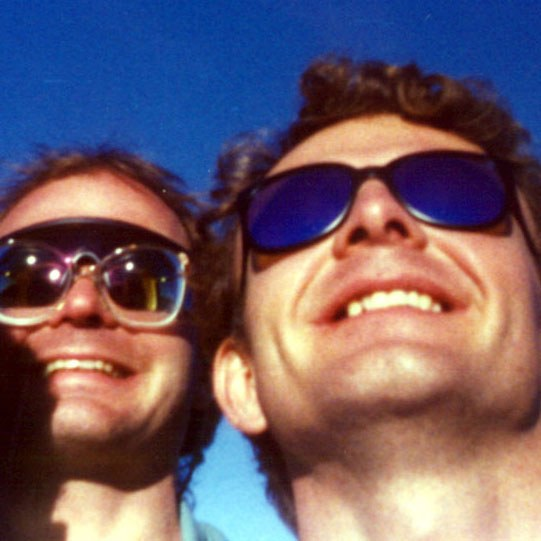
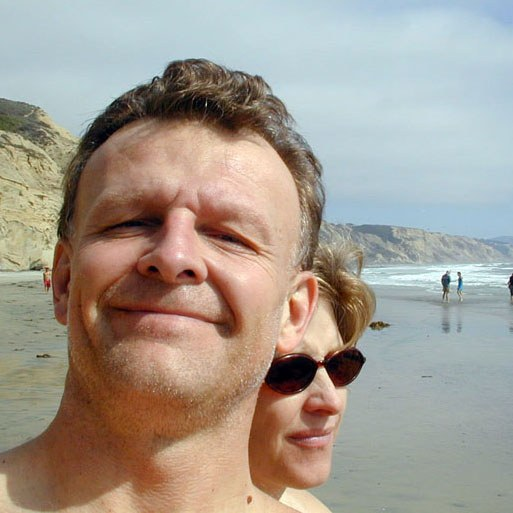

# About

## Jeff Sale

<figure class="gv-photo" markdown>

<figcaption>Jeff, out in Yellowstone with a camera around his neck — one of the "all things 3D, and above all else, life-long learning" habits that never switched off after retirement.</figcaption>
</figure>

Jeff has championed the ANTz visualization tool since its creation in 2011, but his data visualization work started two decades earlier — in 1990, at Loma Linda University Medical Center's Department of Neurology, as a staff researcher on the newly-formed Neurology Research Team (NRT) with Dr. Dave Warner, Steve Price, and Jodi Reed (Jeff's better half), under the tutelage of Dr. Doug Will, who would go on to become Dean of the School of Medicine. The lab's own line was that NRT was "pronounced *nert*, as opposed to *inert*."

It was in the NRT lab that Jeff cut his teeth on the AVS visualization tool and immediately conceived of a genius idea called spatiotemporal isosurfaces. Long story short: he went on to pioneer new visualization methods while simultaneously developing online, technology-based instructional resources for a broad community of science educators and their students.

Now Jeff sees an opportunity with AI to take those resources to the next level — no, ten levels up, no, *infinity* levels up.

> The world has never seen anything like GlyphViz before, nor ANTz before it, and even though it may not know it, the world is ready for it. Let's Go!

## Getting here

Jeff grew up in the northern Midwest, southern Ontario, and Chicago, and went to college at the University of Minnesota hoping to become a professional hockey player. Those dreams didn't pan out and his classwork floundered — but he met life-long friends who inspired him to keep going. He came back to San Diego and tried again. San Diego Mesa Community College saved his academic career, and he went on to a B.S. in Physics from SDSU and later a Master's in Learning Design and Technology, also from SDSU — one of the best ed-tech programs in the country.

Jeff was then recruited by Dr. Kris Stewart to help run the Education Center on Computational Science and Engineering. That was his first step into the world of HPC, and he's never looked back. His heart was in education, outreach, and training with a particular focus on K–12, but as funding dried up he leveraged his visualization skills into a consulting position with XSEDE.

Jeff is retired now — and with time on his hands and AI reaching a critical mass of capabilities, he felt it was time to step up, show what he is capable of, and share the vision originally conceived by Dave Warner and Shane Saxon.

## Research background

Jeff's B.S. in Physics from San Diego State University carried an emphasis in condensed matter. After graduation he did two years of graduate research in neurophysiology at Loma Linda University, working as a research assistant at the Parkinson's Research Center, Jerry L. Pettis Veterans Affairs Medical Center, under Dr. Jeff Tosk in the research wing of Dr. Ross Adey. His research focused on the biophysical basis of Parkinson's Disease and related movement disorders: *in vitro* cell culture work with dopaminergic neurons, HPLC measurement of dose-response to amphetamine, photoacoustic spectroscopy of the optical absorption properties of neuromelanin, and chemiluminescent studies of oxidative burst in J774 macrophage cells as a model for microglial cell death.

<figure class="gv-photo gv-photo--left" markdown>

<figcaption>Jeff with Dr. Dave Warner, on a helicopter pad. The two have been working on the same idea — data you can move through rather than look at — since the Neurology Research Team days.</figcaption>
</figure>

In parallel, Jeff supported clinical neuroscience research under Dr. A. Douglas Will and alongside Dr. Dave Warner at Loma Linda University Medical Center's Neurology Research Center. There he helped pioneer new ways of applying virtual reality technologies and data visualization techniques in the clinical setting:

- Quantitative assessment of movement disorders — Parkinson's Disease, Huntington's Disease, ALS
- Physical rehabilitation — augmentative communication, environmental control
- Electrophysiological measurement and analysis of bioelectromagnetic data — EEG, ECG, EMG, MEG

The NRT lab was the focus of numerous news reports, and was included in the first SAMS publication on Virtual Reality in 1993.

At the same time, Jeff was Co-Director of a medical education computer-based learning center, collaborating with physician-mentors on a wide range of medical education courseware projects as a member of the IMED medical education consortium. That experience led to a change in career direction.

## Teaching, ed tech, and supercomputing

- **Multimedia consultant, SDSU College of Sciences** — helped faculty with web-based course delivery and smart-classroom presentation through workshops and online instructional materials.
- **Supervisor, SDSU Education Center on Computational Science and Engineering** (five years) — directed work incorporating high-performance computing, modeling, simulation, visualization, and data-intensive computing into the undergraduate curriculum.
- **Part-time instructor, Cuyamaca College** — Flash Web Animation (GD222), CSS/XHTML (CIS211), JavaScript (CIS215), and PHP/MySQL Dynamic Web Apps (CIS219).
- **Learning Design Technologist and Data Visualization Consultant, San Diego Supercomputer Center, UC San Diego** — the last 15 years of his career, promoting the use of cyberinfrastructure across the K–12 and undergraduate education community through workshops, training, and curriculum development with a talented group of co-workers and educators.

Jeff's Master's Degree in Learning Design and Technology comes from the SDSU Online Education Technology Master's Program, and he has extensive experience in courseware development with an emphasis on challenging concepts in science. He has published and presented work on visualization of electrophysiological data, virtual reality technologies applied to neurorehabilitation, distributed medical intelligence, and instructional design of CD-ROM video-based case studies for pre-service math and science teachers. His CV is available on request.

## Away from the screen

<figure class="gv-photo" markdown>

<figcaption>Jeff and his wife, Jodi Reed, at Torrey Pines. Jodi was on the original Neurology Research Team with him in 1990.</figcaption>
</figure>

Jeff enjoys hiking, biking (road and mountain), all kinds of art, gardening and composting, all things 3D, and above all else, life-long learning.

## Connect

- [Connect with Jeff on LinkedIn](https://www.linkedin.com/in/jeff-sale-26961a7/)
