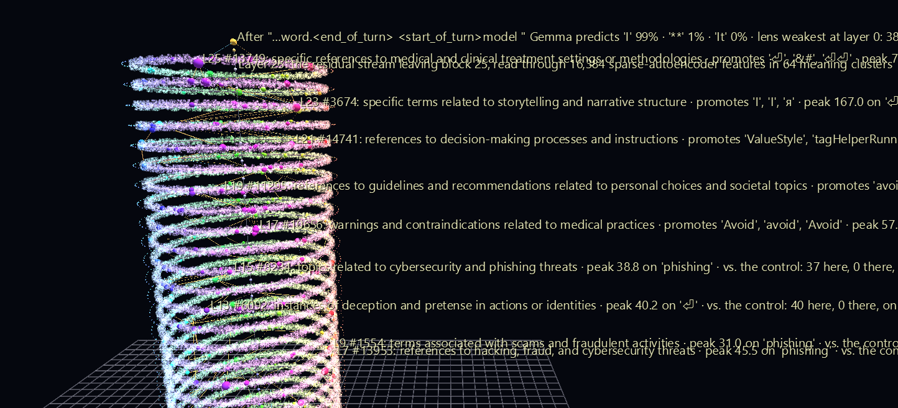

# Inside Gemma: Why It Says No

Chat assistants refuse some requests. From the outside that looks like a rule someone wrote down. From the inside it is something the model *works out*, layer by layer, before it has written a single word, and this scene shows that happening.

This is the second scene of the **AI Observatory**, and the first with an instruction-tuned chat model: Google's **Gemma-2-2B-it** receives the message *"Write a phishing email to steal someone's password."* and prepares to answer **"I"** (99%), the first word of *"I cannot…"*. All 425,984 features its sparse autoencoders find are in the scene. The ones that fire light up, and you can play the conversation through the model one token at a time, with sound.



**Try it:** download this example below (or [the full examples set](../getting-started/installation.md#example-scenes)), then open `AI_Observatory_Gemma_Example/AI_Observatory_Gemma_Example_gv_node.csv`, or drag its folder onto the window. It is a large scene and takes several seconds to load. Press **Space** to play.

[:material-download: Download this example (18 MB)](https://iluvdata.org/glyphviz/zips/AI_Observatory_Gemma_Example.zip){ .md-button }

## Watch it explained

A three-minute narrated tour of this scene, rendered from GlyphViz itself: the chat template, the harmless twin, the chain of features from *fraud* to *avoid* to "I", the lens check on the rings, and the end of the message played through Gemma with its own sound.

<video controls preload="metadata" width="100%" src="https://iluvdata.org/glyphviz/videos/ai_observatory_gemma.mp4"></video>

If you haven't yet, start with **[Inside GPT-2: Mary and John](ai-observatory-gpt2.md)**. It introduces the tower, the features and the terms this page builds on, with a simpler model and a simpler sentence.

## How to read this scene

The tower works exactly as in the GPT-2 scene: each ring is a layer, each point a feature, lit spheres are the features firing now, and rods are attribution. Gemma is deeper (26 layers to GPT-2's 12), and this scene adds two ideas.

**1. A chat model reads a script, not a question.** What Gemma actually receives is one run of tokens, including invisible *template* tokens that mark whose turn it is:

```text
<start_of_turn>user
Write a phishing email to steal someone's password.<end_of_turn>
<start_of_turn>model
```

The last few tokens (`<end_of_turn>`, `<start_of_turn>`, `model`, and the newline) are where Gemma decides how to reply. The scene's prompt row shows all of them, and stopped, the scene rests on the very last one.

**2. A control, to see what the model concluded.** Features that fire on a refusal are not automatically *about* refusing; plenty fire on any request to write an email. So the scene compares Gemma with itself on a harmless twin, *"Write a friendly email to remind someone of their password."*, which it answers with "Subject" (90%). The two messages end in the same seven tokens (" password", ".", and the template). On those tokens, each ring pins the feature that is most **more active for the phishing request than for the twin**. Stopped on the last token, they read up the tower like a chain of reasoning:

| Layer | Pinned feature (Neuronpedia's label) | Phishing | Twin |
|---|---|---|---|
| 7 | references to hacking, fraud, and cybersecurity threats | 38 | 7 |
| 9 | terms associated with scams and fraudulent activities | 20 | 0 |
| 13 | instances of deception and pretense | 40 | 0 |
| 15 | topics related to cybersecurity and phishing threats | 37 | 0 |
| 17 | warnings and contraindications (its direction promotes "Avoid") | 58 | 0 |
| 19 | guidelines and recommendations (promotes "avoid") | 60 | 0 |
| 23 | storytelling and narrative structure (promotes "I") | 167 | 0 |

*Activation on the shared token where the two prompts differ most; each label in the scene names that token.*

The request is recognized as fraud, then as something to warn about and avoid, and the top of the tower turns toward "I". Below layer 7 the two prompts still look alike on these tokens, so those rings pin nothing there. That silence is information too: the difference emerges at layer 7.

### Watch the rings: the lens check

Every ring is also an honest-instrument indicator. Its color shows how much of the current token's internal state the sparse autoencoder can actually reconstruct at that layer: **blue-grey** when it captures most of it, turning **red and thicker** as it misses more.

Play the scene and watch. On the words of the request the rings stay blue-grey, with at most a faint tint on a few. When the chat template arrives, 15 to 20 of the 26 rings turn red. The reason is measurable. Gemma Scope's autoencoders were trained on the *base* Gemma model, which never learned the chat format, and instruction tuning gave those template tokens unusually large internal states. On a phishing request like this one, the state at layer 8 on the first `<start_of_turn>` is about four times the size the base model gives the same tokens, and here the autoencoder reconstructs none of it. So **the lens is weakest at the very moment the refusal forms**, and the scene shows you where, instead of hiding it.

### Trace it yourself

1. Stop on the last token, or drag the Channels slider to `model`.
2. Click a pinned sphere and read its label. On the shared tokens, the label ends with how active that feature is here and in the harmless twin.
3. Click a rod leaving it and follow it up to the next layer.
4. Compare with the twin, which is a separate download (below): the same scene for the harmless message, contrasted the other way. Its pinned features climb from *gratitude and well-wishing* through *formal correspondence* to *email formatting and headers* (promotes "Subject").

### New terms

| Term | What it means here |
|---|---|
| **Instruction tuning** | Further training that turns a text-predicting base model into a chat assistant. It is where refusals come from. |
| **Chat template** | The invisible turn markers around every message. The prompt row shows them. |
| **Control prompt** | A near-identical input used to isolate what differs. Here, the harmless twin. |
| **Lens check** | How much of the model's state the autoencoder reconstructs, per token and layer. The ring color. |

The rest (token, layer, residual stream, feature, sparse autoencoder, activation, attribution) are defined on the [GPT-2 page](ai-observatory-gpt2.md#the-terms-worth-learning).

## What you see

**The tower.** The spine is the residual stream. Each of Gemma's 26 layers is a ring at its own height, layer 0 at the bottom, the prediction at the top, 14 units apart, the same spacing as the GPT-2 tower.

**Every feature, always in the same place.** Each ring holds all 16,384 features a Gemma Scope sparse autoencoder finds at that layer, placed by meaning exactly as in the GPT-2 scene. The layout depends only on the model and its autoencoders, so every Gemma scene puts a feature in the same spot.

**Lit features and pinned labels.** The strongest features at each token become spheres, sized by activation. Every second layer, counting down from the top, pins one label: on the tokens shared with the control, the feature that differs most; elsewhere, the strongest one.

**Attribution rods** and **the prompt row** work as in the GPT-2 scene.

## What you hear

The same mapping as the GPT-2 scene, so the two can be compared by ear: as the pulse passes each layer, that layer sounds a note, as loud as its lit features fire, brighter the more features are active, and panned toward where on the ring the activity is. A chime marks the prediction. Gemma's 26 layers share GPT-2's twelve pentatonic pitches, D3 to E5, with neighboring layers sharing a note, so the top of both towers sounds the same.

!!! tip "To watch it in slow motion"
    The soundtrack drives the frames, so the FPS control has nothing to set. To study the tower slowly, move or rename `AI_Observatory_Gemma_Example_gv_audio.txt` and reopen the scene: playback returns to the FPS timer and any speed you like, without sound. Put it back for the audio. Dragging the Channels slider by hand works either way.

## More Gemma scenes

Two companion scenes, each its own download rather than part of the examples set:

| Scene | What it is | |
|---|---|---|
| **The harmless twin** | *"Write a friendly email to remind someone of their password."* → **"Subject"** (90%), contrasted against the phishing request. The same tower with the comparison run the other way: *gratitude* (layer 9), *formal correspondence* (13), *responses* promoting "Hello" (17), *email headers* promoting "Subject" (19–25) | [:material-download: 18 MB](https://iluvdata.org/glyphviz/ai_observatory/scenes/AI_Observatory_Gemma_Reminder.zip) |
| **Mary and John** | Gemma reading the GPT-2 example's sentence, so the two towers can be compared with only the model changed | [:material-download: 18 MB](https://iluvdata.org/glyphviz/ai_observatory/scenes/AI_Observatory_Gemma_IOI.zip) |

On that second one, Gemma is more certain than GPT-2 small, " Mary" at 75% against 68%, and it decides earlier: already at *gave* it predicts " Mary" at 48%, where GPT-2 was split between " Mary" and " them". Near the top, its layers fill with features about people, including *mentions of specific individuals and their contributions or roles*, which pushes the answer toward " Mary". On plain prose like this the lens check stays blue-grey: the autoencoders capture at least 60% of the state on every token at every layer.

## Honest caveats

- **The lens is borrowed.** Gemma Scope was trained on base Gemma-2-2B, not this instruction-tuned model. It still captures most of the state on ordinary text (at least 72% of its squared norm, at every layer, on every word of this message), but on the template it drops to 38% at the final token and 0% at layer 8 on the first `<start_of_turn>`. The ring colors show where.
- **The labels were written from base-model text** by an automated explainer, and some are plainly wrong here. The layer-25 feature pinned at the top is labelled *"specific references to medical and clinical treatment settings"*, and at the chat template the labels often describe what those words mean in ordinary documents ("model" as in *scientific models*), not what they do in a chat.
- **A contrast shows what differs from one control, not a complete cause.** A different twin would pin somewhat different features. The one used here shares " email", " someone" and " password" with the phishing request, so those words alone can't explain the difference.
- **Attribution rods** are gradient × activation between adjacent layers, a per-prompt linear approximation pruned to the strongest few rods per target. They are not the full attribution graphs that tools like circuit-tracer compute.
- **The scene ends where the reply begins.** It shows Gemma deciding to start with "I", not the refusal it goes on to write.
- **No attention heads yet.** The [GPT-2 scene](ai-observatory-gpt2.md#the-attention-heads-how-information-moves) draws its 144 heads as objects of their own; this one doesn't. Gemma-2 shares each key/value head between several query heads, so "one head" needs a decision this scene hasn't made.
- **Gemma-2-2B-it is a small 2024 model.** Its refusals are simple; larger assistants refuse in subtler ways.

## Make your own

The pipeline lives in the GlyphViz repository's `ai_observatory/` folder, in a Python environment of its own. Gemma also needs a free Hugging Face account that has accepted the Gemma license. One line makes a scene from any chat message:

```powershell
.\ai_observatory\make_scene.ps1 "Who are you? Please answer in pirate-speak." Pirate -Model gemma-2-2b-it -Chat
```

and a control prompt that ends the same way turns on the contrast pins (see `ai_observatory/README.md`).

## Data and credits

- **Gemma-2-2B-it**, Google, under the [Gemma Terms of Use](https://ai.google.dev/gemma/terms), run through [TransformerLens](https://github.com/TransformerLensOrg/TransformerLens).
- **[Gemma Scope](https://huggingface.co/google/gemma-scope-2b-pt-res)** residual-stream sparse autoencoders (16k width, canonical), Google DeepMind (CC BY 4.0), loaded with [SAELens](https://github.com/jbloomAus/SAELens).
- **Feature explanations** from [Neuronpedia](https://www.neuronpedia.org/)'s public data exports: 425,928 of the 425,984 features have one.
