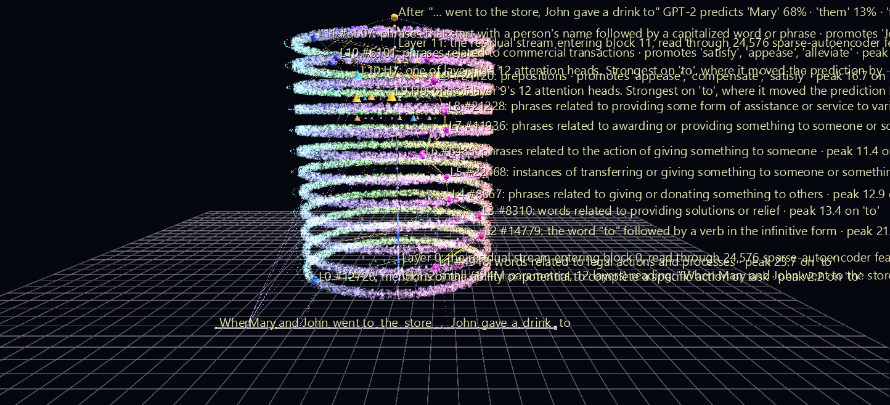

# Inside GPT-2: Mary and John

Much of the worry about AI comes down to one fact: these systems are enormous, and even the people who build them cannot easily see what happens inside. Interpretability research is starting to change that. It pulls out **features** — directions inside a model that track a concept — by the hundreds of thousands. But the results usually arrive as long lists and flat plots, which is a poor fit for something that is layered, high-dimensional, and changes word by word.

This is the first scene of the **AI Observatory**: GPT-2 small reading one sentence — *"When Mary and John went to the store, John gave a drink to"* — and deciding the next word is **" Mary"** (68%). Every one of the 294,912 features its sparse autoencoders find is in the scene, the ones that fire light up, and you can play the sentence through the model one token at a time, with sound.



**Try it:** download this example below (or [the full examples set](../getting-started/installation.md#example-scenes)), then open `AI_Observatory_GPT2_Example/AI_Observatory_GPT2_Example_gv_node.csv` — or drag its folder onto the window. It is a large scene and takes a few seconds to load. Press **Space** to play.

[:material-download: Download this example (12 MB)](https://iluvdata.org/glyphviz/zips/AI_Observatory_GPT2_Example.zip){ .md-button }

## How to read this scene

You don't need a background in machine learning to follow this scene, but it does use a handful of new terms, and they are worth learning. Here is the whole idea in one paragraph:

> GPT-2 doesn't store words. It stores *concepts*, thousands of them overlapping in the same numbers, and it revises which ones are active as it reads each word. This scene breaks that hidden state into named concepts and shows which ones light up, in what order, and which ones caused which, one word at a time.

Two ways to picture it, depending on who you are showing it to:

**As a spectrograph** (for scientists). At every layer, GPT-2's working memory is a single list of 768 numbers in which many meanings are *superposed*; there is no single neuron for "giving" or for "a person's name". A sparse autoencoder works like an assay: it separates that mixture into components drawn from a fixed dictionary of 24,576 candidate concepts, of which only a few dozen are present at any moment. Each ring is one such decomposition, and playing the animation runs the assay again for every word. You are watching a *time series of spectra, twelve stages deep*, as meaning is refined from the identity of the word at the bottom to a prediction at the top. The rods are the attribution: an estimate of how much each component at one stage drove a component at the next. Like any assay, this one has a recovery rate (see the caveats below).

**As a twelve-station assembly line** (for a live demo). A sentence enters at the bottom and moves up through twelve stations. Each station reads everything written so far on a shared workpiece (the spine, called the *residual stream*) and adds its own notes before passing it up. The lit spheres are those notes, made readable. At layer 3 the model has noted *words related to providing solutions or relief*; by layer 6 that has sharpened into *the action of giving something to someone*; by layer 11 it is tracking *phrases that start with a person's name*. The rods are the handoffs. A rod whose label says it is *reaching back through attention* is the model going back to fetch a word from earlier in the sentence. The cycle repeats once per word, about a second each, and the glyph at the top announces what GPT-2 would say next and how sure it is: " Mary", 68%.

### Trace a circuit yourself

Interpretability researchers call this *tracing a circuit*, and GlyphViz lets you do it by hand:

1. Drag the Channels slider to a token, or stop on the last one, *to*.
2. Zoom in on a ring and click a large lit sphere. Read its label: what the feature is thought to mean, and the word it fired hardest on.
3. Click a rod leaving that sphere and read its label: how much it contributed, and whether it reaches back to an earlier word.
4. Follow the rod up to the sphere it feeds on the next layer, and repeat until you reach the prediction.

### The terms worth learning

| Term | What it means here |
|---|---|
| **Token** | The unit the model reads: roughly a word, sometimes a piece of one (" Dursley" is " D" + "urs" + "ley"). One cube in the prompt row. |
| **Layer** | One of GPT-2's 12 processing stages. One ring. |
| **Residual stream** | The shared running state every layer reads from and writes back to. The spine. |
| **Superposition** | Many concepts encoded in the same numbers at once. It is why you can't simply look at one neuron. |
| **Feature** | One concept in the learned dictionary. Every point on a ring is a feature: all 24,576 of that layer's, in the same place in every scene the Observatory makes. |
| **Cluster** | A group of features with similar directions. The small markers just outside each ring. |
| **Sparse autoencoder (SAE)** | The method that learns the dictionary and splits the state into a few active features. |
| **Activation** | How strongly a feature is present right now. Sphere size. |
| **Attribution** | An estimate of how much one feature caused another. The rods. |

Two caveats are worth saying out loud before anyone asks: the dictionary is a *lens*, not the model (it misses part of what the model does, more at the top than the bottom), and the feature labels are *machine-written guesses*. Click a few and judge them for yourself. The full list is under [Honest caveats](#honest-caveats).

## What you see

**The tower.** The thin vertical spine is the model's *residual stream*, the running total every layer reads from and writes back to. Each of GPT-2's 12 layers is a ring at its own height: layer 0 at the bottom, the prediction at the top.

**Every feature, always in the same place.** Each ring holds all 24,576 features a sparse autoencoder finds at that layer, drawn as points. They are placed by *meaning*: features whose directions are similar are clustered together, the clusters are ordered around the ring so neighbours are related, and each ring is turned to line up with the one below. So a color is a meaning neighbourhood, and it holds all the way up the tower — and because the layout depends only on the model, not the sentence, a feature sits in exactly the same spot in every scene the Observatory makes. Click any point to read what that feature is thought to mean.

**Lit features.** The strongest features at each token become spheres at their home positions, sized by how strongly they fire. The strongest on each layer pins its label.

**Attribution rods.** Which features drove which: from each layer to the next, and from the last layer into the prediction. **Orange** pushes the target up, **blue** pushes it down, and thickness is the share of the target's total attribution the rod carries. A rod that reaches back to an earlier word is the model *attending* to it.

**The prompt** runs along the front, one cube per token. When the animation is stopped, the scene shows the last token, *to*, where the answer is decided.

## What you hear

The soundtrack is not music laid over the animation. It is generated from the same numbers that drive it. For each token, as the pulse climbs past a layer, that layer sounds one note:

| Sound | What it means |
|---|---|
| **Pitch** | which layer — a pentatonic scale from D3 at layer 0 up to E5 at layer 11, so the pulse always climbs |
| **Loudness** | how strongly that layer's lit features fire on this token |
| **Brightness** | how many of the layer's 24,576 features are active at all (more active features, more harmonics) |
| **Left / right** | where around the ring the activity is, as seen from the front |
| **Chime** at the top | the prediction — louder the more confident GPT-2 is |
| **Click** | the next token begins |

A layer with nothing lit stays silent. Pitch is the one fixed design choice, so the ear can tell layers apart; everything else is data. That is why the sound changes as the animation plays: it is *reporting* what is changing.

You can hear the model at work. On *gave*, layers 2 through 4 lean only slightly right (pan +0.35 to +0.41), layers 5 and 6 sit dead centre, and the chime is middling — GPT-2 is split 37% " Mary" to 36% " them". On the final *to*, layers 2 through 6 swing hard to the right (pan +0.45 to +0.85), toward the column of giving-related features on that side of the tower, the upper layers get brighter as more features join in (118 active at layer 10), and the chime is noticeably louder — 68% sure.

## What the data says

**The model tracks the act of giving, layer after layer.** The features that pin their labels on the right-hand side of the tower read, from layer 3 up: *words related to providing solutions or relief*, *phrases related to giving or donating something to others*, *instances of transferring or giving something to someone*, *the action of giving something to someone*, *awarding or providing something to someone*, *providing some form of assistance or service*. Six different features in six consecutive layers, all tracking one idea as it is refined.

**Near the top, names take over.** Layer 11's strongest feature is *phrases that start with a person's name*, and rods from the final layers run into the prediction.

**Stated plainly: this is not the full circuit.** Researchers have mapped how GPT-2 small solves exactly this kind of sentence ([Wang et al., 2022, "Interpretability in the Wild"](https://arxiv.org/abs/2211.00593)), and much of that work happens in attention heads that copy the right name forward from earlier in the sentence. The scene shows those through rods that reach back to earlier words, but it does not draw attention heads as objects of their own — yet.

## Structure

```text
GPT-2 small (root)
├─ residual stream        thin vertical cylinder
├─ layer hub ×12          one per layer, stacked 14 units apart
│  ├─ ring                faint torus, radius 60
│  ├─ feature cloud       Point Cloud topology
│  │  └─ feature ×24,576  every SAE feature, at its home position
│  ├─ cluster marker ×64  meaning cluster: size, common themes
│  └─ lit feature ×~90    sphere at the same position, size = activation
├─ prompt row             Plot topology, one cube per token
├─ output                 one prediction per token, shown in turn
└─ attribution rod ×2,137 cylinder links between lit features
```

298,965 nodes. Channels drives the animation: 1,350 channels over 504 frames, synced to a 17-second audio track through the scene's audio manifest, so the notes land exactly on the frames their layers light.

## Honest caveats

- **The autoencoders are a lens, not the model.** They reconstruct 99.7% of the residual stream's variance at layer 0, falling steadily to 78% at layers 10–11. What they miss is not in the scene.
- **Feature explanations are automated guesses**, written by language models looking at examples of where each feature fires. Many are good; some are vague or wrong.
- **Attribution rods are an approximation**: gradient × activation between adjacent layers, holding each autoencoder's reconstruction error fixed, and pruned to the strongest few rods per target. They show a per-prompt, linear picture of influence, not a proof of mechanism.
- **The ring layout is one projection of 768 dimensions.** Distance around a ring is suggestive, not a measurement.
- **GPT-2 small is a small, 2019 base model.** It is the right model to build the instrument on, and nothing in it resembles the behaviour of the chat assistants people worry about.

## Make your own

The pipeline that built this scene lives in the GlyphViz repository's `ai_observatory/` folder, in a Python environment of its own (PyTorch, TransformerLens, SAELens) so GlyphViz itself never depends on it. Once that environment exists, one line turns any prompt into a scene in about a minute:

```powershell
.\ai_observatory\make_scene.ps1 "Michael Jordan plays the sport of" Jordan
```

Because every feature keeps its place, scenes from different prompts can be compared side by side.

## More GPT-2 scenes

Three more prompts are already built. They are too large to ship inside the examples set, so each is its own download, and because every feature keeps its home position, they can be read against this one and against each other.

| Scene | Prompt → prediction | |
|---|---|---|
| **Induction** | *"Mr and Mrs Dursley were proud to say that they were perfectly normal. Mr and Mrs"* → **" D"** (85%), the first piece of " Dursley": pattern copying | [:material-download: 12 MB](https://iluvdata.org/glyphviz/ai_observatory/scenes/AI_Observatory_GPT2_Induction.zip) |
| **Jordan** | *"Michael Jordan plays the sport of"* → **" basketball"** (50%): fact recall that works | [:material-download: 12 MB](https://iluvdata.org/glyphviz/ai_observatory/scenes/AI_Observatory_GPT2_Jordan.zip) |
| **Eiffel** | *"The Eiffel Tower is in the city of"* → **" London"** (8%) over **" Paris"** (7%): fact recall that doesn't. Its location features clearly know a city belongs there, but a 124M-parameter model barely knows which | [:material-download: 12 MB](https://iluvdata.org/glyphviz/ai_observatory/scenes/AI_Observatory_GPT2_Eiffel.zip) |

Eiffel and Jordan make a pair: the same kind of question, answered once by knowing and once by guessing.

The next scene, **[Inside Gemma: Why It Says No](ai-observatory-gemma.md)**, points the same instrument at an instruction-tuned chat model as it decides to refuse a request.

## Data and credits

- **GPT-2 small**, OpenAI (MIT licence), run through [TransformerLens](https://github.com/TransformerLensOrg/TransformerLens).
- **Residual-stream sparse autoencoders** `gpt2-small-res-jb`, trained by Joseph Bloom (MIT licence), loaded with [SAELens](https://github.com/jbloomAus/SAELens).
- **Feature explanations** from [Neuronpedia](https://www.neuronpedia.org/)'s public data exports — 277,769 of the 294,912 features have one.
