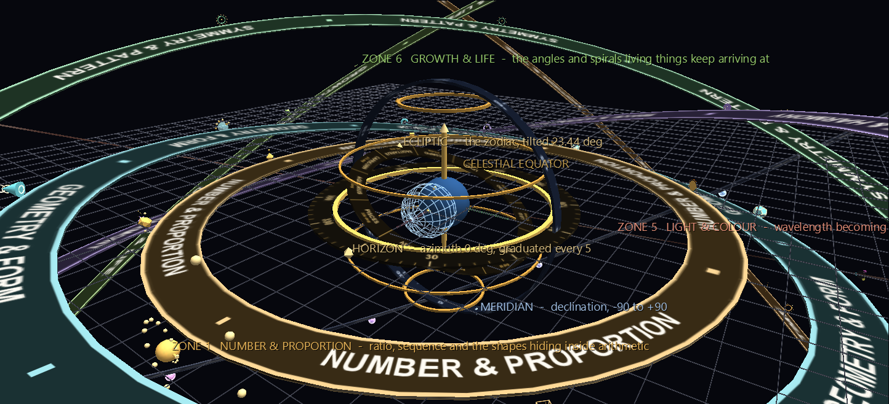
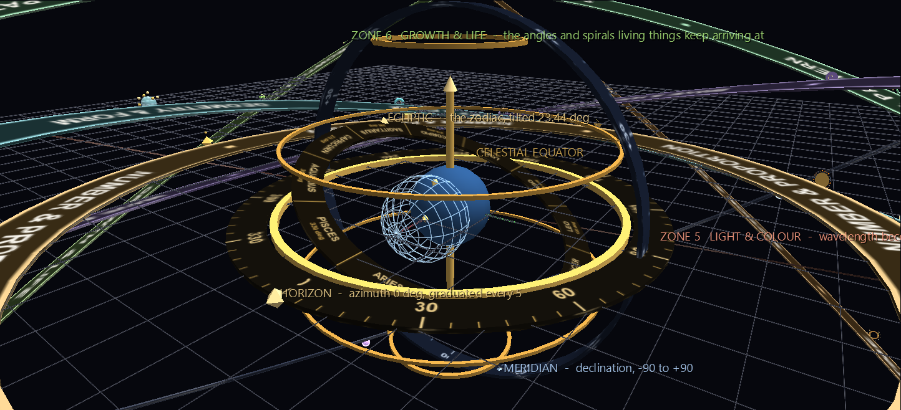
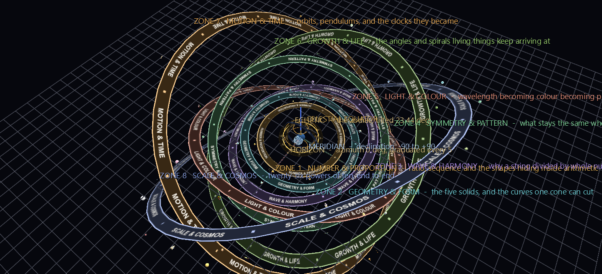

# The Armillary World

A teaching space you fly through: an armillary sphere at the centre, and eight concentric **topic zones** around it, each a ring carrying exhibits that connect a piece of mathematics to something you can look at. Number, Form, Wave, Symmetry, Light, Growth, Motion, Cosmos — 991 nodes in about 300 KB.



It is also the first scene built on the **[Flat Ring](../reference/geometries.md#the-flat-ring)** geometry, added the same day: a torus whose cross-section is a rectangle instead of a circle. A rounded torus reads as soft tubing, and its highlight slides around the tube. An instrument is made of machined bands with square edges — and only a flat face will hold a legible texture, which is what every graduation, zodiac sign and zone name here is.

**Try it:** download this example below (or [the full examples set](../getting-started/installation.md#example-scenes)), then open `Armillary_World_Example/Armillary_World/armillary_world_gv_node.csv` — or drag its folder onto the window.

[:material-download: Armillary_World (265 KB)](https://iluvdata.org/glyphviz/zips/Armillary_World_Example_Armillary_World.zip){ .md-button }

## The instrument



Horizon, meridian, celestial equator, ecliptic, the two tropics and the two polar circles, plus a globe and a polar axis — a real armillary, to a real obliquity of 23.44°.

Three of its rings are **graduated**, and those are the ones the geometry exists for: the horizon carries an azimuth dial marked every 5°, the meridian carries declination from −90 to +90, and the ecliptic carries the twelve signs of the zodiac at 30° each. Each is an image wrapped once around a flat band.

The declination numbering is worth a look if you like this sort of thing. Declination is *not* linear in the angle around the ring — it climbs to +90 and comes back down — so every round value except the poles appears **twice**, at `θ = acos(−sin δ)`. The generator solves for those positions rather than spacing the numbers evenly, which is what an instrument maker would have had to do.

## The zones



Each zone is three things: a thin **rail** carrying its exhibits, a wide textured **band** with the zone's name wrapped around it, and one **gateway** — a pin glyph with the zone's name pinned on, sitting on the rail. The gateway is the thing to click, or to press **F** on.

| | Zone | Exhibits include |
|---|---|---|
| 1 | Number & Proportion | φ, Fibonacci, the primes, π, Pascal, the golden rectangle |
| 2 | Geometry & Form | the five Platonic solids, the conic sections, the kissing number |
| 3 | Wave & Harmony | the harmonic series, octaves, fifths and fourths, standing waves, beats |
| 4 | Symmetry & Pattern | rosettes of 3-, 4-, 5-, 6-, 8- and 12-fold symmetry |
| 5 | Light & Colour | the visible spectrum, additive and subtractive primaries, refraction, the rainbow |
| 6 | Growth & Life | phyllotaxis at 137.5°, a branching tree, cell division, the nautilus, a double helix |
| 7 | Motion & Time | a working orrery, pendulums, a turning clock face, Kepler's second law |
| 8 | Scale & Cosmos | twenty-six powers of ten, from a nucleus to the observable universe |

**Every node in the scene carries a label**, so pressing **T** explains any glyph you are looking at. Only the ten gateway and instrument-ring labels are pinned on permanently — the rest would make an overview unreadable.

Several things move, all of it from `rotate_rate_z` in the CSV rather than from Channels: each zone rail turns at its own slow rate, the orrery's four planets keep their real period ratios, and the clock face turns.

## Three rules this scene is built on

These are the non-obvious parts of authoring with rings, and they are the parts worth reusing.

### 1. A ring that carries children is scaled uniformly

A Flat Ring's radial width comes from `ratio` and its height from `scale_z`, so a wide thin dial needs `scale_z ≠ scale_x`. But children inherit their parent's per-axis scale, so a child of an `(S, S, Z)` ring comes out stretched. Hence the split used throughout:

- **Rails** — uniform scale, small `ratio`. The cross-section comes out square (side `2 × ratio × S`), which is exactly the thin machined hoop you wanted anyway, and exhibits riding it inherit a clean uniform `S`.
- **Bands** — wide (large `ratio`), thin (small `scale_z`), textured, and childless.

### 2. A ring's texture must be built at the ring's own aspect ratio

`u` runs once around the whole circumference while `v` crosses the narrow reading face, so the canvas a ring hands its texture is enormously wide: `2πR / face width`, which for a thin hoop is 150:1 or worse.

There are two ways to get this wrong and this scene hit both on the way here. Give the image the wrong aspect and every letter smears sideways — a 12:1 image on a 180:1 band stretches each one 15×. Fix the aspect by repeating the content more times and you are right in principle but starving each copy of pixels: 22 copies of a name across a 1024-pixel image is 46 pixels each, which renders as a solid white streak.

**So the consequence is a design constraint, not a coding one: a ring that carries readable text has to be a wide band, on the order of 10–20% of its own radius.** Which is exactly what a real armillary's zodiac ring is. Note also that the reading face differs by ring type — for a flat dial read face-on it is the band's radial *width*; for a tall hoop read on its outer wall it is the band's *thickness*.

### 3. Tilting a ring takes two angles, not one

`rotation_mode = EULER_XYZ` composes as `Rx·Ry·Rz` applied to a column vector, so `rotate_z` turns *first* and cannot swing a tilt's direction around afterwards. The generator's `aim_normal(tilt, azimuth)` solves `Rx(a)·Ry(b)·(0,0,1)` for the ring axis it wants and returns the pair. Every tilted ring here goes through it. See [Topologies](../reference/topologies.md) for the wider version of this — placement aims a glyph, rotation poses it.

Two more facts the generator relies on, both verified against the engine rather than assumed: a child of a `TOPO_TORUS` parent at `translate_y = 0, translate_z = 0` lands exactly on the parent's own radius, with `translate_z` pushing it outward as a *fraction* of that radius; and an exhibit's **local +Z points radially outward** from the world centre, which is why the tree in Zone 6 grows outward from its ring.

## Known limits of this first pass

Stated plainly, because they are the interesting part of building a world at this scale:

- **The gateway labels crowd near the middle** in a whole-world overview. They are deliberately spread around their rings, each at a different angle, but a nested system seen from outside projects its inner rings into a small part of the frame no matter where you put them.
- **The zones are thematic, not spatial.** An exhibit's distance from the centre says which topic it belongs to and nothing else. A world that used radius to mean *scale* — the Zone 8 idea applied to everything — would be a different and probably better scene.
- **Nothing is animated with Channels yet.** All the motion here is `rotate_rate_z`.

## Rebuilding

```
python build_armillary_world.py [--out-dir DIR]
```

Regenerates the CSV and all eleven textures. Needs Pillow; everything else is plain Python.
