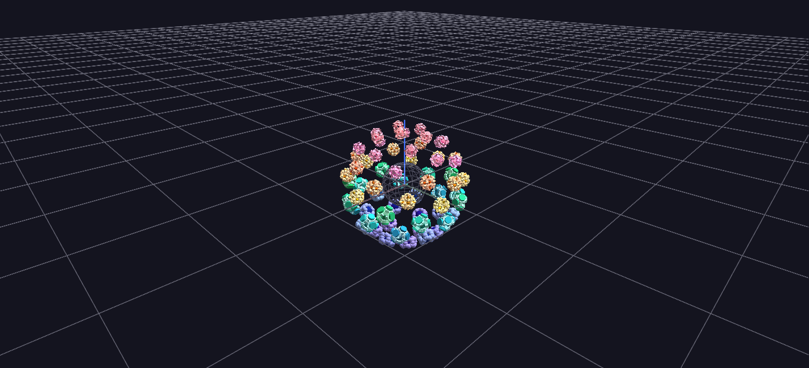

# Cat Scan Synesthesia

One master glyph and 64 frequency-band hyperglyphs (4,529 nodes) on a Fibonacci shell — bass at the south pole, treble at the north — with four frequency zones given distinct geometry, palettes, and motion personalities.

*The commercial source recording is not redistributed; all generated animation files are included.*

**Try it:** [download the examples set](../getting-started/installation.md#example-scenes), then open `Audio_Animation_Example/Cat_Scan_Synesthesia_Example/Cat_Scan_Synesthesia_Example_gv_node.csv` — or just drag its folder onto the GlyphViz window. Press **Space** to start the animation.

---

*A full write-up of this example is coming soon.*
