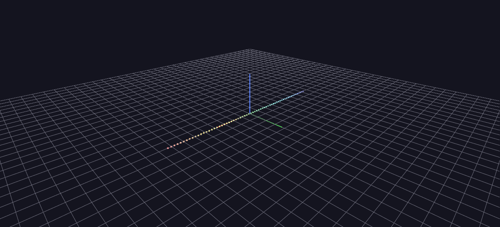

# Violin in A Major

The audio-Channels pipeline on a solo violin recording in A major — a single instrument's harmonics moving cleanly up and down the 64-band array.

**Try it:** download this example below (or [the full examples set](../getting-started/installation.md#example-scenes)), then open `Audio_Animation_Example/Violin_A_Major_Example/Violin_A_Major_Example_gv_node.csv` — or just drag its folder onto the GlyphViz window. Press **Space** to start the animation.

[:material-download: Download this example (2 MB)](https://iluvdata.org/glyphviz/zips/Violin_A_Major_Example.zip){ .md-button }

---

*A full write-up of this example is coming soon.*
