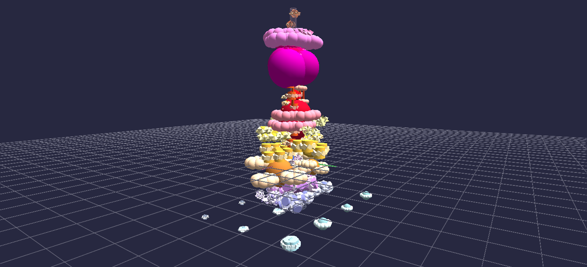

# Warm Winter: One Glyph per Instrument

Most of the audio scenes in this gallery are given a finished stereo mix and have to take it apart — split one file into frequency bands and hope the bands land on the instruments. This one starts from the other side. *Warm Winter* is a 3:47 piece by Jeff Sale, built in GarageBand from seven keyboard tracks, and the scene is made from **the multitrack session**: each track gets a hyperglyph of its own, so a glyph's shape, colour and motion belong to *that instrument* rather than to a slice of the combined spectrum.

**Try it:** download this example below (or [the full examples set](../getting-started/installation.md#example-scenes)), then open `Audio_Animation_Example/Warm_Winter_Synesthesia_Example/Warm_Winter_Synesthesia_Example_gv_node.csv` — or just drag its folder onto the GlyphViz window. Press **Space** to play; the mixdown plays in sync automatically.

[:material-download: Download this example (10 MB)](https://iluvdata.org/glyphviz/zips/Warm_Winter_Synesthesia_Example.zip){ .md-button }

The music is the composer's own, so unlike [Cat Scan Synesthesia](audio-cat-scan-synesthesia.md) — which solves the same problem from a commercial stereo mix, and is worth opening beside this one — the audio ships with the scene.

## The shape of the piece is the shape of the scene

Every track runs the full length of the file, but each one enters a few measures after the last and leaves a few measures before it. Measured from the stems themselves, at a −34 dB gate:

| Track | Plays | Reads as | Colour |
|---|---|---|---|
| 1 | 0:00 – 3:45 | a flat blanket of pads | pale ice blue |
| 2 | 0:17 – 3:30 | orbs laid out on a grid | pale periwinkle |
| 3 | 0:34 – 3:12 | a shell of orbs | pale violet |
| 4 | 0:52 – 2:54 | a helix of helices | amber gold |
| 5 | 1:09 – 2:38 | rods standing in a grid | warm orange |
| 6 | 1:27 – 2:19 | one dominating rod trunk | scarlet |
| 7 | 1:44 – 2:02 | a tapering spire | magenta |

A perfectly nested set: about 17 seconds of stagger on each side, with the centre of the piece at 1:53. The scene says that three times over.

**It stacks them.** The seven glyphs sit on one vertical axis in playing order, eight world units apart, so the column reads bottom to top as the order the instruments arrive in.

**It blooms them.** Each glyph's whole size follows its own track's loudness. A glyph waits as a small dormant seed, opens when its instrument enters, and folds back down when it drops out. Because a root's scale carries its entire subtree, the whole hyperglyph breathes as one — watch the column light up from the bottom, crest at track 7, and go dark again in the same order.

**It lights the sky.** The World row is on a channel too, driven by the seven tracks' combined presence: background colour and fog open from a near-black winter night, through a warming dusk at the climax, and settle at a middle intensity for the long fade-out. The ending is deliberately *not* as dark as the opening — the ramp that lifts the floor only starts climbing after the measured peak, so the world keeps some of the warmth the climax gave it. Fog takes the background's colour, so the mist always matches the sky.

## Seven copies of one recipe, reading as seven instruments

Each glyph is built from the same design — a master root whose twelve children are frequency bands, each band a small tree of its own, 715 nodes in all. What changes from track to track is the **topology** at the top two levels, and that alone is enough to make them read as different instruments:

- a **Plane** root lays its twelve bands out as a flat 4×3 blanket;
- a **Sphere** root distributes them over a shell, bass at the pole;
- a **Spiral** root threads them along a helix;
- a **Rod** root becomes a trunk with the bands strung up it;
- a **Pin** root is a spire the bands ride, tapering to a point.

Track 1's blanket is deliberately spread about nine times wider than the rest, so the pad that holds the whole song becomes the floor the column stands on. Track 2's grid is opened out to three times, which keeps its orbs from crowding each other.

Two details are worth knowing if you build something like this yourself. A node whose topology is **Rod** is not just following a placement rule — GlyphViz draws it a quarter as wide and five times as tall, ANTz-style, so the node literally *becomes* the rod its children are threaded along. Nest Rod inside Rod and that stretch multiplies at every level until the glyph is a smear of needles, which is why Rod appears at exactly one level per glyph. Track 6 uses **Zrod** below it instead — the same family, centred, which rings children around a node without restyling it.

## Each instrument gets its own frequency window

A single 20 Hz – 16 kHz window would leave the bass track lighting three bands and the rest dead. Instead each stem is measured for its own spectral rolloff and given a window an octave wider on each side, so all twelve of a glyph's bands are in play and the fan shows where *that* instrument lives:

| Track | Window | Centroid |
|---|---|---|
| 1 | 242 – 3876 Hz | 826 Hz |
| 2 | 38 – 603 Hz | 328 Hz |
| 3 | 82 – 1314 Hz | 630 Hz |
| 4 | 65 – 4188 Hz | 1375 Hz |
| 5 | 67 – 1572 Hz | 879 Hz |
| 6 | 129 – 2067 Hz | 934 Hz |
| 7 | 75 – 1443 Hz | 510 Hz |

The trade is that a glyph's four zones — the scene calls them DEEP, FLOW, SHINE and SPARK, and gives each its own geometry, envelope and motion — read as that instrument's own low-to-high register rather than as absolute frequency.

## What the animation drives

260 channels across 348 tracks, 6,807 frames at 30 fps, over 5,006 nodes. Per band: the band root's **scale** follows band power through a zone-tuned envelope; its children **pop** outward and spin faster as the band gets loud; their children **orbit** faster still. Per glyph: the master root's scale follows that track's presence. And the World row carries the sky and the fog.

Only *angular* axes ever carry a rate. A rate on a linear axis integrates forever and would throw the children out of the scene by the end of the song.

## The overlap is the point

An earlier version spread the glyphs along an arc wide enough that no two ever touched. It was replaced with this column, and the glyphs do grow into each other once the music is running. That is deliberate — in the composer's words:

> There is some overlap when the animation plays, but that's the way music is. The instruments are not isolated from each other in the audio, they are all overlapping.

The column is what he sees when he hears the piece.

## The file opens larger than it plays

Open the scene without playing and every glyph is at full size under the night sky — the rest state the **Stop** button restores. "Full size" here means each root at its own *peak* presence, all seven at once, which is a state the playback never reaches: the tracks peak at different times, and a dormant glyph sits at 38% of it.

So the file opens about 1.4× larger than a typical playing frame, on purpose. The scene is sized so that a glyph reads correctly **while its instrument is playing** rather than so that the rest state does. Press Play and the column settles to the size it was tuned at; the climax comes back up to roughly the size it opened at.

One more thing the file does quietly: the app's **Global Scale** setting is baked into the numbers. Nothing in a node CSV records which Global Scale a scene was authored against, and this one was tuned at 3.0 — so rather than ship a file that only looks right after you move a slider, the generator writes it to open correct at GlyphViz's own default of 1.0. The example README explains the arithmetic, which is worth reading before you re-tune this scene in the app.

---

*Every node carries a label in the companion tag CSV, and nothing is pinned — select anything and press **T** to read it. The generator, its full design note, and instructions for rebuilding the scene from the stems are in the example's own `README.md`.*
