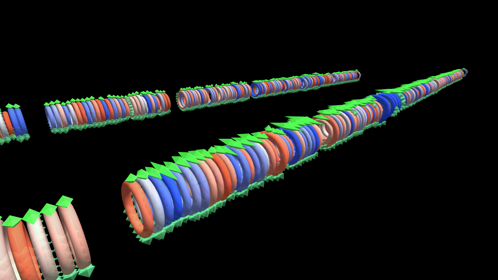

# AutoSleep — A Year of Sleep

A year of Apple Watch sleep data: one Rod-topology cylinder per month carrying a Torus ring per day, each ring fringed with one small octahedron per slept hour plus a taller one marking that day's deep sleep — ring color diverges blue/red with deep sleep vs. your own 7-day trend.

**Try it:** download this example below (or [the full examples set](../getting-started/installation.md#example-scenes)), then open `AutoSleep_2025_Example/autosleep_2025_gv_node.csv` — or just drag its folder onto the GlyphViz window.

[:material-download: Download this example (166 KB)](https://iluvdata.org/glyphviz/zips/AutoSleep_2025_Example.zip){ .md-button }

---

*A full write-up of this example is coming soon.*
