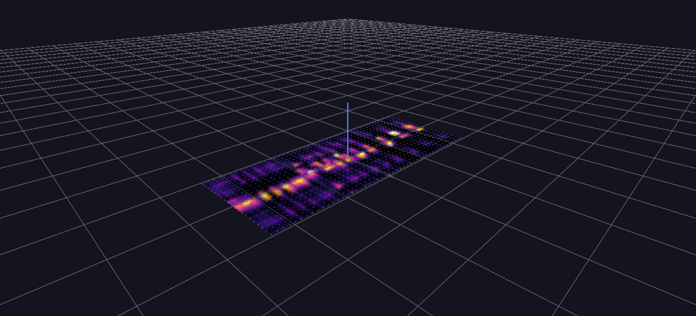

# Bird Song Spectrogram Surface

A real field recording's spectrogram rendered and animated as a deformable Surface-topology grid — a showcase of what `TOPO_SURFACE` alone can do with real audio data.

**Try it:** download this example below (or [the full examples set](../getting-started/installation.md#example-scenes)), then open `Bird_Song_Surface_Topology_Example/Bird_Song_Surface_Topology_Example_gv_node.csv` — or just drag its folder onto the GlyphViz window. Press **Space** to start the animation.

[:material-download: Download this example (1 MB)](https://iluvdata.org/glyphviz/zips/Bird_Song_Surface_Topology_Example.zip){ .md-button }

---

*A full write-up of this example is coming soon.*
