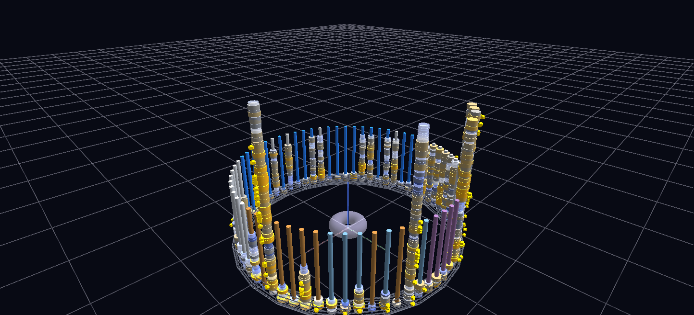

# The Breathing Century

A century of NHL hockey (1909–2012): every franchise stands as a vertical tower of season discs on a founding-order ring — disc width is points percentage, color runs outscored-blue through silver to dominant-gold, and gold dodecahedra hang at Stanley Cup heights. Channels replay it as a growth animation, one step per season.

**Try it:** [download the examples set](../getting-started/installation.md#example-scenes), then open `Breathing_Century_Example/century_reef_gv_node.csv` — or just drag its folder onto the GlyphViz window. Press **Space** to start the animation.

---

*A full write-up of this example is coming soon.*
