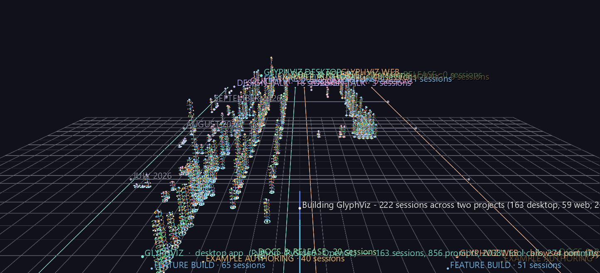
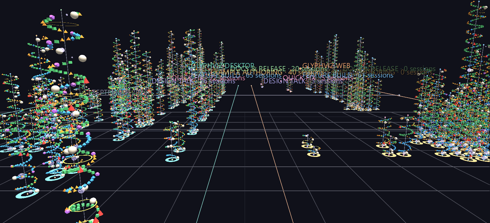
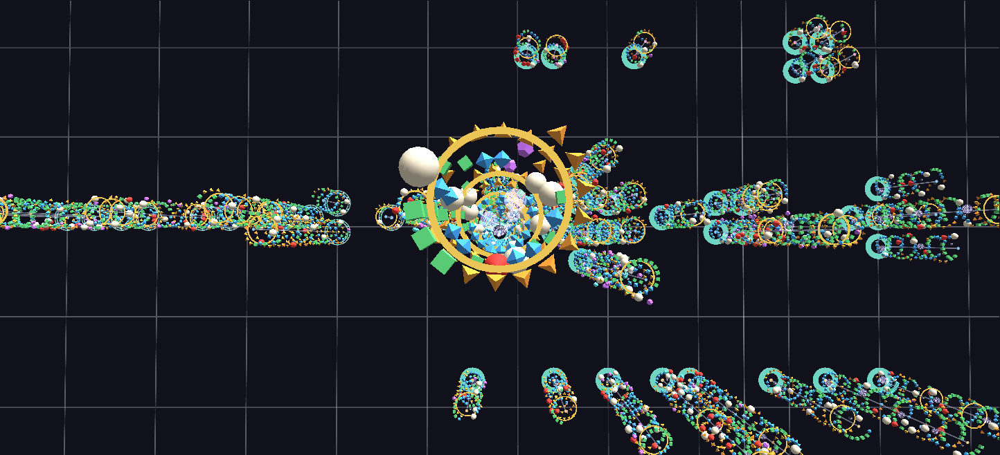
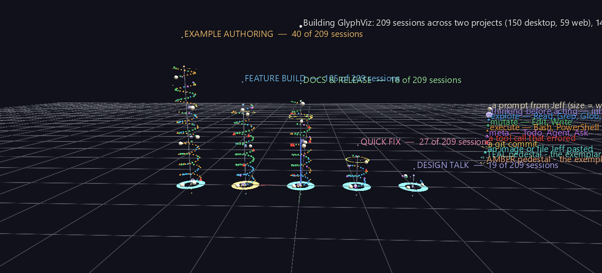

# Building GlyphViz: Every Session

GlyphViz was built by Jeff Sale working with [Claude Code](https://www.anthropic.com/claude-code), Anthropic's AI coding assistant, one working session at a time. Claude Code saves each session as a transcript: every prompt Jeff typed, every stretch of Claude's thinking, every file it read or edited, every command it ran and every commit it made. This scene reads those transcripts back through the tool they produced.

It covers **222 sessions**, from the very first one on 6 June 2026 to 25 September 2026, across two projects: the GlyphViz desktop app and its browser port, GlyphViz Web. Each session is one column. Together they hold **1,034 prompts, almost 29,000 tool calls and 381 commits**.

**Try it:** download this example below (or [the full examples set](../getting-started/installation.md#example-scenes)), then open `building_glyphviz_gv_node.csv`, or drag the zip onto the GlyphViz window. The scene has about 32,000 nodes and opens in a few seconds. Then press **C** for Camera Mode and fly down the gap between the two projects.

[:material-download: Download this example (0.8 MB)](https://iluvdata.org/glyphviz/zips/Building_GlyphViz_Example.zip){ .md-button }
[:material-download: Five Archetypes (13 KB)](https://iluvdata.org/glyphviz/zips/Building_GlyphViz_Example_Five_Archetypes.zip){ .md-button }

## Watch it explained

A two-minute narrated tour of this scene, rendered from GlyphViz itself: the two projects and their five lanes, how to read one column from the bottom up on the Five Archetypes scene, the view straight down the tallest column, and what the record shows about how the collaboration changed.

<video controls preload="metadata" width="100%" src="https://iluvdata.org/glyphviz/videos/building_glyphviz.mp4"></video>

Want to see your own sessions this way? The download includes the scripts that built this scene. See [Make your own](#make-your-own).

## Why a column per session

A session is a conversation that turns into work. Jeff describes what he wants, Claude thinks, reads the code, edits it, runs the tests, and either commits or asks a question back, and the loop repeats. Summary statistics flatten that loop into a single number. A column keeps it in order: you can read a session from its base to its top and see where the prompts landed, how much exploring came before each edit, where the errors clustered and where the commits fell.

The column is a **Spiral** topology. Each event advances the coil by a fixed angle, so the height of a column is how much *happened*, not how long it took. One winding of the coil is 18 tool calls' worth of arc. Across the scene, a winding works out to a median of about 15 tool calls and 5 minutes of active work, because prompts and idle pauses take their share of the angle too.

## Reading the scene

**The layout.**

- **Left to right: project, then kind of session.** The desktop project fills the left bank and GlyphViz Web the right, with a 30-unit gap between them. A teal rail runs down the desktop bank's outer edge and an amber one down the web bank's, so you can tell which project you're in from anywhere inside the scene.
- **Within each bank, five lanes** for the five kinds of session, in the order work usually moves: *design talk*, *quick fix*, *feature build*, *example authoring*, *docs & release*. Sessions were sorted into these by rule, using how long they ran and where their edits landed.
- **Front to back: the calendar.** Both banks share one date axis, so quiet days are real gaps, busy days are real clusters, and a look across the gap shows what the other project was doing that same week. Month markers are ruled across both banks. When several sessions of the same kind fall on the same day, they fan out sideways across their lane, never along it.

**The glyphs on the coil.**

| Glyph | Meaning |
|---|---|
| warm-white sphere | a prompt from Jeff, sized by its word count |
| violet wire sphere | Claude's thinking before it acted, sized by the number of thinking blocks |
| blue octahedron | exploring: reading files, searching the code, the web |
| green cube | editing: changing or writing a file |
| orange tetrahedron | running something: a shell command, a test, a build |
| magenta dodecahedron | managing the work: to-do lists, sub-agents, questions back to Jeff |
| red cone | a tool call that came back with an error |
| gold ring around the axis | a git commit |
| cyan icosahedron outside the coil | an image or file Jeff pasted in |

**The pedestals.** Each column stands on a ring. Its **colour** is the project (teal for desktop, amber for web). Its **shape** is where the data came from: a solid ring means the column was rebuilt from Claude Code's own transcript; a thin wire hoop means it was reconstructed from a saved text copy of the chat (see [Where the data came from](#where-the-data-came-from)).

**Click anything.** Every glyph has a label. A prompt sphere shows the first line of what Jeff actually typed. A tool glyph shows the tool and its target, such as the file it edited or the command it ran. A commit ring shows the commit message. The label at the base of a column gives the session's date, title, kind and totals. Labels appear on what you select, so select a column's base to read about it. To see every label at once, untick **Show Tag Labels of Selected** in the Properties panel's Display group. On the full scene that's a lot of text, so it reads best on a single column.

## Views worth flying to

**Stand in the gap.** Park the camera low in the gap between the banks and look along the calendar. Desktop sessions rise on your left and GlyphViz Web on your right, and both rails run away towards September.

**Look straight down a column.** Seen from directly above, a coil flattens into a rosette. Because the thinking spheres ride their own radius inside the coil, they gather in the middle while the tool calls ring the outside, so one glance shows how much of a session was thinking and how much was action. Below is the tallest column in the scene, 22 June 2026, *"Add audio support and music synchronization to GlyphViz"*, looked at from above.

## What the record shows

- **Prompts got fewer while the work per prompt grew.** On average one prompt set off about 16 tool calls in June, 25 in July, 39 in August and 43 in September. The collaboration moved from step-by-step direction to handing over whole features and reviewing the result.
- **The web port was all engine.** Of GlyphViz Web's 59 sessions, 51 were feature builds. Its *example authoring* and *docs & release* lanes are empty, and they're kept with a "0 sessions" nameplate rather than closed up, because the empty lanes are the finding: a port reimplements the engine, while the examples and documentation already existed on the desktop side.
- **The desktop project changed character over the summer.** Early sessions were mostly feature builds. Later ones were more and more example authoring and documentation: 40 example-authoring sessions and 18 docs & release sessions in all, as the app matured into something to be shown and taught.
- **The two projects ran side by side.** The web port didn't follow the desktop app; from late July it ran alongside it. Looking across the gap at any date shows both being worked on in the same weeks.
- **The tallest column is one of the earliest.** 22 June 2026, adding audio support, took 29 prompts and 396 tool calls.

## The five archetypes

The second, smaller scene holds just five columns: one typical session of each kind. Each is the *medoid* of its group, the real session closest to the group's typical profile across a dozen measures (active time, prompts, tool calls, files edited, thinking, commits and more), so it's a session that actually happened and not an average. It's the best place to learn to read a column before walking into the full forest. Its pedestals follow the same colour rule: the *feature build* exemplar is a GlyphViz Web session, so its pedestal is amber.

## Where the data came from

**209 sessions come from Claude Code's own transcripts**, which record everything: timestamps, thinking, every tool call and its result. Two details matter when reading the scene:

- **Active time, not clock time.** A session left open overnight or resumed days later would otherwise look enormous, so durations count only the time between records that are less than five minutes apart.
- **Thinking is counted, not read.** For most of the models involved, the transcript stores that a block of thinking happened but not its text, so the violet spheres encode how *many* thinking blocks came before Claude acted, and their labels carry no thinking text.

**13 sessions from June 2026 were reconstructed.** Claude Code deletes transcripts after 30 days by default, and by the time that was noticed every session before 20 June was gone, including the one that started the project. Jeff had saved text copies of those chats. The tool calls, their targets, errors and commits were parsed back out of the copies; the prompts were picked out by hand, since nothing in a text copy marks where a prompt ends and Claude's reply begins. The copies carry no timestamps and no separate thinking, so these columns have prompts and tool calls but no thinking spheres and no idle gaps. Their wire-hoop pedestals mark them.

**What was changed for publication.** Local file paths in the labels are shortened to `~` in place of the author's home folder, and messages generated by the software itself (background-task notices, context summaries) were left out, so every prompt sphere is something Jeff typed. Prompt labels show the first line of each prompt, up to 160 characters.

## Make your own

Every Claude Code session you run leaves the same kind of transcript, in the terminal or in the VS Code extension, so you can draw your own work this way. The example download includes a `Make_Your_Own` folder holding the scripts that built this scene, rewritten to work on anyone's transcripts. They need only Python, with no extra packages, and nothing leaves your machine.

1. Run `python extract_transcripts.py --list` to see the transcript folders Claude Code has saved for your projects.
2. Put the one you want (or several, one bank each) into `PROJECTS` in `config.py`.
3. Run `extract_transcripts.py`, then `build_corpus_scene.py` and `build_archetype_scene.py`, and open the `gv_node.csv` files they write.

The folder's README covers the rest: how sessions are sorted into the five kinds, and how to tune that sorting for your repository's layout. It also shows where to change the lanes, colours and glyphs. **Before sharing a scene**, build it with `--public`: that shortens your home folder to `~` and removes your user name from every label, and it won't write the file if anything slips through. The labels still quote your prompts, though, so read them before you pass the file on.

Claude Code deletes transcripts after 30 days by default. If you'd like a longer record to draw, raise `cleanupPeriodDays` in your Claude Code settings now.
