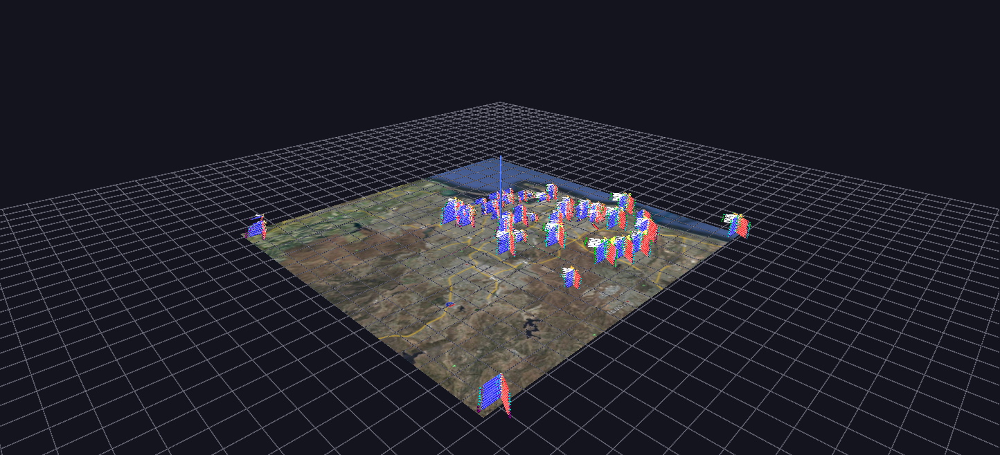

# California STAR Test Scores

California STAR standardized-test scores (San Diego Unified, 2003–2012): one tree per school and year, fanning into demographic subgroup branches and real CST/CAPA test-score branches.

**Try it:** download this example below (or [the full examples set](../getting-started/installation.md#example-scenes)), then open `CalStateTesting_Example/CalStateTesting_Example_gv_node.csv` — or just drag its folder onto the GlyphViz window.

[:material-download: CalStateTesting_Example (9 MB)](https://iluvdata.org/glyphviz/zips/CalStateTesting_Example.zip){ .md-button }
[:material-download: AchievementGap (8 MB)](https://iluvdata.org/glyphviz/zips/CalStateTesting_Example_AchievementGap.zip){ .md-button }
[:material-download: GradesCube (9 MB)](https://iluvdata.org/glyphviz/zips/CalStateTesting_Example_GradesCube.zip){ .md-button }

---

*A full write-up of this example is coming soon.*
