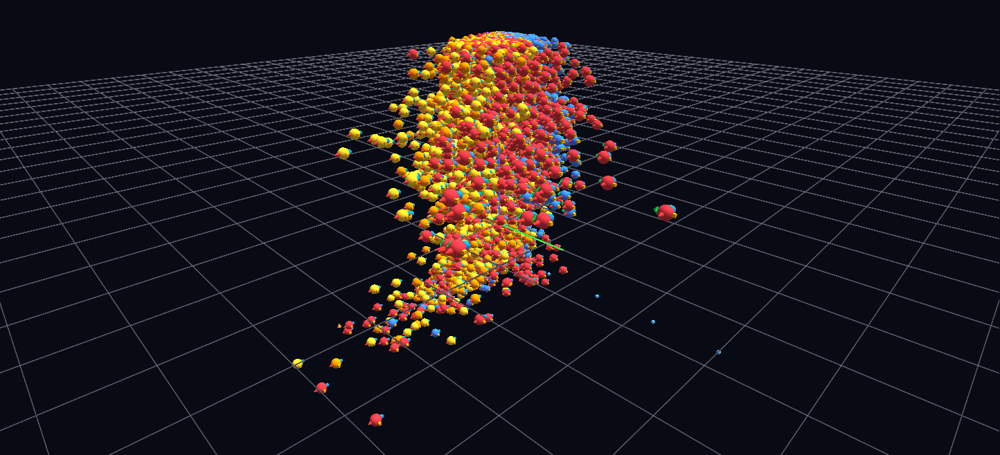

# The Century Swarm

All 29,140 player-seasons of 25+ games from 1921–2012 as hyperglyphs placed in scoring phase space — goals per game × assists per game × year — sized by points per game and colored by position, with stat satellites on each: about 140,000 nodes.

**Try it:** [download the examples set](../getting-started/installation.md#example-scenes), then open `Century_Swarm_Example/century_swarm_gv_node.csv` — or just drag its folder onto the GlyphViz window.

---

*A full write-up of this example is coming soon.*
