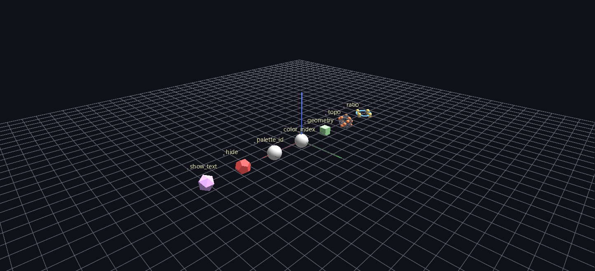

# Channel Parameters

A test bench of seven labeled stations, one per Channels-bindable attribute family — `ratio`, `topo`, `geometry`, `color_index`, `palette_id`, `hide`, `show_text` — each driven by its own channel. The ch-map file doubles as a legend, and the 8-second loop runs every station at once.

**Try it:** download this example below (or [the full examples set](../getting-started/installation.md#example-scenes)), then open `Channel_Parameters_Example/channel_parameters_gv_node.csv` — or just drag its folder onto the GlyphViz window. Press **Space** to start the animation.

[:material-download: Download this example (8 KB)](https://iluvdata.org/glyphviz/zips/Channel_Parameters_Example.zip){ .md-button }

---

*A full write-up of this example is coming soon.*
