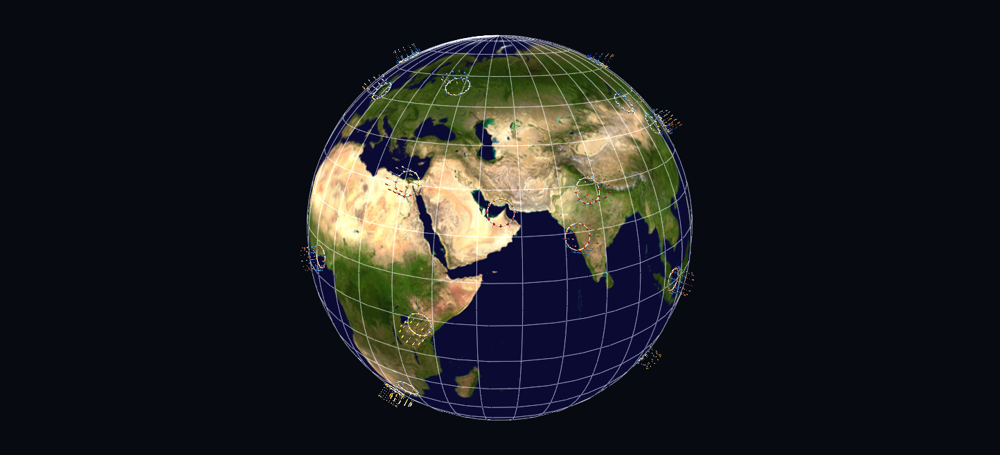
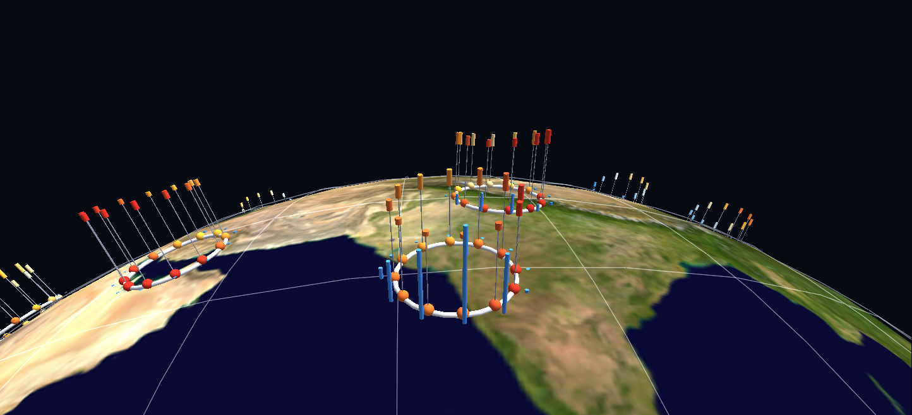
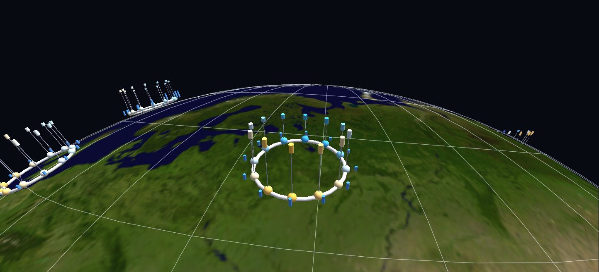

# City Climate Rings

A year of climate for 31 cities, drawn as a ring of months around each city on a globe. It began as an ordinary spreadsheet, one row per city per month, and became a scene by describing it to Claude with the [GlyphViz Claude Skill](../getting-started/installation.md#claude-skill).



**Try it:** download this example below (or [the full examples set](../getting-started/installation.md#example-scenes)), then open `City_Climate_Rings_Example/climate_rings_gv_node.csv`, or drag its folder onto the window.

[:material-download: Download this example (1.6 MB)](https://iluvdata.org/glyphviz/zips/City_Climate_Rings_Example.zip){ .md-button }

## Watch it explained

A narrated walk-through, under two minutes, rendered from GlyphViz itself: the spreadsheet this scene started as, the plain-words request to Claude, the folder dropped onto the window, and then the rings read city by city, from Moscow's wide year and Singapore's unchanging one to Mumbai's monsoon and the seasons flipping across the equator.

<video controls preload="metadata" width="100%" src="https://iluvdata.org/glyphviz/videos/climate_rings.mp4"></video>

## Reading a ring



- **Each ring is one city's year.** January is at the top (north) and the months run clockwise, like a clock face.
- **Each month's bead is coloured by its mean temperature**, from deep blue for the coldest months, through pale, to red for the hottest.
- **The bar standing on each month spans its average low to its average high.** The higher a bar stands, the warmer the month. A thin grey stem joins each bead to its bar.
- **The blue column just outside each bead is that month's rainfall.**
- **Click anything to read it.** Every ring, bead, bar and column is labelled with its city, month and value.

## What the rings show



- **Yakutsk has the widest year.** Its monthly mean runs from −37.4 °C in January to 19.8 °C in July, a 57.2 °C swing. **Bogotá has the narrowest**, 1.3 °C, near the equator and high in the Andes. Singapore is next, at 2.2 °C.
- **Mumbai has a monsoon.** 94% of its 2,509 mm a year falls from June to September, 834 mm of it in July alone, and January gets none.
- **Lima is the driest city here**, at 24 mm a year: drier than Cairo (60 mm) or Dubai (85 mm).
- **The seasons flip across the equator.** Sydney's warmest month is January and Moscow's is July, so their warm colours sit at opposite ends of the clock.

## From a spreadsheet to a scene

This example is the one the **Your Data in GlyphViz** video [above](#watch-it-explained) walks through, and everything in that walk-through ships in the folder:

1. **`city_climate.csv`**, the data: 372 rows with columns `city`, `country`, `lat`, `lon`, `month`, `high_c`, `low_c`, `mean_c` and `precip_mm`.
2. **`prompt.md`**, the request, in plain words: put each city on a globe, draw a clock face of months around it coloured by temperature, and stand a temperature bar and a rainfall column on each month.
3. **`build_climate_rings.py`**, the generator Claude wrote with the GlyphViz skill. Before it writes a file, it checks the geometry through GlyphViz's own placement engine: January due north on all 31 clocks, running clockwise, every bar upright, and every bar's length exactly what the data says.
4. **`climate_rings_gv_node.csv`**, the scene: 3,381 nodes.

To try the same thing with your own data, describe the picture you want and let the skill work out the placement.

## Tip: look straight down on a ring

A ring on a city far from a pole lies at an angle to the screen. To look straight down on one, turn the globe itself. Select it with **G**, set **Rotation Mode** to Euler XYZ in the Properties panel, and set **Rotate** Y to −(90 − latitude) and Z to −longitude. That city comes round to the top of the globe, with north up when you view it from azimuth 0. That's how the close-ups on this page were made.

## Structure

```text
World Grid (globe, Blue Marble, scale 3)
└─ city ring ×31          Torus glyph and Torus topology, at the city's lon/lat
   └─ month carrier ×12   hidden; on top of the tube, so it points straight up
      ├─ month bead       sphere, colour = mean temperature
      ├─ stem             Link, bead -> the bar's low end
      ├─ temperature bar  Link between two hidden nodes, at the low and the high
      └─ rain column      Link between two hidden nodes, base and top
```

Every bar is a Link between two hidden nodes, so both of its ends are coordinates and it keeps its height at any Global Scale. Heights: 0.16 world units per degree, with −45 °C at the ring itself, and 1 unit per 60 mm of rain.

## Data

| What | Source |
|---|---|
| Monthly climate | **NASA POWER** daily point data, public domain, no API key: every day from January 2001 to December 2020, averaged by calendar month. High and low are the means of each day's maximum and minimum; rainfall is each month's total, averaged over the 20 years. |
| Globe | NASA Visible Earth Blue Marble |

These values are for the MERRA-2 **grid cell** a city sits in, about 50 km across, not for a weather station. A coastal city's cell often reaches inland: San Diego's summers come out a few degrees warmer than its airport records.

POWER also has a ready-made monthly climatology, but its maximum and minimum temperatures are each month's *extremes*, not its average high and low. It gives San Diego a 27.6 °C January "high". So `fetch_climate.py` averages the daily data instead.
