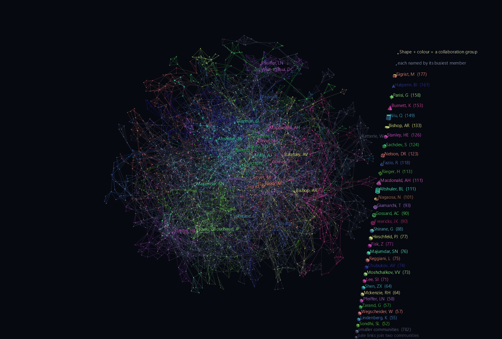
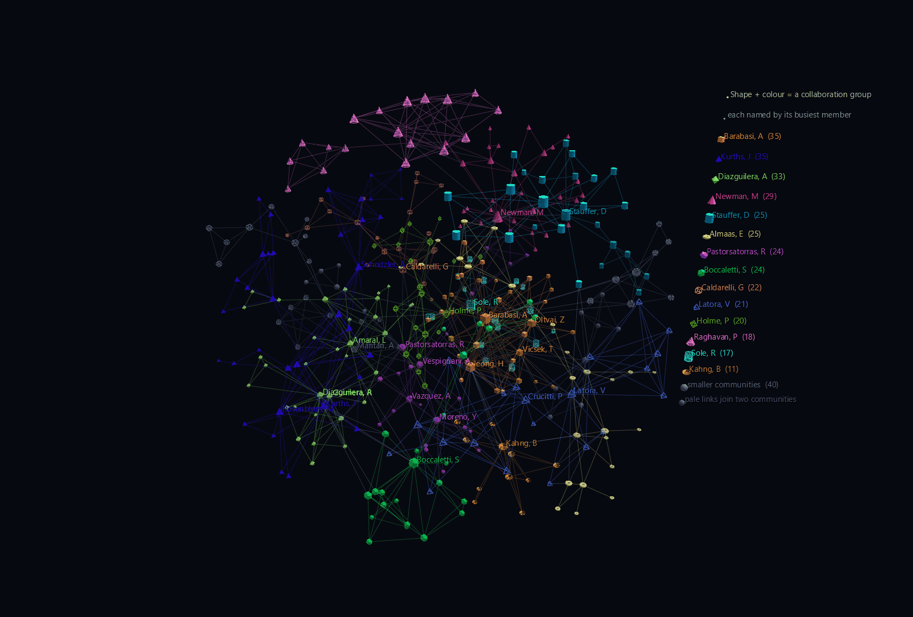

# Collaboration Networks

A scientific paper has an author list, and an author list is a claim about who worked with whom. Collect twenty years of them and you get something no department chart records: the real shape of a field, drawn by the people in it, one collaboration at a time.

These two scenes are that shape, laid out in three dimensions by GlyphViz's own ForceAtlas2 implementation — no Gephi, no external graph library. See [3D Graph Layout](../reference/graph-layout.md) for the modules behind them.



**Try it:** download either scene below (or [the full examples set](../getting-started/installation.md#example-scenes)), then open `Collaboration_Network_Example/Condensed_Matter/Condensed_Matter_gv_node.csv` — or drag its folder onto the window.

[:material-download: Condensed_Matter (200 KB)](https://iluvdata.org/glyphviz/zips/Collaboration_Network_Example_Condensed_Matter.zip){ .md-button }
[:material-download: Network_Science_Emergence (459 KB)](https://iluvdata.org/glyphviz/zips/Collaboration_Network_Example_Network_Science_Emergence.zip){ .md-button }

## The two scenes

**`Condensed_Matter/`** — 3,931 physicists and the 10,223 collaborations between them, filtered out of Mark Newman's cond-mat co-authorship network (every arXiv condensed-matter preprint from January 1995 to March 2005). Size is number of collaborators. Fly into it and the names are the field's landmarks — Ketterle, Parisi, Stanley, Sachdev, Kotliar, Bishop, Balatsky, Das Sarma. The pale grey threads running between coloured regions are the collaborations that cross community boundaries, which in a co-authorship network are the interesting ones: someone changed subfields, or a technique moved.

**`Network_Science_Emergence/`** — the 379-author giant component of the network-science community itself: Barabási, Newman, Vicsek, Vespignani, Pastor-Satorras, Amaral, Latora, Solé. Small enough that every glyph is individually visible, and the reason it exists is the Channels track.



Press play on the transport and **the layout runs**. All 379 authors have their `translate_x/y/z` bound to channels carrying 130 frames of the ForceAtlas2 solver's own history, resampled from 700 iterations on a power-law schedule so the animation is dense where the motion is. It starts as a random cloud with every community thoroughly mixed and crystallises into the structure above.

The 914 links have **no channels at all** and need none: a Link draws between its two endpoints' current world positions, so the entire edge set follows for free. This is the thing a conventional graph tool cannot show you — its layout runs live, but it cannot be replayed, scrubbed, or paused halfway.

## Reading the scene

**Every author carries their own name.** All 3,931 of them have their name in `text`, so any glyph will say who it is — select it, find it in the node table, or press **T** to bring the labels up. What separates the hubs is `show_text`, which *pins* a label on regardless of that setting: the thirty biggest names stay legible from the outside, and nobody else clutters the view until you ask.

**Community is encoded twice, as colour and as shape.** Louvain finds the collaboration groups, and each of the largest gets both its own colour and its own geometry — cubes, tetrahedra, octahedra, cones, cylinders, tori, icosahedra, dodecahedra, then the same nine again as wireframes. Colour is what you read; shape is what you can *act* on, because **Select By → Geometry** then pulls out an entire sub-network in one go. Anything past the end of that cycle falls back to a plain sphere, so "select all spheres" means "the groups without a shape of their own" rather than colliding with a real community.

Four geometry families are deliberately unused: Pin stands on its apex instead of straddling its origin, so a pin node would sit visibly off the position the solver computed for it; Grid is a flat plate that disappears edge-on; Point is a fixed-pixel sprite that ignores scale and so could not carry the degree encoding; Mesh needs an imported file.

**The key is part of the scene.** GlyphViz draws no screen-space overlay, so the legend is a column of real glyphs off to one side, each drawn with its community's actual colour *and* shape, labelled with that group's busiest member and its size. It hangs off a single title node as children, so dragging the title moves the whole key.

## Structure

```text
Condensed_Matter
author ×3,931          root, topology None; position = the solver's output,
                       colour + geometry = Louvain community, size = degree
collaboration ×10,223  Link; pale where it crosses between communities
legend title
└─ swatch ×N           one glyph per named community, in its own shape

Network_Science_Emergence
author ×379            root; translate_x/y/z bound to 130 frames of the
                       ForceAtlas2 solver's own history
collaboration ×914     Link; no channels — an edge follows its endpoints
```

Both scenes are ordinary root nodes with topology None. A force layout produces free world positions, and a GlyphViz root's `translate_x/y/z` *is* its world position, so there is no hierarchy, no placement offset, and no `topo_scale` anywhere in either file.

## What had to change for three dimensions

The forces in ForceAtlas2 are vector quantities, so the formulas carry into 3D untouched. One constant inside them does not, and it turned out to matter more than everything else combined.

ForceAtlas2's repulsion falls off as **1/d**. That is not arbitrary — it is the Coulomb law *of the plane*, and it is right for the 2D layouts the algorithm was written for. Used unchanged in three dimensions it is far too long-ranged, and the result is the cliché that gives 3D graph drawing its bad name: a dense ball with a few filaments whipping off it. Half the nodes end up inside a third of the radius.

Setting `repulsion_falloff=2.0` restores the actual three-dimensional inverse-square law. Measured on the Condensed Matter graph, fitted to the same 200-unit radius so the numbers compare directly:

| repulsion | nearest-neighbour spacing | r(50%) / r(98%) |
|---|---|---|
| 1/d — ForceAtlas2 as published | 2.61 | 0.33 |
| 1/d² — the 3D law | 11.90 | 0.70 |

The right-hand column is the tell. At the published exponent the layout is a core; at 1/d² the volume is evenly filled. Both images on this page are the second one — the first looked like a hairball, and no amount of colour, camera work or glyph tuning was going to fix it.

## Filtering

Two filters get from 40,421 authors down to 3,931, and they do different jobs. Newman's edge weights count a shared paper as `1/(authors−1)`, so requiring **weight ≥ 0.8** keeps repeated collaboration and discards the single forty-author paper that would otherwise drop a forty-clique of strangers into the middle of the scene. The **3-core** then removes what survives that on one or two threads — authors who add rows and no structure.

The example's `build_collaboration_scenes.py` prints the numbers that decide whether a scene is legible — nearest-neighbour spacing against glyph diameter, what fraction of glyphs interpenetrate, and how tightly communities cluster — because changing a filter or a fit radius will silently break the scene otherwise.

## Data

Both files are Mark Newman's, unmodified, cached in the example's `data/` folder:

- `cond-mat-2005.gml` — M. E. J. Newman, *The structure of scientific collaboration networks*, PNAS **98**, 404–409 (2001). This edition covers preprints posted 1995-01-01 to 2005-03-31; weights per Newman, *Phys. Rev. E* **64**, 016132 (2001).
- `netscience.gml` — M. E. J. Newman, *Finding community structure in networks using the eigenvectors of matrices*, *Phys. Rev. E* **74**, 036104 (2006).
