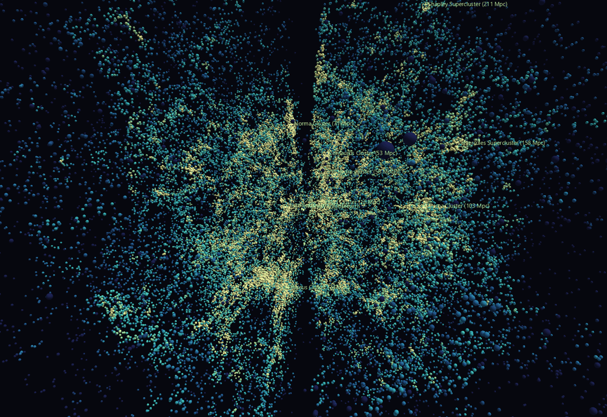
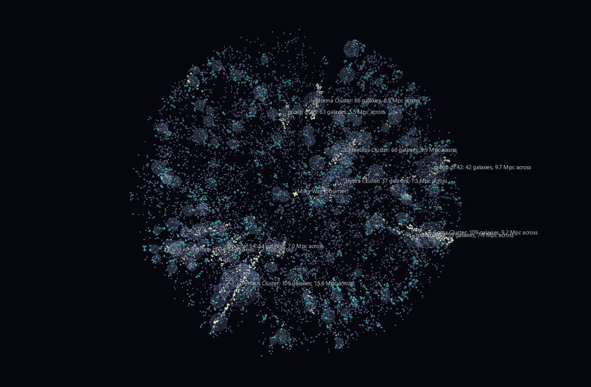

# The Cosmic Web

The cosmic web is the one structure in astronomy that a flat picture cannot tell the truth about. Filaments, sheets and voids are *defined* by how they connect in three dimensions; project them onto the sky and they overlap into a uniform haze. That is why almost every published "cosmic web" image is either a thin slice through a survey or a simulation.

This is neither. It is the 2MASS Redshift Survey — **43,414 galaxies with measured distances, covering the whole sky** — placed in supergalactic Cartesian coordinates at one world unit per megaparsec, and coloured by how crowded each galaxy's own neighbourhood is.



**Try it:** download this example below (or [the full examples set](../getting-started/installation.md#example-scenes)), then open `Cosmic_Web_Example/Local_Universe/LocalUniverse_gv_node.csv` — or drag its folder onto the window.

[:material-download: Local_Universe (1 MB)](https://iluvdata.org/glyphviz/zips/Cosmic_Web_Example_Local_Universe.zip){ .md-button }
[:material-download: Cluster_Anatomy (375 KB)](https://iluvdata.org/glyphviz/zips/Cosmic_Web_Example_Cluster_Anatomy.zip){ .md-button }

## The two scenes

**`Local_Universe/`** — the whole catalogue, out to 427 Mpc. The colour ramp runs from deep indigo in the voids through teal in the filaments to warm white in the cluster cores, and it does the real work: without it a point cloud this size is fog. Nine named structures are marked, and so is the observer. Press **C** for Camera Mode and fly into it.

**`Cluster_Anatomy/`** — the same sky, restructured. A volume-limited subsample inside 120 Mpc is run through a friends-of-friends percolation, and every group it finds becomes a hyperglyph: a frame at the group's centre of mass carrying its member galaxies, wrapped in a wire shell at the group's own radius. A knot of the web stops being a smear of pixels and becomes a structure you can select, name and count.



## What the data says

**The local universe really is flat, and the frame proves it.** De Vaucouleurs defined the supergalactic plane in 1953 from the apparent alignment of nearby galaxies. Put the catalogue into that frame and the median |supergalactic latitude| inside 40 Mpc is **20.0°** against the **30.0°** an isotropic distribution would give — and the flattening weakens with distance, exactly as it should for a local structure.

**Percolation rediscovers the famous clusters without being told they exist.** The four richest groups the friends-of-friends finds are, in order, **Perseus, Coma, Norma and Centaurus**, each landing within a few Mpc of its published position. The Great Attractor, which took astronomers a decade to identify because it sits behind the Milky Way, is the third-brightest knot in the box.

**All nine named landmarks sit on genuine overdensities** — 6× to 138× the galaxy density expected at their own distance. Each was placed from its literature position and run through the same coordinate pipeline as the galaxies, so that is an end-to-end check on the pipeline, not a decoration.

**The fingers of God are real and they all point at you.** Cluster members have their own motions, which add to the redshift, so a cluster smears along the line of sight — across the 40 richest groups the median radial spread is **6.1×** the transverse spread. Those radial spikes are not structures. They are the price of using redshift as distance, and their convergence on the origin is how you recognise them.

**And there is a wall of nothing through the middle.** The dark gash splitting the cloud is the Zone of Avoidance: our own galaxy's dust and stars. 2MRS is selected in the near infrared precisely to see through it and does far better than any optical survey, but it still cuts hard at 5° of galactic latitude. **Zero galaxies** lie inside that band, which is 8.7% of the sky, permanently.

## Structure

```text
Local_Universe
anchor
├─ galaxy ×43,414        sphere; position = supergalactic Mpc,
│                        colour = local density, size = K luminosity
├─ landmark ×9           wire icosahedron, labelled, at its own distance
└─ observer              cross at the origin

Cluster_Anatomy
anchor
├─ field anchor
│  └─ field galaxy ×8,733    in no group; dim slate
└─ group hub ×401            invisible frame at the centre of mass
   ├─ wire shell             radius = the group's own rms spread
   └─ member galaxy ×N       offset from the centre, colour = richness
```

Both are CSV-native — no channels, no textures, no media folder.

Two things this example demonstrates that generalize:

**Colour has to carry the structure, or a point cloud is a fog.** The density estimate behind the ramp is the standard k-nearest-neighbour one, and it separates the Coma core from the field by 1.5 dex. That is what turns 43,000 identical dots into filaments and voids.

**Point geometry is the wrong glyph for a 3D cloud.** GlyphViz draws `GEO_POINT` at a fixed pixel size, so points do not shrink with distance and the cloud loses its depth. These scenes use small solid spheres instead, which shade and foreshorten and give the eye something to fly past.

## Honest caveats

Stated plainly in the example's README and worth repeating: everything is in redshift space, so clusters are radially elongated and nothing corrects for it. The survey thins with distance — that is a selection effect, and it is why `Cluster_Anatomy` works on a volume-limited subsample instead. Galaxies inside 500 km/s are excluded because that close a redshift distance is meaningless, which costs the Local Group. The grouping is a percolation, not a published group catalogue, and it over-merges: Perseus comes out 15.6 Mpc across because it runs into the filament it sits in. And a glyph is a symbol, not a scale model — real galaxies are ~0.03 Mpc across.

## Data

**2MASS Redshift Survey**, Huchra et al. 2012, ApJS 199, 26, via [VizieR](https://vizier.cds.unistra.fr/) catalogue J/ApJS/199/26. 44,599 galaxies, 43,533 with a velocity, vendored as a 1.4 MB gzipped CSV so everything but the initial fetch works offline.
