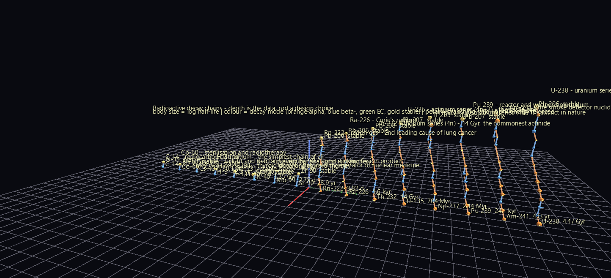

# Decay Chains

A radioactive decay chain is a tree whose depth is not a design choice. U-238 takes fourteen steps to reach lead; tritium takes one. Bismuth-212 genuinely forks — beta-minus 64% of the time, alpha the other 36% — and the two branches rejoin at Pb-208. So the glyph nests as deeply as the physics does, and comparing two glyphs compares two nuclear histories.



**Try it:** download this example below (or [the full examples set](../getting-started/installation.md#example-scenes)), then open `Decay_Chain_Example/Chain_Forest/chain_forest_gv_node.csv` — or drag its folder onto the window.

[:material-download: Chain_Forest (9 KB)](https://iluvdata.org/glyphviz/zips/Decay_Chain_Example_Chain_Forest.zip){ .md-button }
[:material-download: Secular_Equilibrium (13 KB)](https://iluvdata.org/glyphviz/zips/Decay_Chain_Example_Secular_Equilibrium.zip){ .md-button }

## The two scenes

**`Chain_Forest/`** — sixteen chains side by side, ordered by how many decay steps they take, so the forest reads as a skyline. On the left the one-step chains: C-14, Co-60, Cs-137, tritium, I-131, K-40, Mo-99, Sr-90, each with its gold stable endpoint immediately above. On the right the four natural series towering fourteen levels up. The variation *is* the finding.

**`Secular_Equilibrium/`** — the four natural series animated across thirteen decades of logarithmic time, every member's activity solved from the Bateman equations. Watch equilibrium fill a chain from the top down: fast daughters almost at once, Th-230 and Pa-231 taking a hundred thousand years. A cursor rides a log-time axis from 2.78 hours to 317 million years.

## Structure

```text
chain member hub          invisible frame, ALWAYS scale 1
├─ body                   sphere sized by log half-life, coloured by decay mode
├─ activity sphere        animated by the Bateman solution (Secular_Equilibrium)
├─ ring                   topo = Cylinder
│   └─ mode petal ×1-3    azimuth = which mode, length = branching ratio
│       └─ tip            cone sized by the energy released (Q value)
└─ daughter hub           ... and the chain descends from here
```

Sixteen levels deep at the deepest point. That's only possible because **chain hubs are always scale 1**: a parent's scale multiplies its whole subtree, so encoding half-life as the hub's own size would compound fourteen times over and collapse the chain. Half-life lives on a *child* of the hub instead, where it's a leaf and can't propagate.

Horizontal offsets are the real chart-of-nuclides displacement — an alpha step moves −2 protons and −2 neutrons, a beta-minus step +1 and −1 — while each decay step rises by a fixed height. A chain glyph is therefore a spiral staircase whose shadow on the ground is the familiar zigzag of the chart of nuclides, and whose alternating orange and blue rungs are the alpha/beta alternation defining the classical series.

Every decay edge is drawn as a Link node, including edges outside the spanning tree. A chain is a DAG, not a tree — a node can only have one `parent_id` — so each nuclide attaches to the first parent that reaches it and the rest are links, which is how Bi-212's fork stays visible.

## What the physics says

The four classical series come out with the right members and endpoints, staying in their own 4n+k mass-number families. One nice detail: **the neptunium series ends on Tl-205, not Bi-209.** The textbooks stop at bismuth-209, but Bi-209 was measured alpha-unstable in 2003 with a half-life of 2.01×10¹⁹ years, so a current nuclear-data table carries the series one step further.

## Two problems worth recording

**Floats cannot solve this.** Decay constants in one chain span 25 orders of magnitude (Po-214 at 4.2×10³ /s, U-238 at 4.9×10⁻¹⁸ /s). The Bateman solution is an alternating series whose individual terms are astronomically larger than their total, so in float64 it's pure cancellation noise. The solver runs in stdlib `decimal` at 120 digits — exact for these chain lengths, and no new dependency.

**The published branching ratios do not close.** Verifying atom conservation turned up a residual far too large for 120-digit arithmetic, and the cause was the input data: each decay mode's percentage is rounded independently in the evaluated nuclear data, so Bi-214 sums to 100.003%, Tl-210 to 100.007%. Left alone, the solution quietly creates atoms at the 10⁻⁵ level. Branch fractions are now renormalised per nuclide, and conservation comes out at 2.7×10⁻¹⁰ — which is exactly U-238's spontaneous-fission branch, a mode with no single daughter to follow.

Branches below 0.5% are pruned for legibility, which discards the famous astatine path; the verifier checks conservation on both the pruned and unpruned chain so the cost is measured rather than assumed.

## Data

IAEA Nuclear Data Services `ground_states` export (NUBASE/ENSDF-derived), 3,386 ground states, vendored in the example. No network needed to rebuild.
