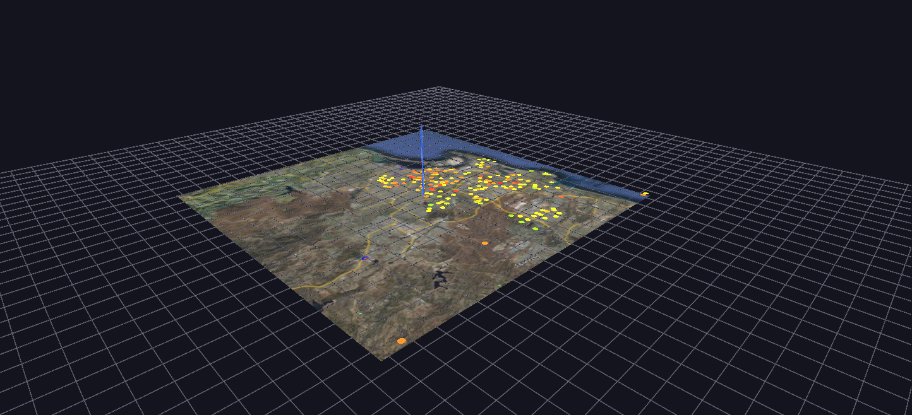

# District Heatmap

The forest, not the trees: every San Diego Unified school as one flat color-coded marker over the district's real satellite imagery, animated across ten years of proficiency data via Channels.

**Try it:** download this example below (or [the full examples set](../getting-started/installation.md#example-scenes)), then open `District_Heatmap_Example/District_Heatmap_Example_gv_node.csv` — or just drag its folder onto the GlyphViz window. Press **Space** to start the animation.

[:material-download: Download this example (8 MB)](https://iluvdata.org/glyphviz/zips/District_Heatmap_Example.zip){ .md-button }

## What it is

This is the district-wide view of the same ten years of San Diego Unified test results that [California STAR Test Scores](calstate-testing.md) draws school by school. It is "the forest, not the trees": instead of a tree per school, each of **217 schools is one flat coloured disc**, lying on the county's real satellite image exactly where the school stands.

Press **Space** and the colours change through the ten years from 2003 to 2012. Because colour is the only thing that moves, the picture answers one question very directly: *where* in the district are scores getting better or worse?

## How to read it

- **Position** is the school's real latitude and longitude, on the same map projection the STAR scene uses, so the two scenes share the same ground.
- **Colour** is the share of students scoring proficient, on a traffic-light scale: **red for low, through yellow, to green for high**. Colour runs smoothly rather than in bands, because at this scale a gradient reads better than five discrete steps.
- **Size is fixed.** The discs are flat, world-scaled circles, so they shrink and grow with the map as you zoom, like the satellite image under them, rather than staying a constant size on the screen.
- **Click a disc** for the school's name with its first and last values, for example *KIPP Adelante: 21.0% (2004) -> 59.1% (2012)* or *High Tech Middle: 61.2% (2004) -> 61.3% (2012)*. Those labels are the quickest way to find the big movers.

The satellite photograph is a single flat plane under the discs.

## What to look for

Watch for regions, not individual schools. A cluster that turns from red to green together is a neighbourhood effect; a lone school that turns green among red neighbours is the exception worth reading about. Then stop playback and click the lone school to see its numbers.

Schools that opened during the decade appear on the map with their first year's value held steady until real data begins. Their labels start at that later year, as in *Learning Choice Academy: 22.4% (2005) -> 38.3% (2012)*.

## A note on the data

The colour is the combined proficiency of male and female students across the grades tested, which stands in for "all students". The all-students row in the source data records a proficiency of exactly zero for every school from 2003 to 2009, so using it would have shown seven years of false red. Males and females combined give the same student counts almost exactly (248,871 against 248,420 in 2003) and have real values for the full decade.

## How it is built

The scene is **218 nodes**: the satellite plane and one disc for each school. The animation has **651 mappings** (red, green and blue for each of the 217 schools) over **271 frames**, which is 30 frames of fade between each pair of adjacent years.

The engine does not interpolate between frames, so the smooth fades are computed in advance by the generator, `generate_district_heatmap.py`, from each school's real yearly values and written into the tracks file. Schools missing a year hold their nearest known value rather than going blank. The generator can read exported CSV files or a live MySQL database, and a command-line option switches the colour to another student group, such as economically disadvantaged students, to see that group's geography instead.

Where this scene and its siblings sit together: [California STAR Test Scores](calstate-testing.md) shows every school's detail as trees, and [SES Achievement Gap Terrain](ses-achievement-gap-terrain.md) shows grade by year as a surface. This one shows *where*.
