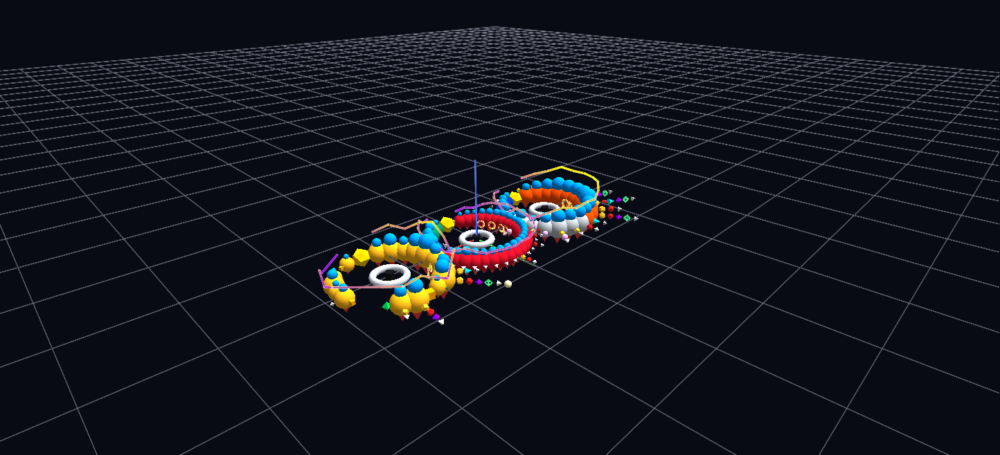

# Duel of Dynasties

Three complete career orreries — Wayne Gretzky, Gordie Howe, Mario Lemieux — side by side: torus hubs carrying team-colored, points-scaled season spheres with stat satellites, award stacks, Stanley Cup rings, and a Plot-topology scoring curve, animated on a shared career-relative clock.

**Try it:** download this example below (or [the full examples set](../getting-started/installation.md#example-scenes)), then open `Duel_Of_Dynasties_Example/duel_of_dynasties_gv_node.csv` — or just drag its folder onto the GlyphViz window. Press **Space** to start the animation.

[:material-download: Download this example (299 KB)](https://iluvdata.org/glyphviz/zips/Duel_Of_Dynasties_Example.zip){ .md-button }

## What it is

Three of hockey's greatest careers, **Wayne Gretzky, Gordie Howe and Mario Lemieux**, built as three orreries side by side on one plane. Each career is a ring of season spheres around a torus hub, and each ring fills in as the career goes on. Press play and you watch three lives unfold in step, so that one can be held against another year for year.

The point of the scene is the clock. It does not run on calendar years. It runs on **years since debut**, 34 steps long, which is the span of Howe's career. Every player's first season arrives on step one, so the three rings fill *in phase* and the differences between the careers become visible gaps and bursts.

## How to read it

Each player's orrery has the same parts:

| What you see | What it means |
|---|---|
| **The torus hub** | the career. Gretzky is on one side, Howe in the middle, Lemieux on the other |
| **A sphere on the ring** | one season. Its colour is the team the player skated for, and its size is points, normalized to one shared scale so the three players are comparable |
| **Small cubes around a season** | its statistics: goals, assists, penalty minutes and plus/minus, on the faces of a cube |
| **A stack beside a season** | the awards that year, sorted by prestige, each award with its own colour and shape |
| **A ring of Stanley Cup markers** | the Cups won |
| **A Plot-topology line** | the player's points per season as a curve, drawn in the same scene |
| **An icosahedron at the end** | the Hockey Hall of Fame |

Read the gaps, because the arc is the same for all three. **Gretzky's ring is gapless**, twenty-one unbroken seasons. **Howe's runs for 34 years** and has a hole for his 1971–73 sabbatical. **Lemieux's is bitten** by injury, by his retirement, and by the 2004 lockout. The Hall of Fame markers appear in the year each man was actually inducted, which is mid-career for both Howe (1972) and Lemieux (1997), who each returned to play after being enshrined.

Each season sphere **flares** to 1.25 times its size for one step when it arrives, then settles to its real size, so the eye is drawn to what just happened. Everything else about a season, such as its stats, awards and Cup markers, appears and stays.

Click any glyph for its line, for example *1978-79 - IND/EDO - 110 Pts (46G 64A)*.

## Things to try

- **Play it, then stop on the last frame** to see the three finished careers side by side.
- **Count the Cups and the awards** by looking at the stacks and rings rather than the numbers.
- **Follow the points curve.** Each career's Plot line grows a point at a time as the seasons arrive, so you can watch a peak form.
- **Change the clock in your mind.** The same nodes on a calendar-year clock would tell a different story: Howe would start decades before the others. Choosing the clock is itself an analytical decision, and this scene makes it on purpose.

## How it is built

The scene is **555 nodes**: three torus hubs with 143 season spheres around them, and the stat cubes, award markers, Cup rings, Hall of Fame markers and Plot-curve points hung from those. It is animated by **423 Channels mappings** over a **34-step clock**, on two attributes only: `color_a` (a glyph's presence) and `scale_x/y/z` (the flare). A satellite is born with its parent by sharing the parent's transparency channel while having its own scale channel, so it does not inherit the parent's flare. Every scale track ends on the authored value, so a looped playback begins in a consistent state.

The generator, `build_duel.py`, ships with the scene and reads the hockey history CSVs named by its `HOCKEY_DATA` setting.
