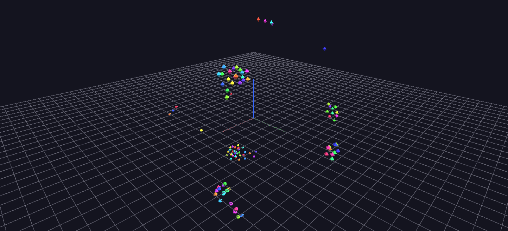

# Flocking (Boids)

A classic Reynolds boids flocking simulation, precomputed and baked into Channels: every boid's position is driven by three tracks — one hundred boids, three hundred tracks.

**Try it:** [download the examples set](../getting-started/installation.md#example-scenes), then open `Flocking_Example/Flocking_Example_gv_node.csv` — or just drag its folder onto the GlyphViz window. Press **Space** to start the animation.

---

*A full write-up of this example is coming soon.*
