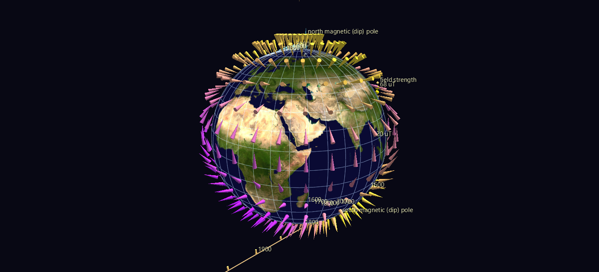

# Earth's Magnetic Field

The field that moves a compass needle is not fixed. It drifts, tilts and weakens on a timescale of decades, driven by convection in the liquid iron outer core 3,000 km down. These two scenes animate that drift from **1590 to 2025** on a World Grid globe.

**Try it:** [download the examples set](../getting-started/installation.md#example-scenes), then open `Geomagnetic_Field_Example/Field_And_Poles/GeomagField_gv_node.csv` — or drag its folder onto the window. Press **Space** to run the four centuries.

## The two scenes

**`Field_And_Poles/`** — a lattice of 420 cone glyphs at 12° spacing, each aimed along the true local field: the cone's compass bearing is the declination, its dip is the inclination, its colour the field strength (purple 20 µT → yellow 68 µT). Both magnetic dip poles ride the same clock along trails of markers labelled by century.

**`Intensity_Shell/`** — the same globe wearing a shell of 1,056 glyphs whose height above the surface *is* the field strength. Strong field over the poles stands high; weak field sags toward the ground.

## What to look for

- **The north dip pole's sprint.** It crawled at roughly 6 km/yr through the 17th and 18th centuries and 10 km/yr through most of the 20th, then accelerated to about **43 km/yr since 1990**, leaving Arctic Canada for Siberia. This is why the World Magnetic Model had to be updated off-schedule in 2019.
- **The two poles are not opposite each other.** Dip poles aren't antipodal, because the real field isn't a pure dipole — obvious the moment you can see both at once.
- **Declination swinging over Europe.** At London the model gives +11.6° east of north in 1590, −23.9° west in 1800, and +0.9° today. A 36° swing, and the reason every old British map carries a date beside its compass rose. Watch the cones over the North Atlantic rotate while the Pacific ones barely move.
- **The South Atlantic Anomaly forms, deepens and marches west.** In `Intensity_Shell` it is an enormous depression in the landscape — the region where Earth's field is weak enough that satellites take measurable radiation damage. From 31.2 µT off southern Africa in 1590 to **22.1 µT over Paraguay** today: a 29% weakening and 74° of westward drift in four centuries, and very rarely rendered as anything but a contour map of one epoch.

## The models

| Model | Span | What it is |
|---|---|---|
| **gufm1** | 1590–1990 | Jackson, Jonkers & Walker (2000). Fitted to ~365,000 historical observations, most of them **compass bearings logged by merchant and naval mariners** — four centuries of the field reconstructed largely from ships' logbooks. |
| **IGRF-14** | 1900–2030 | International Geomagnetic Reference Field, 14th generation (IAGA, 2024). Satellite-constrained over its later epochs. |

Nothing is downloaded: both scenes are computed from bundled Gauss coefficients and are pure CSV once built. The example ships two independent verification suites — one checking the physics against a separately written IGRF implementation, the analytic axial-dipole limit, and observed dip-pole positions from magnetic surveys; the other pulling each cone's direction back out of the real GlyphViz transform engine and confirming the picture agrees with the model to 0.0005°.

## Aiming a glyph on a globe

Worth knowing if you build your own globe scene, because it took a probe against the real transform engine to establish: a globe child's local **+Z is radially outward, +Y is east, +X is south**. In Heading/Tilt/Roll mode, a compass azimuth *A* measured clockwise from north is `heading = A − 90`, so a field with declination D and inclination I is `rotate_x = 90 + I`, `rotate_y = D − 90`.
