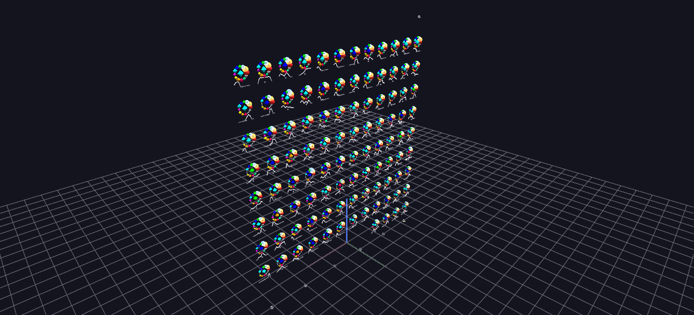

# GTD — Campaign Pulse

Campaigns breathe: the rosette wall for the top 100 organizations animated on the same half-month clock — each rosette swells and spins with its organization's trailing-12-month activity relative to its own historical peak.

*Data: Global Terrorism Database (START, University of Maryland), 1970–2020.*

**Try it:** download this example below (or [the full examples set](../getting-started/installation.md#example-scenes)), then open `Global_Terrorism_Example/Campaign_Pulse/CampaignPulse_gv_node.csv` — or just drag its folder onto the GlyphViz window. Press **Space** to start the animation.

[:material-download: Download this example (320 KB)](https://iluvdata.org/glyphviz/zips/Global_Terrorism_Example_Campaign_Pulse.zip){ .md-button }

---

*A full write-up of this example is coming soon.*
