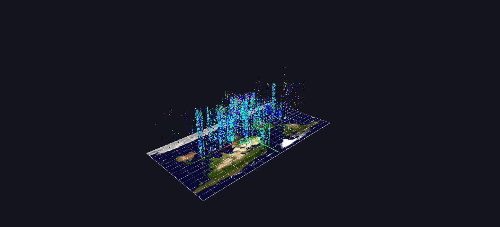

# GTD — Event Cloud

No aggregation: every incident in the database (about 210,000) is one octahedron placed by longitude and latitude, with altitude as date and color as attack type — a half-century of events as a single cloud, and a deliberately large scene.

*Data: Global Terrorism Database (START, University of Maryland), 1970–2020.*

**Try it:** download this example below (or [the full examples set](../getting-started/installation.md#example-scenes)), then open `Global_Terrorism_Example/Event_Cloud/EventCloud_gv_node.csv` — or just drag its folder onto the GlyphViz window.

[:material-download: Download this example (8 MB)](https://iluvdata.org/glyphviz/zips/Global_Terrorism_Example_Event_Cloud.zip){ .md-button }

## What it is

Every incident in the Global Terrorism Database, 1970 to 2020, as one glyph. There is no aggregation and no sampling: **209,705 incidents, 209,705 octahedra**, in a scene of 209,712 nodes. It is the plain, whole picture, and it is deliberately one of the largest scenes in the gallery, so it takes a moment to load and rewards a decent graphics card.

The cloud stands on a real map of the world. Where an incident happened is its position on the map; when it happened is how high it floats above it. A half-century becomes a column of events that rises from the ground.

## How to read it

| Axis or property | Meaning |
|---|---|
| **X** | longitude |
| **Y** | latitude |
| **Z (height)** | date, at two world units per year, so 1970 sits at the map and 2020 about 100 units above it |
| **Colour** | attack type, using the same legend as every other GTD scene (green assassination, blue armed assault, cyan bombing, and so on; see [Organization Profiles](gtdb-organization-profiles.md) for the full list) |
| **Size** | the log of killed plus wounded, with a floor so that events with no casualties stay visible |

Incidents with no recorded coordinates are placed at the centre of their country, computed from that country's geocoded incidents. Under the cloud lies NASA's Blue Marble image on a World Grid, and a few markers along the height axis label the decades.

Click any event for its label: the organization, the date, the city and country, the attack type, the target and the casualties.

## What the shape shows

You do not have to read individual events to see structure. Fly out and look at the whole column:

- **The cloud is bottom-light and top-heavy.** Of the roughly 209,700 incidents, about 6,800 fall in the 1970s, 29,000 in the 1980s, 32,000 in the 1990s, 21,000 in the 2000s and **about 119,000, more than half, in 2010 to 2020**. The cloud thickens sharply near the top.
- **Clusters stand out as pillars.** A country with long-running violence is a column that stays full across many heights; a conflict that ended is a stub near the bottom.
- **Colour layers show the mix of methods.** Look at which colours dominate in a region at a given height.

Look from directly above and you have a map of where; look from the side and you have a history of when.

## Things to try

- **Roll the map into a globe.** The map is a World Grid. In the World Grid panel, set *Shape* to *Sphere*: the map wraps into a globe and every event moves to the same longitude and latitude on its surface, with date becoming distance out from the surface instead of height above the plate.
- **Isolate one kind of attack.** Every label contains the attack type, so in the Select By group type *Bombing* (or *Kidnapping*, or *Assassination*) into *Tag contains* and press *Select Matching Tags*.
- **Slice by time.** Frame a horizontal band to read a single decade.

## How it is built

The scene is **one World Grid and about 209,700 children**, each placed by longitude and latitude on the grid, so that the whole cloud can be switched between flat and globe. It is a single file with no animation; the scene is drawn from a retained display list, which is what lets 200,000-plus glyphs stay interactive. The generator, `generate_gtdb_examples.py` in the parent folder, reads the START spreadsheet (about 100 MB, which takes a couple of minutes to parse the first time) and builds all five GTD scenes.

**Source:** Global Terrorism Database, START, University of Maryland. Map: NASA Blue Marble.
