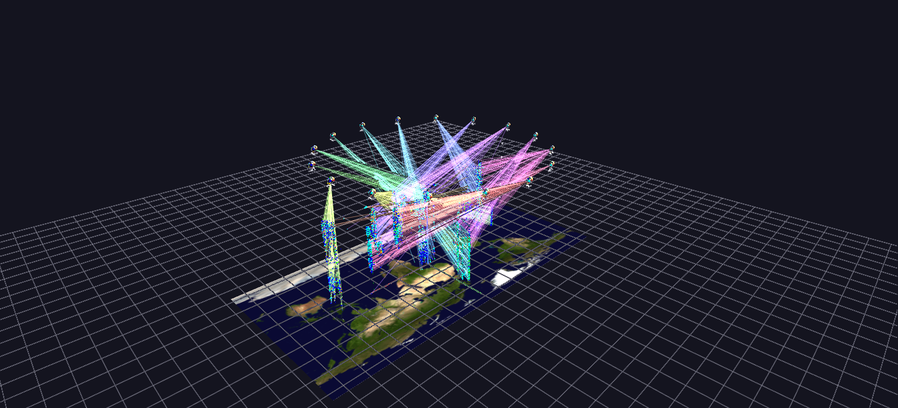

# GTD — Org–Event Network

Profiles and events combined: the top organizations float as rosettes on a ring above their full event cloud on a Blue Marble map plane, with link lines tying each organization to its most lethal events.

*Data: Global Terrorism Database (START, University of Maryland), 1970–2020.*

**Try it:** download this example below (or [the full examples set](../getting-started/installation.md#example-scenes)), then open `Global_Terrorism_Example/Org_Event_Network/OrgEventNetwork_gv_node.csv` — or just drag its folder onto the GlyphViz window.

[:material-download: Download this example (9 MB)](https://iluvdata.org/glyphviz/zips/Global_Terrorism_Example_Org_Event_Network.zip){ .md-button }

## What it is

This scene joins the two before it. [Organization Profiles](gtdb-organization-profiles.md) summarizes each group as a rosette; [Event Cloud](gtdb-event-cloud.md) shows every incident. Here the **16 most active organizations float as rosettes on a ring high above the cloud of their own events**, and **link lines tie each organization to its most lethal incidents**. Each one's links fan down from its rosette like a cone, so you can see where it acted and when.

It has 65,681 nodes: the 16 rosettes, about 59,000 events from those organizations on a Blue Marble map, and 6,400 links.

## How to read it

- **The rosettes are the same glyphs as in Organization Profiles**, with the same centre, clock ring, casualty spheres and reach sphere, so everything you learned there carries over.
- **The cloud underneath is the Event Cloud**, restricted to the events attributed to these 16 organizations: longitude and latitude on the map, date as height, colour by attack type, size by casualties.
- **Each link joins an organization to one of its deadliest incidents**, up to 400 per organization, so 16 × 400 = 6,400 links. Each organization has its own link hue, and its rosette carries a small beacon of the same colour so you can trace a cone back to its source.
- **The cone's shape is the organization's geography and history at once.** Where the links land on the map is where its deadliest incidents were, and how high they land is when.

## Things to try

- **Follow one cone.** Choose a rosette, find its beacon colour, and trace the lines down. Then select one of the events at the other end and read its label for the details of that incident.
- **Compare two cones.** Pick two organizations and compare how widely their links spread across the map.
- **Look from above and from the side.** From above the cones are footprints on the map; from the side they show how the incidents are spread across the decades.

## Why the links cost something

Links are drawn every frame rather than retained, so their cost grows with their number. That is why the scene caps the links at 400 per organization: an uncapped link per attack on a 12,000-attack organization would drown the frame rate. If your graphics card copes comfortably, the generator's `--links-per-org` option raises the cap.

## How it is built

The map is a plain textured plate here, not a World Grid, which makes it a useful contrast with [Event Cloud](gtdb-event-cloud.md) and [Time Replay](gtdb-time-replay.md): a map-anchored visualization does not need a World Grid, though it does give you the flat-to-globe switch. The generator is `generate_gtdb_examples.py` in the parent folder, with options for the number of organizations (`--network-orgs`, default 16) and the links per organization.

**Source:** Global Terrorism Database, START, University of Maryland. Map: NASA Blue Marble.
