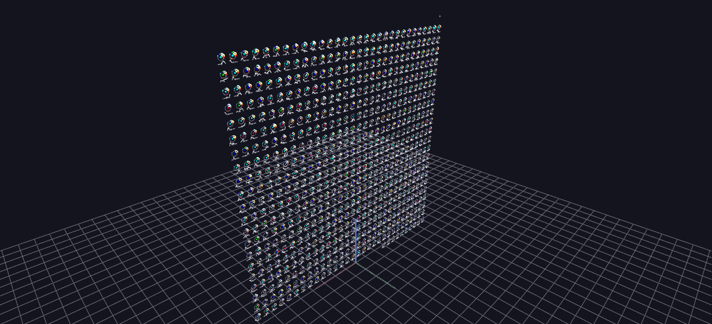

# GTD — Organization Profiles

A wall of profile-rosette hyperglyphs, one per organization with ten or more attributed attacks, sorted most-active first. Each rosette is a fixed layout — an attack-type clock ring, casualty and reach spheres, an activity sparkline — that you learn once and can then read at a glance on any organization.

*Data: Global Terrorism Database (START, University of Maryland), 1970–2020.*

**Try it:** [download the examples set](../getting-started/installation.md#example-scenes), then open `Global_Terrorism_Example/Organization_Profiles/OrgProfiles_gv_node.csv` — or just drag its folder onto the GlyphViz window.

---

*A full write-up of this example is coming soon.*
