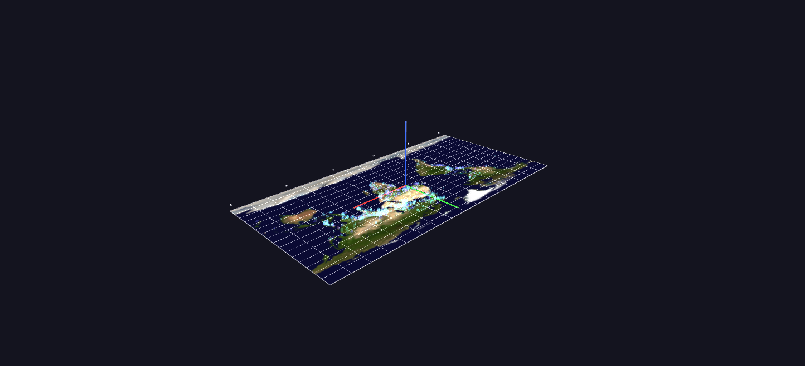

# GTD — Time Replay

Fifty years in sixty seconds: the event cloud flattened onto a Blue Marble World Grid and replayed through Channels. Every frame is half a month; each incident flashes in when its month arrives and decays to a faint persistent ember.

*Data: Global Terrorism Database (START, University of Maryland), 1970–2020.*

**Try it:** download this example below (or [the full examples set](../getting-started/installation.md#example-scenes)), then open `Global_Terrorism_Example/Time_Replay/TimeReplay_gv_node.csv` — or just drag its folder onto the GlyphViz window. Press **Space** to start the animation.

[:material-download: Download this example (2 MB)](https://iluvdata.org/glyphviz/zips/Global_Terrorism_Example_Time_Replay.zip){ .md-button }

## What it is

Fifty years of the Global Terrorism Database, played back in about a minute. The incidents from [Event Cloud](gtdb-event-cloud.md) are flattened onto the Blue Marble map, and **playback time is calendar time**: every frame is half a month, and the 1,224 frames cover January 1970 to December 2020. Each incident is invisible until its month arrives, **flashes to full brightness, and then fades to a faint ember that stays**, so the map accumulates the whole history as it plays.

By the end, the embers have drawn the whole fifty years' footprint on the map, and the flashes show you where the violence was *at each moment* on the way there.

## How to read it

- **Position** is longitude and latitude on the map.
- **Colour** is the attack type, in the same legend as every other GTD scene (see [Organization Profiles](gtdb-organization-profiles.md)).
- **Size** is casualties, on a log scale. The marks are larger than in the Event Cloud, because this scene shows far fewer events.
- **Flash then ember.** A new incident flashes to full opacity and fades, over a few frames, to a faint persistent mark. The bright points are *now*; the faint ones are *before*.
- **The yellow cursor** sweeps along the bottom edge of the map. Its **position is the current date**, and its **height is the number of attacks worldwide that month**, so it rises and falls like a seismograph of the whole period.
- **Decade ticks** mark the sweep.

Watch for the regional stories as they take their turn: Northern Ireland and Italy flaring in the 1970s, Latin America in the 1980s, Iraq erupting after 2003, and the surge of 2014.

## Why it shows about 10,000 events, not all of them

A Channels animation redraws the whole scene every frame, and that costs time for every node, so the full cloud would not play smoothly. Instead the scene picks the **10,040 most severe incidents** with a quota for each month that follows the square root of that month's worldwide attack count. The quiet early decades keep their handful of events, a busy period such as 2014 still reads as a surge, and every incident with 50 or more casualties is always included. The animation data stays small however many nodes there are: incidents born in the same month share one fade track, so there are **612 fade tracks plus two for the cursor**.

## Things to try

- **Play it at about 20 frames per second** for the minute-long version. At 10 frames a second each second of screen time covers roughly five months, which is a good speed for reading the regional stories.
- **Roll it into a globe mid-playback.** The map is a World Grid. Set *Shape* to *Sphere* in the World Grid panel while the animation is running and fifty years of history replays across a turning globe.
- **Stop on a date.** Drag the Channels slider to a month you care about and click the bright points for their labels.
- **Compare with the cloud.** [Event Cloud](gtdb-event-cloud.md) shows all of it at once as a column; this shows the same history as a film.

## How it is built

The scene is **10,047 nodes**: a World Grid carrying the Blue Marble map, the 10,040 incidents as its children, the time cursor and the decade ticks. The Channels file has **614 mappings** (a `color_a` fade for each birth month, and the cursor's position and height) over 1,224 frames. The CSV itself stores each incident at its ember brightness, so the freshly loaded scene previews the full fifty-year footprint before playback begins. The generator is `generate_gtdb_examples.py` in the parent folder.

**Source:** Global Terrorism Database, START, University of Maryland. Map: NASA Blue Marble.
