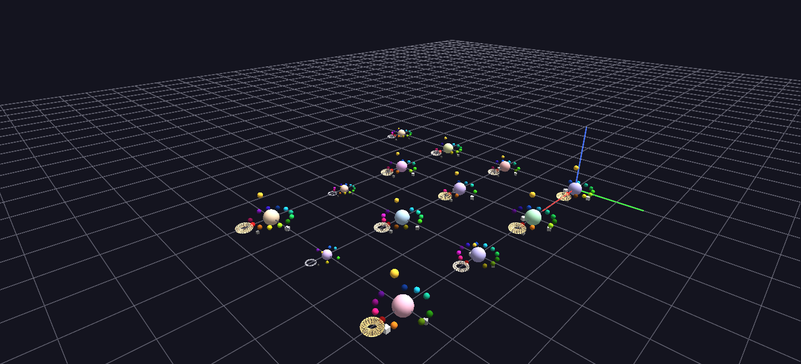

# Hacking Creativity Glyph

A legible single-person "creative style" glyph for the Hacking Creativity dataset (Red Bull High Performance Team, 2015) — a redesign of the dense 2015 ANTz hyperglyph the same data first produced. A second CSV in the folder holds a single-person variant.

**Try it:** download this example below (or [the full examples set](../getting-started/installation.md#example-scenes)), then open `Hacking_Creativity_Glyph_Example/Hacking_Creativity_Glyph_Example_gv_node.csv` — or just drag its folder onto the GlyphViz window.

[:material-download: Download this example (16 KB)](https://iluvdata.org/glyphviz/zips/Hacking_Creativity_Glyph_Example.zip){ .md-button }

## What it is

In 2015 the Red Bull High Performance Team and Vibrant Data's Mappr surveyed about 660 people on how they work creatively: when, how fast, alone or in company, driven by what. Mappr grouped the respondents into clusters of similar creative style. This scene draws those clusters, **13 glyphs, one per cluster**, each a compact picture of what that cluster's members have in common.

It is also a redesign. The first version of this visualization, built in ANTz in 2015, put one ring or cube on a glyph for every raw survey question, more than a hundred permanently labelled shapes per person. By its author's own assessment it was too dense to read. This version shows less on purpose, so that each glyph can be read at a glance.

## How to read a glyph

| Part | What it shows |
|---|---|
| **The central sphere** | the cluster. Its **colour** is a pale tint fixed by the cluster's name, so the same cluster is always the same hue, and its **size** is the number of members (on a log scale across the 13 clusters) |
| **A ring of up to 13 small spheres** | one fixed slot for each creative-style dimension: Time, Juggle/Specialist, Focus, Details, Kinetic/Cerebral/Intuitive, Organization, Process, Pace, Confidence, Social/Solitary, Mood, Adaptable/Determined, and Chance/Risk/Habit |
| **The hue of each slot** | fixed by the dimension, in the same position on every glyph, so two clusters' rings can be compared directly |
| **The brightness of each slot** | the cluster's particular value for that dimension. It tells values apart without implying an order, because most of these dimensions have none: "Doer, Envisioner, Evaluator, Ideator" is a list, not a scale |
| **A gap in the ring** | a dimension that was not computed for this cluster. The gap is left honestly empty |
| **The wire halo** | network reach: its colour temperature, from white to gold, and its thickness show the cluster's *mean number of connections* |
| **The spike on top** | the highest single connection count in the cluster, so a cluster with one well-connected hub looks different from a uniformly peripheral one |
| **Three small cubes below the ring** | the cluster's centrality, bridging and diversity scores. They are cubes rather than spheres so that they are not mistaken for more dimension slots |

Click any piece to read its detail. Every node has a label, but the scene is meant to be viewed with **Tags: Selected Only** on (the default), so that the raw detail appears on demand rather than all at once. A cluster's centre reads, for example, *Cerebral~ Self-confident~ Ideator -- 59 members | mean degree 5.8 (highest 49)*.

## Why 13 glyphs and not 662

The first idea was a glyph per person. Looking at the data showed why that adds nothing: the 13 style dimensions turned out to be **identical for everyone in a cluster**, because they are the very things the cluster label is built from, not an independent measurement of each person. A ring per person would repeat the same ring. What does vary within a cluster is network position, so that is what the halo, spike and cubes carry.

## A single person

The folder also holds one individual's glyph, `Hacking_Creativity_Glyph_Example_person218_gv_node.csv`, built on the same pattern but from that person's own answers. Open it to see how the same layout reads at the scale of one person, with its label giving the answers in their own words (what inspires them, how they see themselves, what they are best at, what drives them) and their network reach.

## Things to try

- **Compare two rings.** Fly between two clusters and compare slot by slot. The same angle and hue on both mean the same dimension.
- **Find the hubs.** Look for the clusters with a tall spike but a modest halo: a well-connected individual in an otherwise quiet cluster.
- **Regenerate for one person.** With the source spreadsheet, `python generate_hacking_creativity_glyph.py --id 218` builds any individual's glyph, centred at the origin.

The generator ships with the example, and the survey spreadsheet it reads does not.
