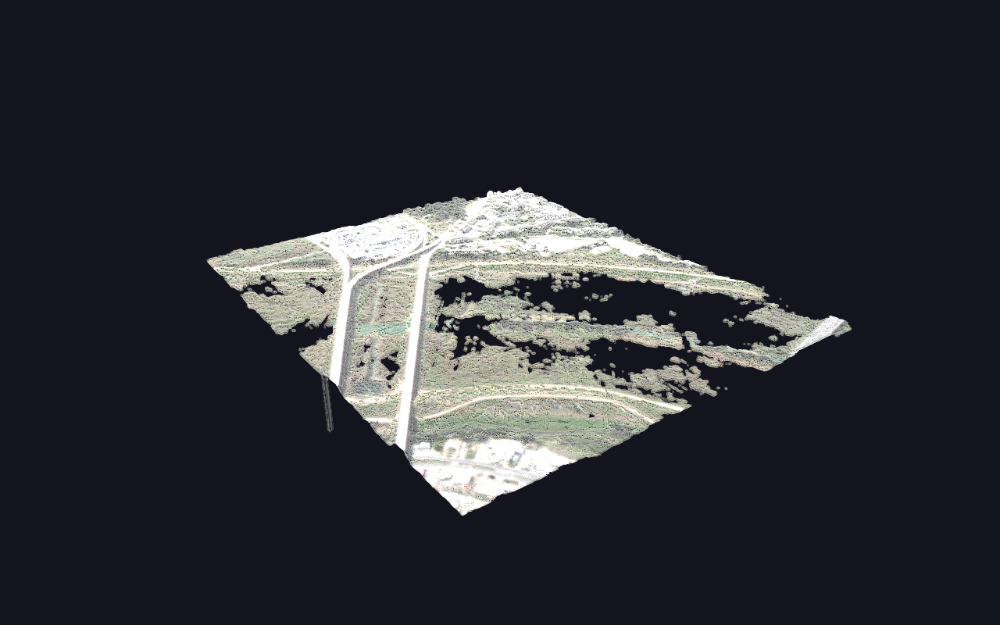

# LIDAR Import (LAS/LAZ)

An aerial laser scan — 442,767 points with per-point colour — brought into GlyphViz through the point-cloud importer, as a [Point Cloud topology](../reference/topologies.md#point-clouds-topology-18) scene.



**Try it:** download this example below (or [the full examples set](../getting-started/installation.md#example-scenes)), then use **Meshes → Import Point Cloud…** to open `LIDAR_Import_Example/aerial_survey.laz` — or just drag the file onto the GlyphViz window.

[:material-download: Download this example (2.5 MB)](https://iluvdata.org/glyphviz/zips/LIDAR_Import_Example.zip){ .md-button }

---

## What you are looking at

About 960 × 1,130 metres of ground, scanned from the air, with RGB from simultaneous imagery mapped onto every return. You can read the road junction, the buildings along the ridge, individual trees, and the field boundaries.

None of that is a texture. **Every one of those 442,767 points is a real GlyphViz node** — click one and the Properties panel edits it, label it and the label sticks, bind it to a Channels track and it animates. They simply draw as a single batched array instead of 442,767 separate glyphs, which is what makes the scene render at a few milliseconds a frame instead of grinding.

The whole scan hangs off one parent glyph. Move, rotate or scale that parent and the cloud follows it, so a scan can be positioned as context underneath a hyperglyph scene of your own.

## Why this file is a good example

Because it is ordinary. Everything awkward about real LIDAR is in it, and the importer has to handle all three before you see anything at all:

**Projected coordinates with a huge origin.** Eastings run 704,194 to 705,153 and northings 3,626,785 to 3,627,912 — a UTM zone, around 32.8° N. Imported unchanged, the scan would be a speck 3.6 million units from the origin. The importer recentres it and scales it to a world span you choose (360 by default, GlyphViz's 1:1 frame).

**8-bit colour in 16-bit fields.** LAS stores RGB as 16-bit, but this file's writer put plain 0–255 values into those slots — as many writers do. Treating it as true 16-bit and shifting it down 8 bits would render the entire scan black, so the importer decides from the data rather than from the format.

**No classification at all.** Every point carries code 0, "created, never classified", which is the normal state of most LIDAR outside government tiles. The ground/vegetation/building colour mode has nothing to work with here, so the automatic mode correctly falls through to the file's own RGB. (For a classified tile it would do the opposite — see [Importing point clouds](../reference/point-cloud-import.md#colour-by).)

## Why it ships as `.laz`

LAZ is the lossless compressed form of LAS — same data, verified bit-for-bit on this file for coordinates and colour alike. As `.las` it is **17.7 MB**; as `.laz` it is **2.55 MB**, or 14%.

That is the entire argument for the format, and it is a published open standard: LAS is an [ASPRS specification](https://github.com/ASPRSorg/LAS), and LAZ became an [OGC Community Standard](https://www.ogc.org/announcement/ogc-announces-publication-of-the-laz-1-4-community-standard/) in September 2026.

## Things to try

- **Take it whole, or sample it.** The import dialog defaults to 100,000 points; this file is small enough to take entire. Compare the two — at a normal working distance you will struggle to tell them apart, which is the practical case for decimating a ten-million-point tile.
- **Turn on vertical exaggeration.** 166 metres of relief across a kilometre reads nearly flat at a truthful 1.0. Try 3×.
- **Switch the colour mode to Elevation.** The RGB shows you what the ground *looks* like; the elevation ramp shows you its *shape*, and the two answer different questions.
- **Fly into it.** Press **C** for Camera Mode and fly along the road at ground level. A point cloud is one of the few things that reads better from inside than from above.
- **Change the point size.** Select the cloud's parent and edit its **Ratio** in the Properties panel — 0.1 is 2 px. Larger points close the gaps between returns and make the scan read as a surface; smaller ones let you see through it.

## Building the scene from code

You do not need to — the importer is the point. But `build_lidar_example.py` ships beside the scan for anyone who wants the same result from a script, or wants to see which knobs the dialog turns:

```
<glyphviz-env>\python.exe examples/LIDAR_Import_Example/build_lidar_example.py --points 100000
```

One thing that script prints is worth knowing before you save a large cloud: the scan is 2.55 MB as `.laz`, but saved as a GlyphViz scene it is **243 MB**, because every point becomes a full 94-column node row. Importing is cheap; keeping a big cloud as a scene file is not.
