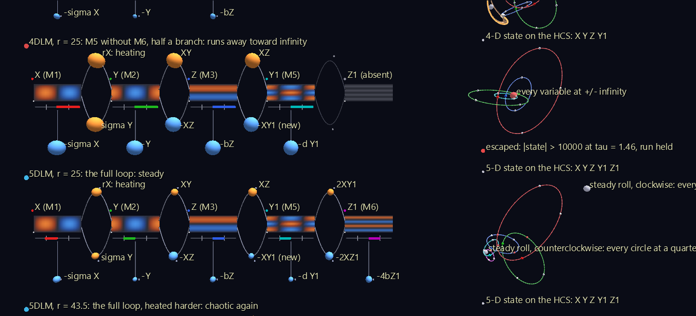
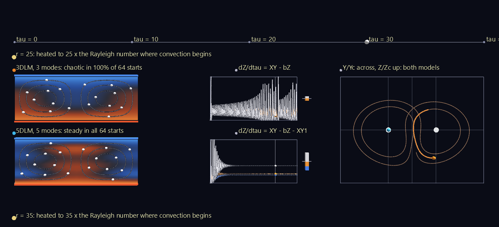
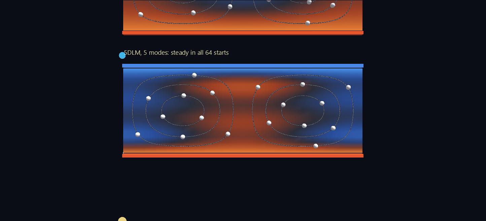
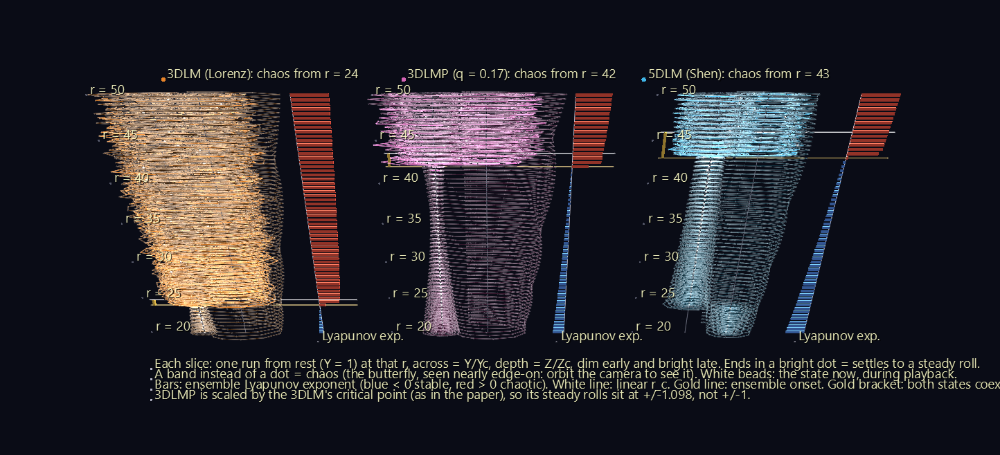
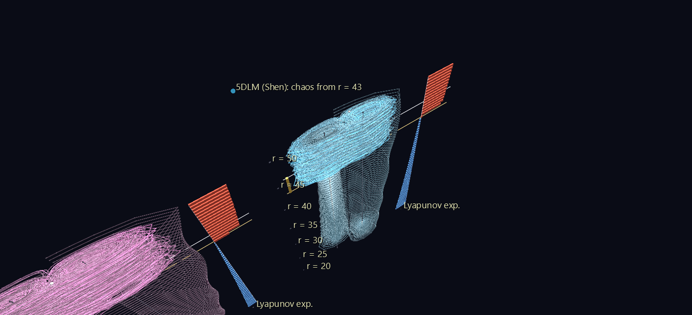
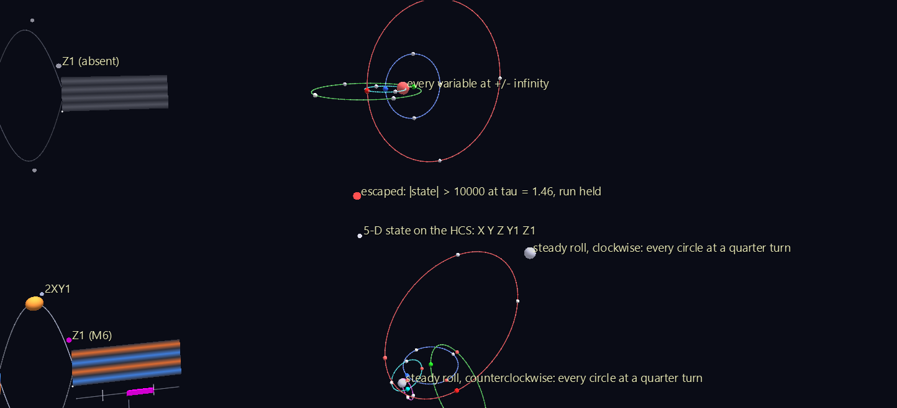
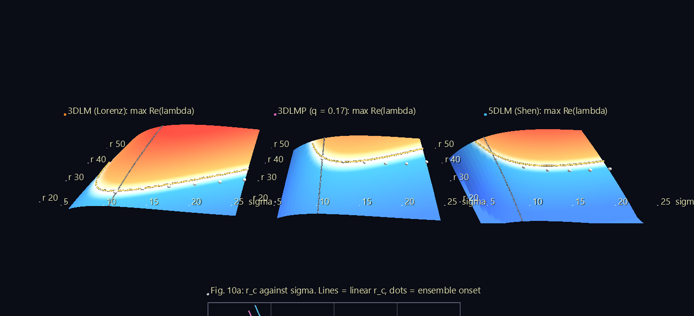
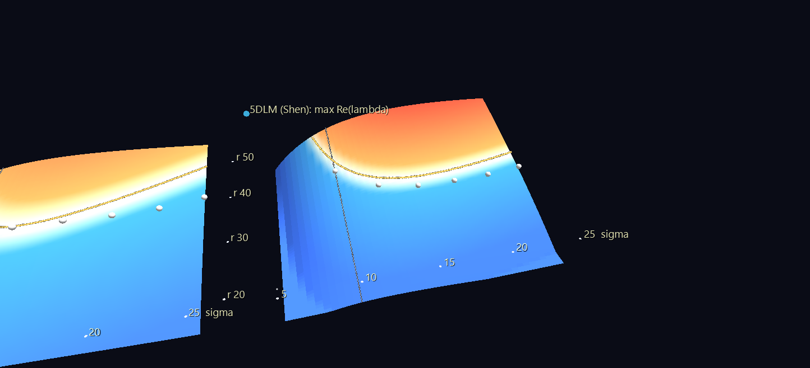
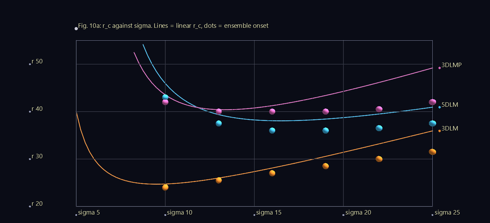

# Nonlinear Feedback in a Five-Dimensional Lorenz Model

Edward Lorenz's 1963 model of a heated layer of fluid is the most famous picture of chaos there is: the butterfly. Lorenz boiled the fluid down to three numbers, and three numbers turned out to be enough to make the motion unpredictable. In 2014 Bo-Wen Shen asked what happens if you give the model a little more detail. He added two finer patterns of temperature, making five numbers, and found that the extra detail makes the flow **calmer, not wilder**. The onset of chaos moves from a heating level of about 25 to about 43–46.

This example turns Shen's paper into **four GlyphViz scenes**:

- Scene 1 shows the fluid itself.
- Scene 2 shows where each model turns chaotic.
- Scene 3 shows the feedback loop that does the calming, with the whole five-dimensional state drawn as one **Hyperdimensional Coordinate System (HCS)** hyperglyph.
- Scene 4 shows the landscape of stability across the model's two parameters.

The HCS is what lets Scene 3 show something an ordinary plot can't: one of the paper's models, built with only half of the new feedback loop, **running away toward infinity**.

**Try it:** download the scenes below (or [the full examples set](../getting-started/installation.md#example-scenes)), then open the `*_gv_node.csv` inside, or drag the zip straight onto the GlyphViz window. Three of the scenes are animated: press **Space** to play. Each runs 1,600 frames, 40 of the model's time units, and loops. The Stability Landscape is a still scene. Turn off **View > Show Grid** for the cleanest view.

[:material-download: Convection_Cells (3 MB)](https://iluvdata.org/glyphviz/zips/Lorenz5D_Convection_Cells.zip){ .md-button }
[:material-download: R_Sweep_Tower (3 MB)](https://iluvdata.org/glyphviz/zips/Lorenz5D_R_Sweep_Tower.zip){ .md-button }
[:material-download: Feedback_Loop (1 MB)](https://iluvdata.org/glyphviz/zips/Lorenz5D_Feedback_Loop.zip){ .md-button }
[:material-download: Stability_Landscape (167 KB)](https://iluvdata.org/glyphviz/zips/Lorenz5D_Stability_Landscape.zip){ .md-button }

## The paper in plain words

Put a thin layer of fluid between a hot plate and a cool one. Heat it gently and it just conducts heat upward. Heat it harder and it starts to turn over in **convection rolls**: warm fluid rises on one side, cool fluid sinks on the other. Heat it harder still and the rolls stop turning steadily and start to reverse unpredictably.

Lorenz described the fluid with three numbers, each the strength of one fixed spatial pattern:

| Number | Pattern | What it means |
| --- | --- | --- |
| **X** | M1 | How fast the rolls turn. Its sign is the turning direction. |
| **Y** | M2 | The temperature difference between the rising and sinking sides. |
| **Z** | M3 | How much the rolls have flattened the layer's vertical temperature profile. |

The heating is the **normalized Rayleigh number r**: r = 1 is where convection begins, and r = 25 means heated to 25 times that. With σ = 10 (the **Prandtl number**, a property of the fluid), Lorenz's three-number model (the **3DLM**) turns chaotic at r ≈ 24.74.

Shen's five-number model (the **5DLM**) adds **Y1** and **Z1**, the same two temperature patterns at finer vertical scales (M5 and M6). They capture layering close to the plates that the 3DLM can't represent. The 5DLM stays steady up to r ≈ 43, and the reason is one new term in the equation for Z:

dZ/dτ = XY − bZ **− XY1**

In the 3DLM, Z has one source (XY) and one drain (bZ), and above r ≈ 25 they never settle into balance. In the 5DLM the new term drains Z into the finer patterns, where strong damping removes it. Shen calls this extending the model's **nonlinear feedback loop**. He also shows that replacing −XY1 with a simple eddy-damping term, −qX², in an otherwise three-number model (the **3DLMP**) reproduces most of the effect. That move is what weather modellers call a *parameterization*.

The paper's larger point is about weather prediction. The chaos found in a model can depend on how many patterns the model keeps, so a chaotic toy model doesn't by itself show that small disturbances must change the large-scale weather.

## Scene 1: Two Convection Cells

The fluid behind the letters. Each cell is the layer itself, rebuilt from the model's numbers with the paper's own spatial patterns, between a **hot plate** (red bar, below) and a **cool plate** (blue bar, above). Colour is temperature: red hot, blue cool. The cell is one horizontal wavelength wide, so it holds **two rolls turning in opposite directions**. The white beads are fluid parcels, carried along the rolls' streamlines by the model's own velocity field.

There are two heating levels, r = 25 and r = 35. At each, the 3DLM is on top and the 5DLM below, and both start from rest with the paper's small nudge, Y = 1.

**Watch the beads.** In the 3DLM they keep stopping and turning around: the rolls reverse 9 times in 40 time units at r = 25, and 28 times at r = 35. **Every lobe switch of the butterfly is the rolls reversing direction.** In the 5DLM the beads settle into one steady circulation, with a warm plume rising up the middle of the cell.

Beside each cell:

- **The dZ/dτ budget** re-draws the paper's Fig. 6. It plots the forcing **XY** (white) against the damping **bZ** (orange) and, in the 5DLM only, the new sink **XY1** (blue) over time, with a cursor. Next to it is a live **tug-of-war**: XY pulls up, while bZ and XY1 pull down. When the bars balance, the flow is steady. In the 3DLM, two ropes are never enough; in the 5DLM, the third rope settles it.
- **The phase panel** re-draws the paper's Fig. 3. It plots Y against Z for both models, each scaled by its own steady-roll values, so both models' steady states sit at (±1, 1). The 3DLM (orange) traces the butterfly, while the 5DLM (cyan) spirals into one wing's steady point and stays there.

Below the cells, a **mode atlas** shows the four temperature patterns the models add up. The last two exist only in the 5DLM.

## Scene 2: The r-Sweep Tower

Where does each model turn chaotic? Each tower is a stack of **61 phase portraits**, one for every half-step of heating from r = 20 to r = 50. There's one tower each for the 3DLM, the 3DLMP and the 5DLM. Each slice is a full 40-time-unit run from rest, drawn dim early and bright late, with a white bead riding it during playback.

**From the front, the tower is a bifurcation diagram.** Below the onset of chaos, every slice ends in a bright dot at a steady roll, so the tower is a thin bright **needle**. Above the onset, every slice is a broad **band**. The 3DLM's needle stops at r ≈ 24; the 3DLMP's and the 5DLM's run up to r ≈ 42 and 43.

**Orbit the camera and the bands become butterflies.** The slices lie flat, so seen from above, each band opens into the run's own phase portrait. The cone of dim spirals around each needle is the start-up transient, winding in towards the steady roll.

Beside each tower is the paper's **Fig. 7, turned on its side**: one bar per slice showing the **Lyapunov exponent**, the average rate at which nearby runs pull apart. Blue bars to the left mean stable; red bars to the right mean chaotic. A **white line** marks where the steady roll itself loses stability (the *linear* r_c), and a **gold line** marks where random starts first find chaos (the *ensemble* onset). The gold bracket between them is the subject of [the coexistence window](#the-coexistence-window) below.

The 3DLMP is scaled the way the paper scales it, by the 3DLM's steady values, so its steady rolls sit at ±1.098 rather than ±1. The parameterization buys the 5DLM's stability at the cost of shifting the steady state by about 10%.

## Scene 3: Inside the Feedback Loop, and the HCS

This scene shows **how** the extra patterns calm the flow, and **where** the five-dimensional state is while they do it. It has four rows, each started from the paper's nudge:

| Row | Model | Loop | Outcome |
| --- | --- | --- | --- |
| 1 | 3DLM, r = 25 | the trunk only, M2 ↔ M3 | chaotic |
| 2 | **4DLM**, r = 25 | M5 added *without* M6: half a branch | **runs away toward infinity** |
| 3 | 5DLM, r = 25 | the full loop | steady |
| 4 | 5DLM, r = 43.5 | the full loop, heated harder | chaotic again |

### The loop: the paper's Fig. 1, live

The left half of each row is Fig. 1 of the paper brought to life. Each pattern is a **tile** showing its shape, ordered from coarse to fine. Energy moving to finer scales (a *downscale* transfer) runs rightward along an arc **above** the tiles. Energy moving back to coarser scales (*upscale*) runs leftward along an arc **below**. Each arc is one nonlinear term of the model, labelled with that term:

| Arc | Term | Direction |
| --- | --- | --- |
| M2 → M3 | XY | downscale |
| M3 → M2 | −XZ | upscale |
| M3 → M5 | XZ | downscale |
| M5 → M3 | −XY1 | upscale |
| M5 → M6 | 2XY1 | downscale |
| M6 → M5 | −2XZ1 | upscale |

The linear heat engine joins the roll to the temperature contrast: heating (rX) and buoyancy (σY). The stub hanging under each tile is that pattern's damping.

**Every arc and stub carries a live meter**, a bead that pulses during playback:

- Its **size** is the magnitude of that term.
- Its **colour** says what the term does to the pattern it feeds: **warm** if it *amplifies* that pattern (the term and the pattern's amplitude share a sign), **cool** if it *damps* it.

That's how the paper's central claim becomes visible: in the steady 5DLM, the **−XY1** bead runs cool. The new upscale branch feeds back on the M3 pattern *negatively*. It's a second drain on Z, working alongside the damping, and it's the reason the rolls settle. In the 3DLM row that arc doesn't exist; it's drawn faint, labelled absent.

The coloured bar under each tile is that pattern's amplitude, compressed with the HCS map described below. The tick marks its steady value, and the end of the bar is infinity.

### The state as one HCS hyperglyph

The right half of each row shows the same run as a **single point in phase space**. At any instant the 5DLM's state is five numbers, (X, Y, Z, Y1, Z1): a point in a five-dimensional space. The **Hyperdimensional Coordinate System** draws that point as one object.

The HCS is Jeff Sale's coordinate system for plotting many dimensions at once, built on Dr. Art Springer's subsegment-ratio construction. It rests on two ideas:

- **Every number line becomes a circle.** A value *v* is drawn as an angle,

    θ = 180° · (v/s) / (1 + |v/s|)

    so 0 sits at 0°, the scale value *s* lands at 90°, and +∞ and −∞ meet at a single point, 180°. Nothing ever runs off the edge of the chart. A value heading to infinity just climbs towards the far side of its circle.
- **Dimensions nest as circles on circles.** The first value picks a point on a circle. The second is a smaller circle centred on that point, standing at right angles to the first. The third is centred on the second's point, and so on. The point on the last circle, the **leaf**, is the data point.

Here there is one circle per variable, coloured red, green, blue, cyan and magenta for X, Y, Z, Y1 and Z1. They are nested coarse to fine, like the energy cascade itself.

**The scale *s* is the paper's own.** Shen measures every variable against its value at the steady roll. Using that as each circle's *s* has a striking consequence: a steady roll lands at exactly ±90° on every circle. **A steady state is every circle parked at a quarter turn.** The 5DLM at r = 25 settles at exactly (−90°, −90°, 90°, −90°, 90°), right on its ghost marker. The chaotic rows' leaves wander between the two quarter-turn ghosts, one for each turning direction of the rolls. A three-number model is visibly a glyph with two fewer circles.

### Why the HCS matters here: the 4DLM runs away toward infinity

The second row is where the HCS does something no ordinary plot can. The paper notes, in passing, that the five-number model has a natural halfway house: add M5 (Y1) but not M6 (Z1). This **4DLM** has no steady state for r above about 7.3, and unlike the others it doesn't conserve energy in the absence of friction. The paper doesn't study it further.

Run it from the paper's start at r = 25 and it **runs away**. The state passes 1,000 by τ = 1.19, a time that stays the same when the time step is shrunk, so it isn't a numerical artefact, and it passes a million soon after. Beyond that the equations turn too stiff to follow faithfully, and with no steady state to settle on, it didn't come back in any run tried. Plotted on ordinary axes, that's a line leaving the chart. On the HCS, **infinity is a place**: the point at 180° on every circle. The 4DLM's leaf flies out to the red marker labelled *every variable at ±∞*, and every amplitude bar in its row hits its end.

The scene stops integrating the 4DLM once the state passes 10,000, because past that point the numbers are dominated by stiff oscillations and mean nothing. A red light in the row marks the moment.

The lesson is the paper's, made visible: **half of a feedback loop is worse than none**. M5 opens a path for energy to move to a finer scale. Without M6 to carry it further down and dissipate it, the energy has nowhere to go.

## Scene 4: The Stability Landscape

The other scenes all use σ = 10. This one looks across the whole plane of the two parameters the paper varies: the Prandtl number σ from 5 to 25, and the heating r from 20 to 55.

For each model, the steady roll is **linearized**: the model is approximated by straight-line terms around the roll, as in the paper's appendix C. The largest real part of its eigenvalues, Re(λ), is then drawn as relief. Where Re(λ) is below zero (**blue**), small disturbances die away and the roll is stable. Where it is above zero (**red**), they grow. The panels lie back like terrain, with σ across and r running away from you. On each panel:

- The **gold line** is where Re(λ) = 0: the linear r_c for every σ.
- The **white dots** are the ensemble onsets, measured at the paper's σ values.
- On the 3DLM panel, white **crosses** mark Lorenz's own closed-form answer, r_c = σ(σ + b + 3)/(σ − b − 1). The gold line runs straight through them, which checks the eigenvalue computation.

Below the panels is the paper's **Fig. 10a**, flat: the three r_c curves and their dots on one chart. For every σ, the 5DLM and 3DLMP need far more heating than the 3DLM before the roll goes unstable. The curves match the paper's: the 5DLM's r_c bottoms out at 38.06 near σ = 16.5, the 3DLMP's at 40.40 near σ = 13, and the 3DLM's at 24.70 near σ = 9.5.

## The coexistence window

Look closely at the towers' gold brackets and the landscape's dots, and something shows up that the paper doesn't discuss. **Every ensemble onset sits below its linear r_c.** Between the two, the steady roll is still stable: a run started next to it stays there. Yet almost every *random* start falls onto the chaotic butterfly instead. The two coexist.

This is the classic picture for Lorenz's own model, where the window runs from 24.06 to 24.74. It explains why the paper's ensemble r_c for the 5DLM (42.9) sits below its linear r_c (45.94). At σ = 10, with 64 random starts per value of r:

| Model | Ensemble onset (here) | Paper's ensemble r_c | Linear r_c (here and paper) | Window |
| --- | --- | --- | --- | --- |
| 3DLM | 24.0 | 23.7 | 24.74 | 24.0 – 24.74 |
| 3DLMP, q = 0.17 | 42.0 | 41.8 | 43.54 | 42.0 – 43.54 |
| 5DLM | 43.0 | 42.9 | 45.94 | 43.0 – 45.94 |

Repeating this at the paper's other σ values (32 starts per r) reproduces the dots of its Fig. 10a. It also shows the window at **every σ, for all three models**, with a run started near the steady roll holding steady throughout it. And the window **widens as σ grows**:

| σ | 3DLM onset / linear r_c | 3DLMP | 5DLM |
| --- | --- | --- | --- |
| 10 | 24.0 / 24.74 | 42.0 / 43.54 | 43.0 / 45.94 |
| 13 | 25.5 / 26.00 | 40.0 / 40.42 | 37.5 / 39.37 |
| 16 | 27.0 / 28.11 | 40.0 / 41.26 | 36.0 / 38.08 |
| 19 | 28.5 / 30.57 | 40.0 / 43.40 | 36.0 / 38.43 |
| 22 | 30.0 / 33.20 | 40.5 / 46.15 | 36.5 / 39.50 |
| 25 | 31.5 / 35.94 | 42.0 / 49.20 | 37.5 / 40.93 |

These are numerical observations from modest ensembles, not proofs. They are this example's own findings, offered as something to discuss.

## How it's built and checked

| Scene | Nodes | Animation |
| --- | --- | --- |
| Convection Cells | 35,365 | 2,805 tracks |
| r-Sweep Tower | 152,482 | 549 tracks |
| Feedback Loop | 46,167 | 504 tracks |
| Stability Landscape | 9,426 | static |

The models are integrated with a fourth-order Runge–Kutta method, using the paper's σ = 10, b = 8/3 and aspect ratio a = 1/√2. Some details of the construction:

- **The fluid cells are real Surface meshes.** Every vertex's colour is a channel. The temperature field is mirror-symmetric across the cell, so mirrored vertices share one channel.
- **The hyperglyph is a real GlyphViz node chain**: one circle and one spinner per variable, with the spinner's `rotate_z` driven by that variable's HCS angle. The next circle hangs at the spinner's rim.
- **The comet trails** are short Plot segments whose visibility is a channel, shared across every trail in a scene.

Everything is checked by `verify_shen_lab.py`, through GlyphViz's own objects:

- **The model against the paper:**
  - the critical points solve the equations;
  - the linear r_c values are 24.74, 43.54 and 45.94;
  - the 3DLMP settles at −1.098 (the paper's Fig. 9a);
  - the paper's energy budget (its appendix A) holds to 6 × 10⁻¹⁶.
- **The physics:** warm fluid rises. Upward velocity matches the temperature field, and the heat flux is positive, which checks the signs linking the roll to the temperature.
- **The scenes against the model:**
  - every fluid-cell colour is within 1/255 of the mode sum;
  - every bead stays on its streamline;
  - the tower slices match their runs;
  - each hyperglyph leaf, played through the engine, lands where a direct port of the HCS reference geometry puts it, to within 2 × 10⁻⁶;
  - the landscape heights equal Re(λ), and its contour sits on Re(λ) = 0 to 10⁻¹⁴.

The generators, the ensemble scripts and the checks are in the [`lorenz5d_feedback_lab`](https://github.com/jsale/glyphviz/tree/master/lorenz5d_feedback_lab) folder of the GlyphViz repository.

## Assumptions

- **Ensemble size:** 64 random starts per r at σ = 10, and 32 for the σ sweep, each run for 250 time units with a step of 0.01. The paper used 10,000 starts, 1,000 time units and a step of 0.0001. The onsets agree to within one half-step of r.
- **The random starts' spread** isn't given in the paper; unit Gaussian noise about the origin is used here.
- **Units:** layer height 1 and temperatures in units of the plate difference, with the scaling of the paper's eq. 9. The cells colour the *total* temperature (conduction plus the patterns), so they look like real convection; the mode atlas shows the patterns themselves.
- **The 4DLM** is the paper's equations 10–13 with Z1 removed, as the paper describes it. Its hyperglyph borrows the 5DLM's scales, since the 4DLM has no steady state of its own.

## Credits

The research is Bo-Wen Shen's: "Nonlinear Feedback in a Five-Dimensional Lorenz Model," *Journal of the Atmospheric Sciences* 71 (2014), 1701–1723, [doi:10.1175/JAS-D-13-0223.1](https://doi.org/10.1175/JAS-D-13-0223.1). The equations, spatial patterns, critical points and normalizations come from it, along with the figures these scenes re-draw. The ways of showing it are this example's own. So are the simulations, the ensembles, the 4DLM run and the coexistence window. Any errors are this example's, not the author's.

The Lorenz system is Edward N. Lorenz's, "Deterministic Nonperiodic Flow," *Journal of the Atmospheric Sciences* 20 (1963), after Barry Saltzman (1962). The Hyperdimensional Coordinate System is Jeff Sale's, built on Dr. Art Springer's subsegment-ratio construction. The HCS geometry is ported from Jeff's **hyperdims** plotter.
