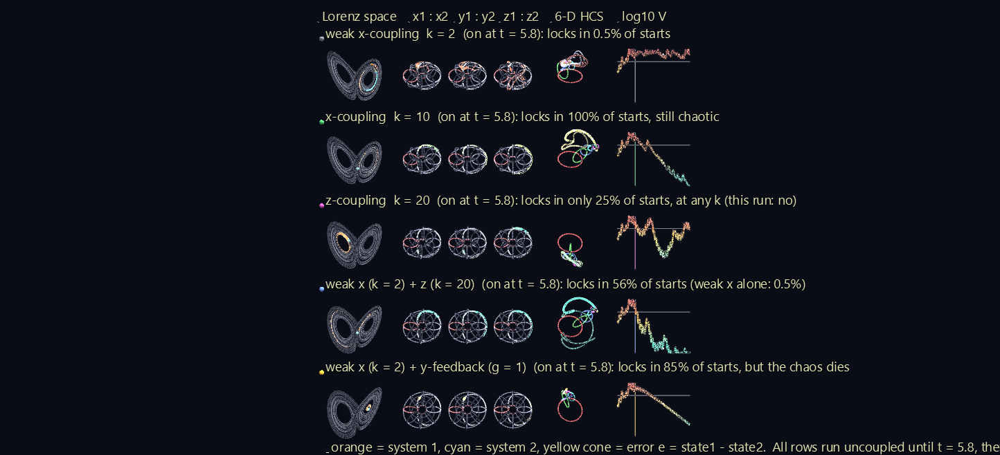
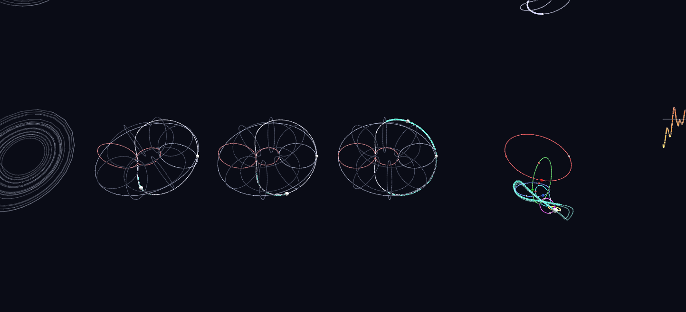
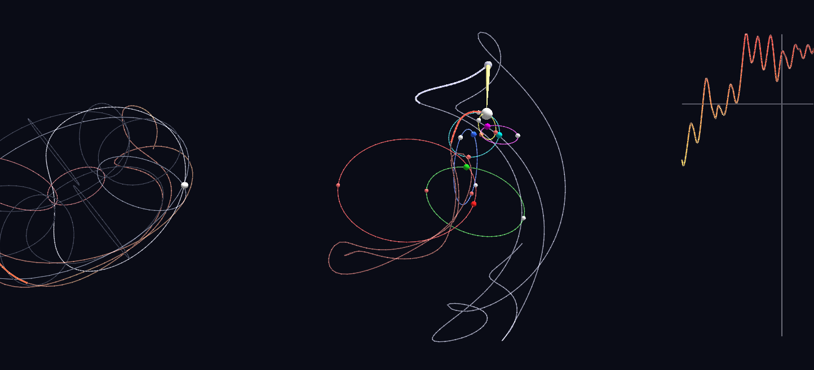

# Two Lorenz Systems Falling into Sync: the HCS in Six Dimensions

Two copies of the Lorenz system, the classic butterfly of chaos, are started a hair apart and left alone. They fly apart, as chaos says they must. Then a controller couples them, and in some cases they lock into identical motion while both stay chaotic. Together the two systems are one point moving in a **six-dimensional** space (x1, y1, z1, x2, y2, z2). Synchronization means that point falls onto a three-dimensional slice of it: x1 = x2, y1 = y2, z1 = z2.

This scene draws that six-dimensional process with the **Hyperdimensional Coordinate System (HCS)**, five times side by side, once for each of five controllers. It's a demonstration of what the HCS is for: showing a space with more dimensions than three, and showing values that run off toward infinity, in one picture you can read.



**Try it:** download this example below (or [the full examples set](../getting-started/installation.md#example-scenes)), then open `Lorenz_Sync_gv_node.csv`. In the full examples set, drag `Lorenz_Synchronization_Example/Lorenz_Sync.zip` onto the GlyphViz window instead; it extracts beside itself and loads. It's a large scene (about 217,000 nodes) and takes a few seconds to load. Press **Space** to play. For the cleanest view, turn off **View > Show Grid**, then zoom in on one row to read its tori.

[:material-download: Download this example (4 MB)](https://iluvdata.org/glyphviz/zips/Lorenz_Synchronization_Example_Lorenz_Sync.zip){ .md-button }

## The Hyperdimensional Coordinate System

The HCS is Jeff Sale's coordinate system for plotting many dimensions at once. It rests on two ideas.

**Every number line becomes a circle.** A value *v* is drawn as an angle:

θ = 180° · (v/s) / (1 + |v/s|)

Zero sits at 0°, the value *s* lands at 90° and −*s* at −90°, and +∞ and −∞ meet at a single point, 180°. Nothing ever runs off the edge of the chart: a value racing toward infinity just climbs toward the far side of its circle. This is Dr. Art Springer's subsegment-ratio construction, "a way to bring infinity into view". The scale *s* is the one free choice; here each variable's typical size lands at 90°.

**Dimensions nest as circles on circles.** The first value picks a point on a circle. The second dimension is a smaller circle centred on that point, standing at right angles to the first, like the cross-section of a doughnut. The third is a circle centred on the second's chosen point, and so on. Two dimensions nested this way trace out a **torus**, and the point on the last circle is the plotted data point, the *leaf*.

## Reading the scene

All five rows start from the **same six-dimensional initial condition**: two systems 0.05 apart. Every row runs **uncoupled until t = 5.8**, so the opening stretch is identical in every row, and shows the two systems drifting apart exactly as chaos predicts. At t = 5.8 each row's controller switches on, and the light beside its title turns from grey to colour.

Each row has six columns.

**Lorenz space.** System 1 is the orange bead, system 2 the cyan halo, each trailing a fading comet over the faint shape of the Lorenz attractor. The yellow cone is the **error**, e = state1 − state2, pointing from system 2 to system 1. When the systems lock, the cone shrinks to nothing and the orange bead sits inside the cyan halo.

**Three HCS tori: x1 : x2, y1 : y2 and z1 : z2.** Each torus is a two-dimensional HCS for one pair of variables: the angle around the ring is system 1's value, and the angle around the tube is system 2's. This turns synchronization into something you can see:

- The **white loop** is where the angle around the ring equals the angle around the tube: v1 = v2. It's the synchronization manifold for that pair, the torus version of the diagonal on an ordinary *x1 vs x2* plot.
- **Unlocked** motion smears across the whole torus. **Locked** motion runs along the white loop.
- The **red loops** are ±∞ on each circle, and the bright circles are 0. Faint circles mark every 45°, with 90° at ±*s*.
- The trail is coloured by how far apart the pair is: **red** far apart, **yellow** closing, **teal** locked.

*z* is shown as *z* − 27, the centre of the attractor, so it uses the whole circle. The raw *z* of the Lorenz system is always positive and would only ever use half of it.

**The 6-D HCS hyperglyph.** The whole coupled state, all six numbers, as one glyph: six nested HCS circles, coloured red, green, blue, cyan, magenta and yellow for x1, x2, y1, y2, z1 and z2. Pairing the dimensions in that order means circles 1 and 2 form the same x torus as the one beside it, circles 3 and 4 the y torus, and circles 5 and 6 the z torus. The white **leaf** on the last circle is the six-dimensional state.

In six dimensions, synchronization isn't a single loop; it's a whole three-dimensional slice. So the hyperglyph also carries a **ghost**: the nearest synchronized state, with both systems set to their average. A yellow cone runs from the ghost to the leaf. That cone is the six-dimensional error, made visible as a distance. Before coupling, the leaf's trail (red) and the ghost's trail (white) wander apart. When the systems lock, the cone disappears and the leaf's trail, now teal, lands exactly on the ghost's.



**log10 V.** The Lyapunov function V = |e|²/2, the "energy" of the error, on a logarithmic scale over the whole run, coloured with the same red-to-teal ramp. A white cursor moves along it with the playback, and the vertical line marks the moment the controller switches on. A row that locks falls straight down the scale; one that doesn't stays high.

**Click a bead or a marker.** Every moving bead says what it is, and the small dots on each 6-D circle say which variable it carries and where its 0 and ±∞ lie.

## The five controllers

Each controller couples the two systems differently. *k* is a coupling strength and *g* a feedback gain.

- **x-coupling** pulls the two x variables together: system 1 gets +k(x2 − x1) on its x equation and system 2 the mirror term, like a spring between them.
- **z-coupling** does the same through z.
- **y-feedback** adds a damping term −g·y to each system's own y equation, using only that system's own state.

How often does each one lock? One run can't say. In a chaotic system, moving the switch-on time by just 0.001 flipped the z-coupled row from "never locks" to "locks". So each row's caption carries a rate from **200 independent starts**, each run for 18 time units, counted as locked when the error stays below 0.1 over the last two. The switch-on time was then chosen so that every row's run shows its controller's *typical* outcome.

| Row | Controller | Locks | Still chaotic once locked? |
|---|---|---|---|
| 1 | weak x-coupling, k = 2 | 0.5% | — |
| 2 | x-coupling, k = 10 | 100% | yes (93%) |
| 3 | z-coupling, k = 20 | 25% | mostly |
| 4 | weak x (k = 2) + z (k = 20) | 56% | mostly |
| 5 | weak x (k = 2) + y-feedback (g = 1) | 85% | **no**: the chaos stops |



## What the simulations suggest

- **Strong x-coupling locked in every one of 200 starts, and the locked motion stays chaotic.** This is the classic result: the two systems still wander the butterfly, but they wander it together.
- **z-coupling alone is a coin flip at every strength.** It locked in 25–44% of starts at *k* = 2, 5, 20 and 50, so pulling harder doesn't help. z-coupling can't guarantee a lock, but it isn't useless. Row 3's V trace shows what that looks like: the error dips toward locking, then bursts back out.
- **z helps once x is there.** Weak x-coupling alone locked 0.5% of the time. Adding z-coupling raised that to 56%.
- **y-feedback, in the form used here, locks by stopping the chaos.** Every locked run in row 5 had stopped switching between the butterfly's two wings. In the row's own run, both systems spiral in together toward the same steady point on one wing, rather than sharing chaotic motion.
- **Near its threshold, x-coupling flickers.** At *k* = 3 the error can fall to 0.03 and then burst back up to 30, a behaviour known as on-off intermittency.

These are numerical observations at one Rayleigh number, not proofs. Proving when coupled chaotic systems *must* synchronize is the job of Lyapunov stability theory, which gives guarantees, and guarantees are usually more conservative than what a simulation shows.

## How it's built

```text
Wall (turned and leaned back to face the opening camera)
└ per row ×5
  ├ Title + switch light           grey until t = 5.8, then the controller's colour
  ├ Lorenz space                   attractor outline (Plot), two beads, error cone (Link), two comets
  ├ HCS torus ×3                   guide circles (Plot), the white sync loop, a moving point, a comet
  ├ 6-D hyperglyph                 per dimension: a circle + a spinner whose rotate_z is that
  │                                dimension's HCS angle; the next circle hangs at the spinner's rim
  │   ├ leaf (the 6-D state)       at the end of the chain
  │   └ ghost + error cone         the nearest synchronized state, and the distance to it
  └ log10 V                        the whole run (Plot), a zero line, the switch-on line, a cursor
Legend
```

The scene has 217,261 nodes and 390 animation tracks over 2,400 frames (24 Lorenz time units, 80 seconds at 30 fps). The systems are integrated with a fourth-order Runge–Kutta method at a step of 0.001, with σ = 10, b = 8/3 and Rayleigh number r = 28.

- **The comets are cheap to animate.** Each trail is cut into short segments, and every segment is a small Plot polyline whose visibility is driven by a channel. A segment is shared across every trail in the scene by its time slot, so 35 comets animate from 240 shared channels.
- **Fast stretches use the true in-between states.** Where the trail moves far between frames, the generator inserts the integrator's own intermediate states rather than a straight chord, which on a torus would cut through the inside and off the loop it's meant to follow.
- **The geometry is checked against the HCS itself.** `verify_lorenz_sync.py` confirms that every torus trail point is exactly where GlyphViz's own Torus topology seats a child at those two angles, and plays the 6-D hyperglyph through GlyphViz's engine to check that its leaf lands where a direct port of the HCS reference code puts it, to within 10⁻¹⁴.

The folder ships the generator, `generate_lorenz_sync.py`, and the scripts behind every number on this page: `ensemble_lorenz_sync.py` (the 200-start lock rates), `pick_switch_time.py` (the switch-on time) and `verify_lorenz_sync.py`.

## Assumptions

- **The coupling forms are standard ones, not taken from a particular paper.** x- and z-coupling are bidirectional and diffusive. The y-feedback form, −g·y on each system's own equation, is one simple choice of decentralized feedback; other forms may behave differently.
- **r = 28**, the textbook chaotic case. Larger Rayleigh numbers need stronger coupling: at r = 60, x-coupling at *k* = 5 no longer locks.
- **The 6-D hyperglyph's circles shrink by 0.7 per level.** A smaller ratio is more compact but leaves the sixth circle too small to read.

## Credits

The Hyperdimensional Coordinate System is Jeff Sale's, built on Dr. Art Springer's subsegment-ratio construction. The subject comes from Yan Wu's talk *Synchronizability between two coupled Lorenz systems* (Georgia Southern University), on the program of a 2026 American Mathematical Society regional meeting. The simulations, controllers and rates on this page are this example's own and aren't drawn from that work.
