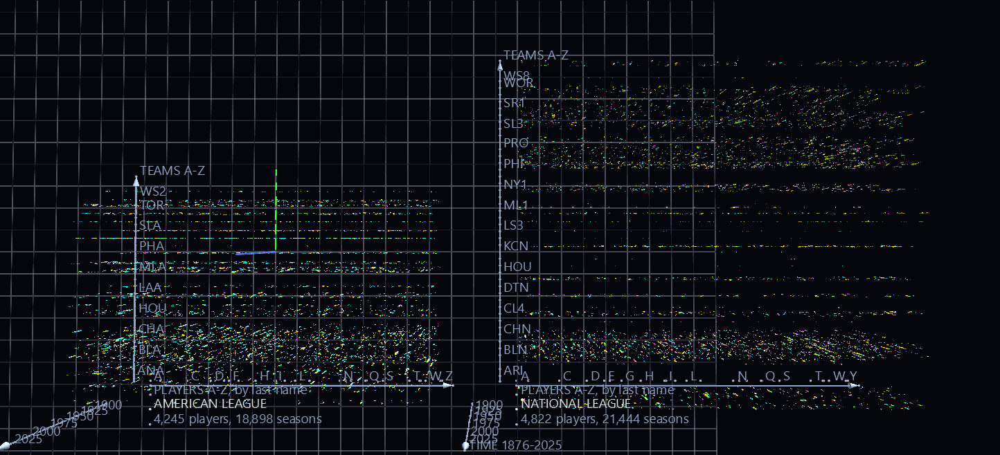
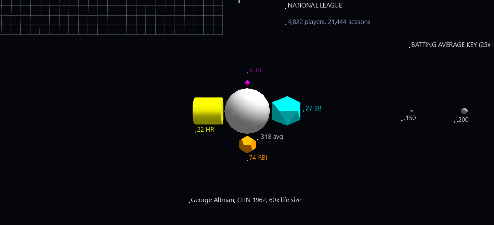
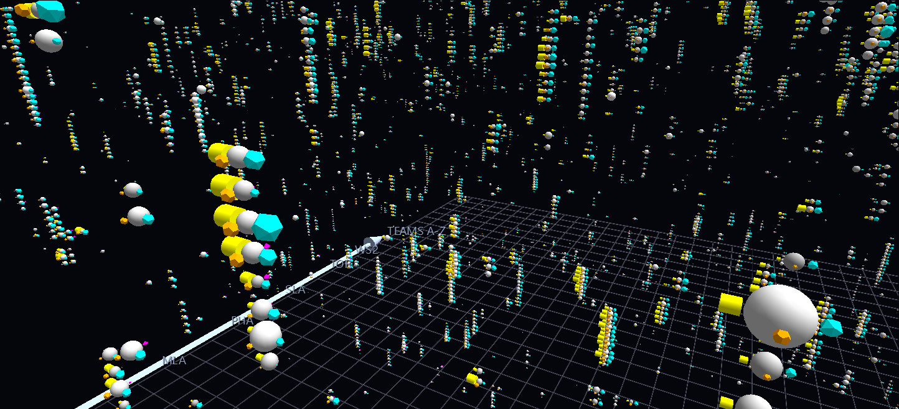

# MLB Batting History, 1876–2025

Every American League and National League player-season since 1876, one glyph each: 40,342 of them, 187,530 nodes in all. It is a large scene on purpose. It shows what GlyphViz does with a dataset people already have opinions about, and it opens in a few seconds.



**Try it:** download this example below (or [the full examples set](../getting-started/installation.md#example-scenes)), then open `MLB_Batting_History_Example/MLB_Batting_History_gv_node.csv`, or drag its folder onto the window.

[:material-download: Download this example (4.4 MB)](https://iluvdata.org/glyphviz/zips/MLB_Batting_History_Example.zip){ .md-button }

It recreates one of the best-loved visualizations made with ANTz, GlyphViz's ancestor, and updates it to the 2025 season from the SABR Lahman Baseball Database. The zip also holds the two scripts that built it, so you can rebuild it, change it, or point it at a different slice of baseball history.

## Reading a glyph



Each glyph is one player in one season, and it is a hyperglyph: a sphere with four shapes around it.

| Part | Shows |
|---|---|
| **Sphere** | Batting average. Its **size** and its **gray** both follow the average, so a good hitter is a big pale sphere and a poor one a small dark one. |
| **Cyan icosahedron** | Doubles |
| **Magenta octahedron** | Triples |
| **Yellow cylinder** | Home runs |
| **Orange dodecahedron** | RBI |

- **A shape's size is its count, and nothing else.** A 22-home-run cylinder is the same size on a .200 hitter and on a .400 hitter. A season with none of a stat has no shape for it, so the shapes present are themselves information.
- **Every stat has its own colour *and* its own shape.** The colours read at a distance; the shapes tell them apart up close, and they make each stat selectable on its own (see [below](#pull-out-one-stat)).
- **Click anything to read it.** Every part is labelled in the form *Hank Aaron ML1 1957 2B: 27*. Rubber-band a group to read them all, or press **T** to toggle labels.
- **The example glyph** in front of the data is George Altman's 1962 season with the Cubs (.318, 27 doubles, 5 triples, 22 home runs, 74 RBI), drawn 60 times life size and labelled part by part. Beside it, the **batting-average key** shows the same sphere at six averages from .150 to .400, so the size and gray ramps can be read straight off.

## Reading the space

Each glyph sits where its player, team and year say it does. All three axes are labelled in the scene.

- **x: the player**, alphabetical by last name, 0.1 units apart. Letter ticks mark where each initial begins.
- **y: the team**, alphabetical by team code, 10 units apart. Every third team is named, and every team has a tick; zoom in and the names between them are in the labels of the glyphs themselves.
- **z: the year**, one unit per year, with 1876 at the bottom and 2025 at the top. Time is vertical, so a player's career is a column and a team's history is a slab.
- **The two leagues sit side by side**, the American League on the left and the National League on the right, each ranked on its own. A player who played in both leagues has a place in each.



A player who keeps playing for the same team stands up as a column, one glyph per year, which is why the scene looks like a city. Because players are in alphabetical order, neighbours in the scene share nothing but the first letters of their surnames; the structure you see comes from teams and years.

## What the history shows

- **Home runs rise, triples fade.** Per 600 at-bats, hitters hit 2.6 home runs in the 1900s and 21.5 in the 2020s so far, while triples fell from 10.6 in the 1890s to 2.5. Scroll up the time axis and the yellow cylinders swell as the magenta octahedrons all but vanish. The data shows the change, not why it happened.
- **The records are all in there.** Barry Bonds' 73 home runs (2001), Hack Wilson's 191 RBI (1930), Earl Webb's 67 doubles (1931) and Owen Wilson's 36 triples (1912) are the biggest cylinder, dodecahedron, icosahedron and octahedron in the scene.
- **The biggest sphere is Hugh Duffy's** .440 for Boston in 1894. Ted Williams' .406 in 1941 is the last .400 season over a full year.
- **The 1870s are thin and the 1990s are crowded.** There are 79 qualifying seasons in 1876 and 446 in 2025, which is why the lower part of the volume is sparse and the upper part is dense.

## Pull out one stat

Because each stat has a geometry no other node uses, you can single one out in two clicks, and then change it while you look at the whole scene.

1. In the Properties panel, open **Select By**, choose **Geometry**, pick **11: Octahedron** and press **Select All Matching**. Every triples shape, and nothing else, is now selected.
2. Arm **Size** and tick **Lock X/Y/Z together**, then drag a handle. Size multiplies every selected shape by the same factor, so the counts stay proportional while the whole stat grows or shrinks.

That makes it easy to try the comparison the other way round: shrink the home runs, or make the triples loud enough to see from across the scene. The same works for 19 Cylinder (home runs), 15 Icosahedron (doubles) and 9 Dodecahedron (RBI). Don't type a number into the scale boxes for this. They write one value to every selected node, which would flatten the counts to a single size.

## Make your own

The scene is built from a MySQL copy of the database by two scripts that ship in the folder:

1. **`lahman_to_mysql.py`** loads every Lahman CSV into MySQL, one table per file, named like the file in lower case (`Batting.csv` becomes `batting`). Column types are inferred, blanks become NULL, and the key columns are indexed.
2. **`lahman_batting_to_glyphviz.py`** reads the `batting` and `people` tables and writes the scene.

```text
pip install pymysql
python lahman_to_mysql.py --csv-dir lahman_1871-2025_csv --user root
python lahman_batting_to_glyphviz.py --user root
```

The second script's options change the picture:

| Option | Does |
|---|---|
| `--min-ab N` | Keep seasons with more than N at-bats (default 100) |
| `--first-year`, `--last-year` | Keep a slice of history |
| `--child-scale K` | Scale all four shapes up or down together (default 0.25) |
| `--triples-gain G` | Multiply the triples shape by G, to make the rarest hit visible from afar |
| `--avg-range LO HI` | Pin the batting averages that map to the smallest and largest sphere |
| `--team-labels-every N` | Name every Nth team on the team axis (1 names all) |

The cutoff of 100 at-bats is not the 150 that the original title card quoted. The 34,681 seasons in the original scene are exactly the AL and NL seasons from 1876 to 2012 with more than 100 at-bats, so that is what this scene reproduces. Pass `--min-ab 150` for the stricter rule.

## Where the data comes from

The scene is built from the [SABR Lahman Baseball Database](https://sabr.org/lahman-database/), 1871–2025 release, which is not in the download; fetch the comma-delimited version and unzip it beside the scripts. It is copyright SABR, donated by Sean Lahman, and licensed under [Creative Commons Attribution-ShareAlike 3.0](http://creativecommons.org/licenses/by-sa/3.0/). The scene file is derived from it and carries the same licence.

Only the American and National Leagues are drawn, from 1876 on. The earlier National Association, the American Association, the Union Association, the Players' League, the Federal League and the Negro Leagues, all of which are in the database, are left out, as they were in the original.

## Structure

```text
Sphere glyph ×40,342     batting average: size and gray; Point topology
├─ icosahedron           doubles, cyan, at longitude 0
├─ octahedron            triples, magenta, at longitude 90
├─ cylinder              home runs, yellow, at longitude 180
└─ dodecahedron          RBI, orange, at longitude 270

Each shape's scale is its world size divided by the sphere's, so it depends
only on the count; its distance is set in world units, just clear of the sphere.
Axes, league titles, the legend, the example glyph and the key are Point glyphs
carrying pinned labels, joined by Link nodes drawn as prisms and cones.
```
