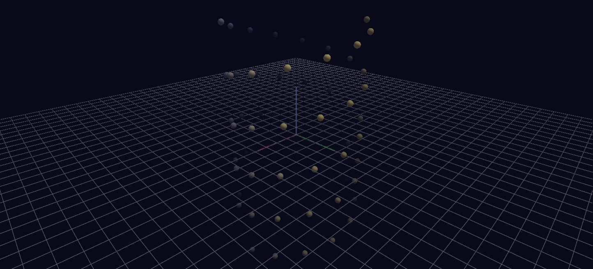

# Mood Background

The background is the animated element: a static double helix of spheres hangs in space while a single channel drives the World row's background color through a 16-second mood loop — Channels animating the scene settings themselves.

**Try it:** download this example below (or [the full examples set](../getting-started/installation.md#example-scenes)), then open `Mood_Background_Example/mood_background_gv_node.csv` — or just drag its folder onto the GlyphViz window. Press **Space** to start the animation.

[:material-download: Download this example (16 KB)](https://iluvdata.org/glyphviz/zips/Mood_Background_Example.zip){ .md-button }

## What it is

Most Channels examples animate glyphs. This one animates the **world they sit in**. A double helix of 68 spheres hangs in space and never moves, and everything you see change over the 16-second loop (480 frames) is the scene's background, its fog and its blend mode, all driven by a single channel on the World row.

Press **Space** and the sky goes through a day: a deep indigo night, a violet pre-dawn, a warm rose-amber dawn, a pale sand-coloured day, a magenta dusk, night again, and finally a glowing ember where the helix burns bright against black.

## The mood arc

| Phase | Background | Fog | Blend |
|---|---|---|---|
| deep night | near-black indigo | on, mid | Normal |
| pre-dawn | violet-grey | on, close | Normal |
| dawn | warm rose-amber | on, wide | Normal |
| clear day | pale sand | **off** | Normal |
| dusk | deep magenta | on, mid | Normal |
| night falls | indigo | on, close | Normal |
| ember glow | near-black | **off** | **Additive** |

Fog fades distant glyphs toward the background colour, so when the sky changes the fog changes with it. With fog on, the far end of the helix melts into the sky colour; with fog off, as at midday, every sphere stands sharp. None of it needs any per-glyph animation.

## What it teaches

The World row holds GlyphViz's scene-wide settings, and Channels can drive all of them. Give that row a Channel In like any other node and bind:

- `color_r`, `color_g`, `color_b`: the **background colour**
- `fog_enabled`, `fog_start`, `fog_end`: atmospheric depth
- `render_mode`: the scene-wide blend mode (0 Normal, 1 Additive, 2 Subtractive, 3 Dark/Multiply, 4 Off, 5 Screen, 6 Premultiplied)

That is one channel and seven tracks, and every glyph in the scene is affected at once.

## Two things worth knowing

**Fog cancels Additive blending.** Fog fades geometry toward the background colour, so thick fog over a near-black sky subtracts exactly what Additive blending is adding, and the glyphs vanish. The ember phase turns fog off for that reason. It is the easiest way to get a "nothing is rendering" result from a scene that is working perfectly, so if an Additive scene goes blank, check the fog first.

**Integer fields are step functions, not ramps.** `fog_enabled` and `render_mode` are rounded and clamped on the way in, so interpolating them between keyframes only produces meaningless in-between modes. The generator holds each at its keyframe value until the next key; only the colours and the two fog distances are interpolated. The engine does no interpolation of its own, so every smooth fade you see was precomputed per frame.

## Making it your own

The whole design is the `MOODS` list at the top of `generate_mood_background.py`: keyframes of `(t, name, rgb, fog_enabled, fog_start, fog_end, render_mode)` on a 0 to 1 timeline. Edit it, rerun the generator, and reload. The last keyframe repeats the first (`t = 1.0` equals `t = 0.0`) so the loop closes without a jump.

Fog distances are in world units of eye-space depth, so they depend on how far your camera sits from the scene. Expect to retune them if you swap the helix for your own geometry.

To drive the sky from music instead of a fixed arc, put a `*_gv_audio.txt` manifest in the folder pointing at a WAV. Frame advance then follows the audio's real playback position instead of the frame-rate timer. The [Warm Winter](audio-warm-winter.md) example does exactly this to warm its sky as the piece builds.
