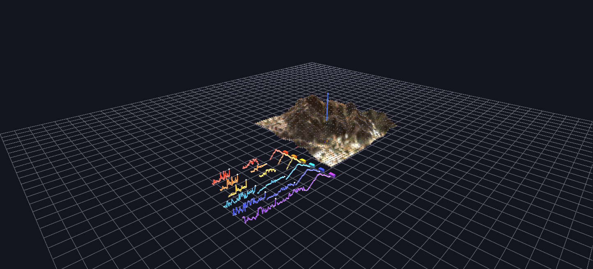

# Multi-Hike Ghost Race

A ghost race: six real GPS hike recordings — the three fastest and three slowest ascents of Cowles Mountain — replayed simultaneously on the real terrain, each climber a GPS-driven pin with its own stats dashboard.

**Try it:** download this example below (or [the full examples set](../getting-started/installation.md#example-scenes)), then open `Multi_Hike_Race_Example/Multi_Hike_Race_Example_gv_node.csv` — or just drag its folder onto the GlyphViz window. Press **Space** to start the animation.

[:material-download: Download this example (267 KB)](https://iluvdata.org/glyphviz/zips/Multi_Hike_Race_Example.zip){ .md-button }

## What it is

Six real hikes up the same mountain, run as one race. Cowles Mountain in San Diego is a popular climb, and the scene's author recorded the trip on GPS many times. This scene takes the **three fastest and the three slowest** of those ascents and starts them all at the same instant, so the differences between a fast day and a slow one play out side by side on the real terrain.

Each climber is a pin that follows its recorded GPS track up the mountain. The fast hikes (warm colours) reach the summit and stop; the slow ones (cool colours) are still climbing for another hour. The race is real: the fastest climber is at the top after about 79 minutes, while the slow hikes need another hour.

## How to read it

| Hike | Date | Time | Average heart rate | Peak |
|---|---|---|---|---|
| Fast 1 | 7 Oct 2020 | 79 min | 124 | 152 |
| Fast 2 | 2 Oct 2023 | 80 min | 130 | 152 |
| Fast 3 | 7 Oct 2023 | 81 min | 136 | 159 |
| Slow 4 | 4 Mar 2020 | 137 min | 109 | 132 |
| Slow 5 | 24 Sep 2023 | 138 min | 99 | 124 |
| Slow 6 | 2 Sep 2019 | 138 min | 115 | 150 |

- **The mountain** is a real elevation model of Cowles Mountain with an aerial photograph draped over it, drawn at ten times the size of the Surface Topology example so that it matches the dashboards.
- **The climbers** are pins on the terrain surface, one per hike. Each carries a label with its date, duration and heart-rate figures. Their height is taken from the terrain, not the noisy GPS altitude, so they stay glued to the slope.
- **The dashboards** stand in a row to the side of the mountain, one per hike, fastest nearest. Each holds three stat markers (total time, maximum heart rate, average heart rate) and three large plots: **elevation, heart rate and pace**, each with a **needle** that travels along it in step with its climber.
- **The needles are the link** between "where is this climber on the mountain" and "what is their body doing right now." Pause mid-race and you can read a climber's heart rate, pace and elevation at the exact spot where its pin stands.
- **The plots line up.** Every dashboard uses the same layout, so the same metric occupies the same band in every dashboard, and you can scan across the six to compare. The plots are drawn to a common scale, so a slow hike's curve is longer, not squeezed into the same width.

## What to look for

The race framing is the finding. All six climbers share a clock of real elapsed minutes, so position on the mountain at any moment reflects each hike's actual pace, not a percentage of its own route. A hike that finishes early *freezes* at the summit instead of vanishing, so you can see who is waiting for whom.

Compare the heart-rate dashboards of the fast and slow groups. The fast climbers worked harder for less time; the slow ones held a lower, steadier effort for a long climb.

## Things to try

- **Watch from the summit.** Select the top of the mountain and orbit while the race plays, so you see the climbers arrive one by one.
- **Follow one pin.** Select a climber and use Follow Selected to ride the route.
- **Read a dashboard against its climber.** Pause mid-race, find a hike's needle, and check where its pin is.

## How it is built

The scene is **2,410 nodes**: the terrain surface and its vertices, the six climbers, and the six dashboards with their stat markers, plots and needles. The Channels file drives the climbers' positions and the needles' positions with **54 tracks over 1,800 frames**, which is 60 seconds at the default speed.

The GPS recordings come from a personal Strava export, which is not included; only the derived positions and values are. The tracks were registered onto the terrain with a two-point transform, using the trailhead and the summit (recorded at 480 metres, which matches the mountain's known height of about 485). The generator is `generate_multi_hike_race.py`, and the terrain is the one from [Cowles Mountain Terrain](surface-cowles.md). To replay a recorded track of your own, bake the positions into Channels tracks the same way.

## Watch it explained

A narrated tour of the race, about a minute and a half, rendered from GlyphViz itself: GPS tracks driving each pin over the real terrain, the fast hikes turning at the summit while the slow ones are still climbing, the dashboards whose needles run on the same clock as their climbers, and how to replay a recorded track of your own.

<video controls preload="metadata" width="100%" src="https://iluvdata.org/glyphviz/videos/channels_hike_race.mp4"></video>
